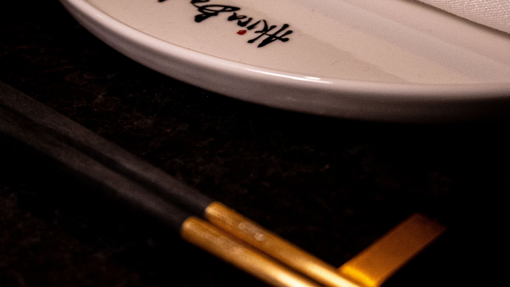
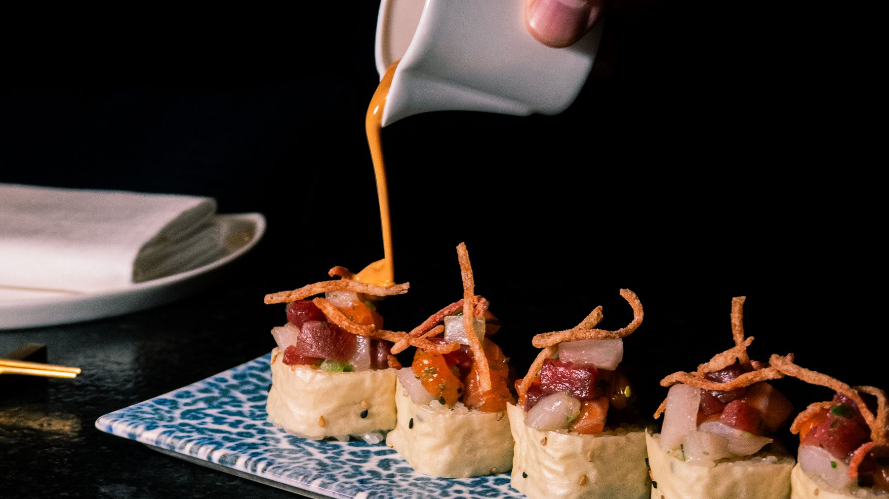
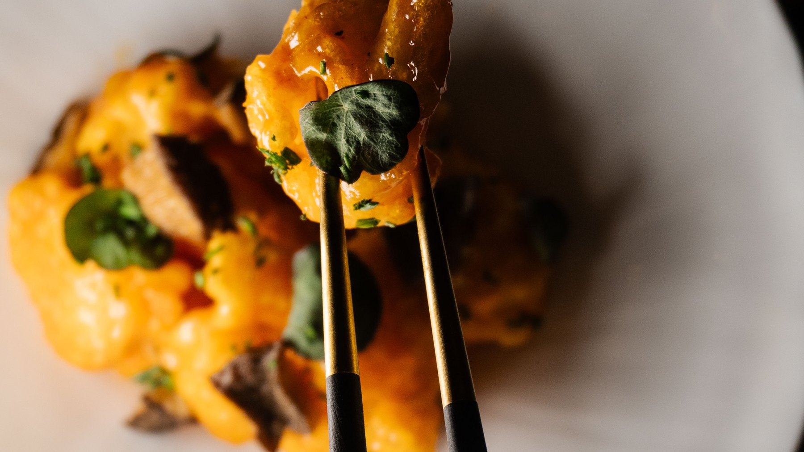
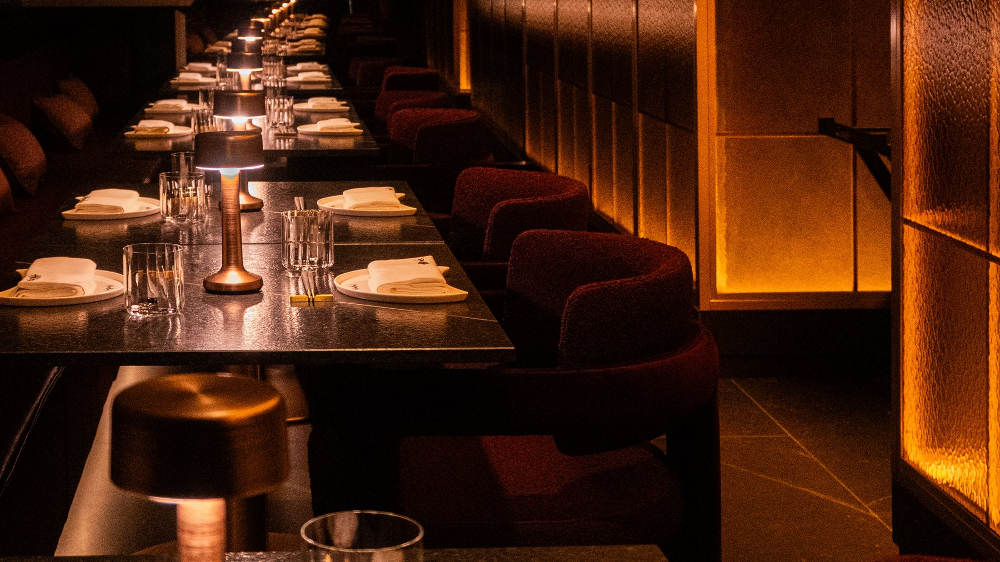
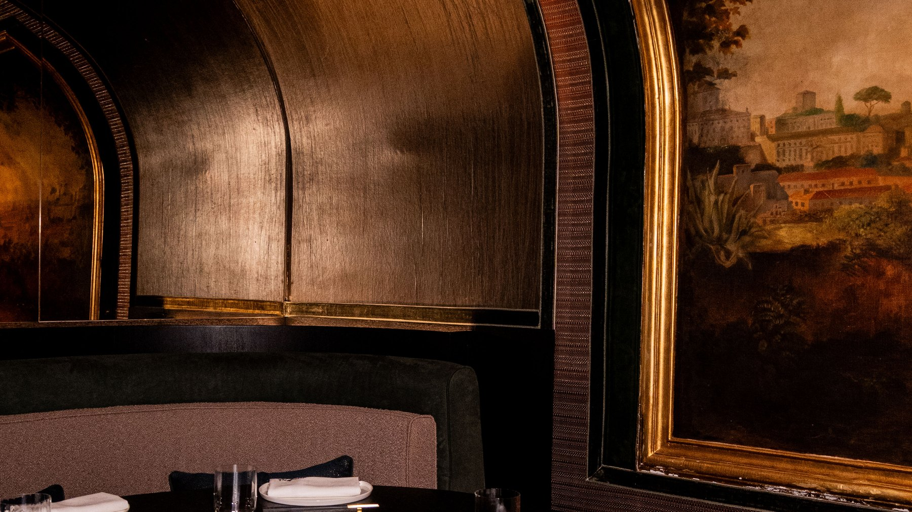
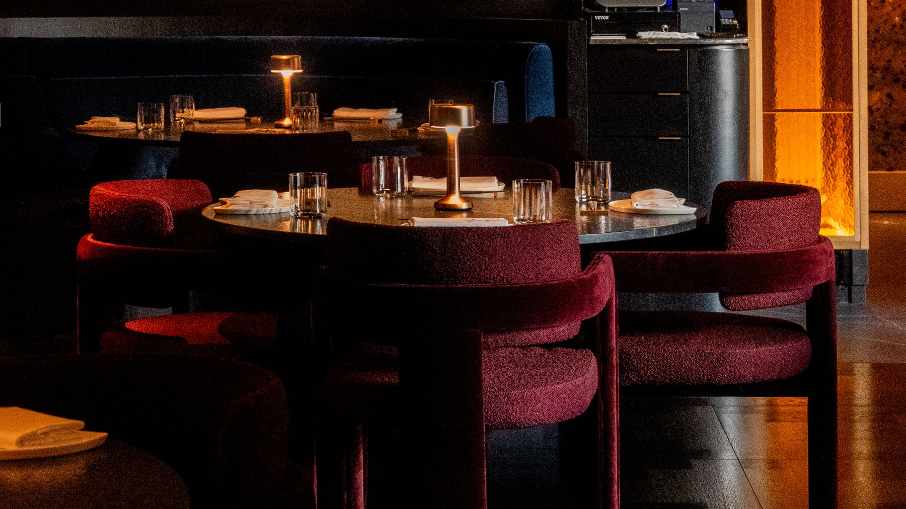
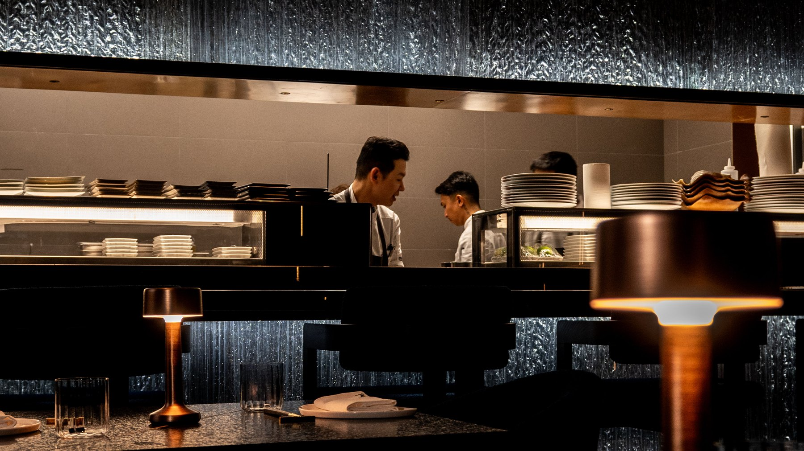

Akira Back is one of the best-known names in international dining: 29 restaurants around the world, with ten more on the way. His newest one is in Rome, inside the St. Regis, and it is the first time his cooking has come to the city.

We went to see it before the doors opened. The room is dark, warm and quiet, the kind of place that works as well for a date as for a long dinner with friends.

## From the snowboard to the sushi counter

*Photo: [somuchmedia](https://somuchmedia.it)*

Akira Back was born in Seoul in 1974 and moved with his family to Aspen, Colorado, at fifteen. Before he cooked, he snowboarded: seven years on the professional circuit, with parts in extreme sports films.

To make ends meet he took a job in a Japanese restaurant, and in 1993 he started as a sushi prep cook at Kenichi in Aspen. He trained at the International Culinary School at The Art Institute of Colorado, worked his way up through the Kenichi kitchens, and in 2008 opened his first restaurant of his own, Yellowtail, at the Bellagio in Las Vegas.

From there the list grew city by city, from London and Paris to Dubai, Singapore, Seoul and Toronto. Dosa, his modern Korean restaurant, has held a Michelin star in Seoul and in London. Italy came late: Florence first, at the W hotel in December 2025, and now Rome.

## The cooking

*Photo: [somuchmedia](https://somuchmedia.it)*

The kitchen is Japanese in its technique, with Korean flavours worked in: gochujang, marinades, the seasonings Back grew up with. The dishes are built to be bold rather than minimal, with umami, sweetness, acidity and heat on the same plate.

The best-known dish of the brand is the AB Tuna Pizza: a crisp, thin base topped with raw tuna, umami aioli and white truffle. Around it sit raw fish, signature rolls and grilled meat.

*Photo: [somuchmedia](https://somuchmedia.it)*

## The room

The restaurant is dark on purpose. The walls are lined in copper, the tables are black stone with thin brass inlays, and each one has its own small bronze lamp. Light comes mostly from panels of textured amber glass, and behind one of them you can make out the capital of a classical column, a reminder of which city you are in.

*Photo: [somuchmedia](https://somuchmedia.it)*

The chairs are deep red bouclé, the banquettes dark velvet. In a quieter corner, a round table sits under a curved gold ceiling, next to an old oil painting of a hilltown in a gilded frame.

*Photo: [somuchmedia](https://somuchmedia.it)*

*Photo: [somuchmedia](https://somuchmedia.it)*

The kitchen is open to the room, framed behind a wall of rippled glass lit from above, so from most tables you can watch the cooks at work.

*Photo: [somuchmedia](https://somuchmedia.it)*

## Inside the St. Regis

The address is part of the story. The St. Regis Rome opened in 1894 as the Grand Hotel, the project of César Ritz, with Auguste Escoffier cooking the opening dinner. It stands a few steps from Piazza della Repubblica and the Baths of Diocletian, and a short walk from Termini.

## Debut week

From 13 to 17 October, Akira Back is in Rome and in the kitchen himself, the best time to try it if you can get a table.

**The St. Regis Rome, Via Vittorio Emanuele Orlando 3, 00185 Rome** · [Website](https://www.akiraback.com/)
