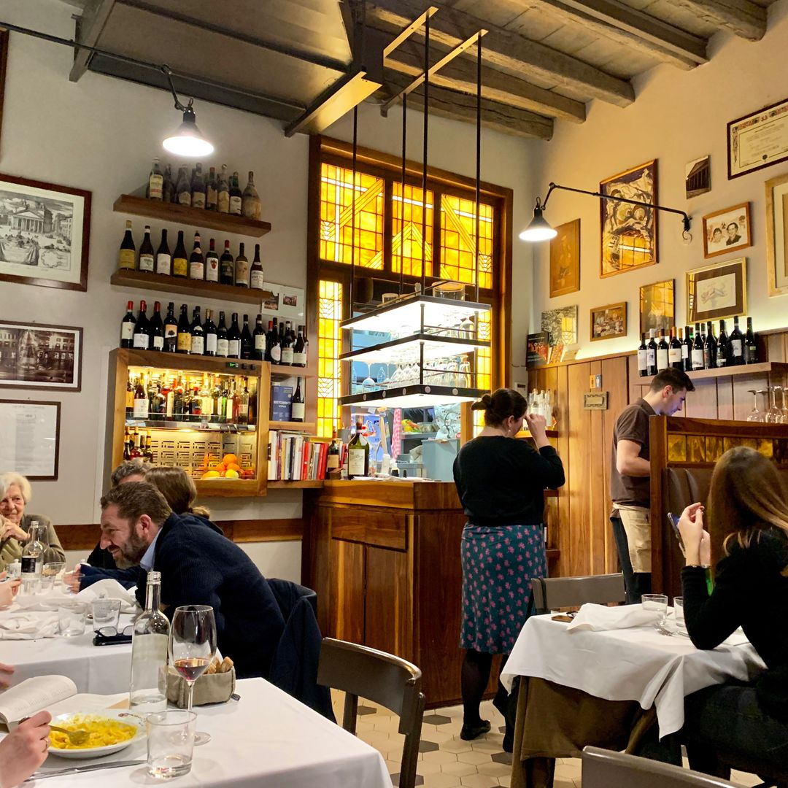
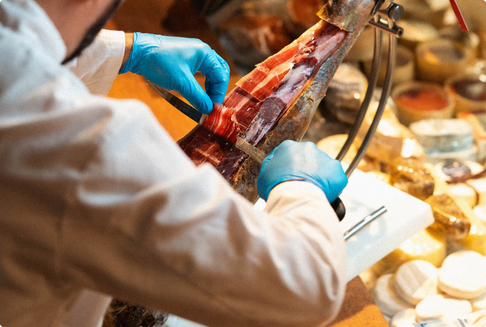
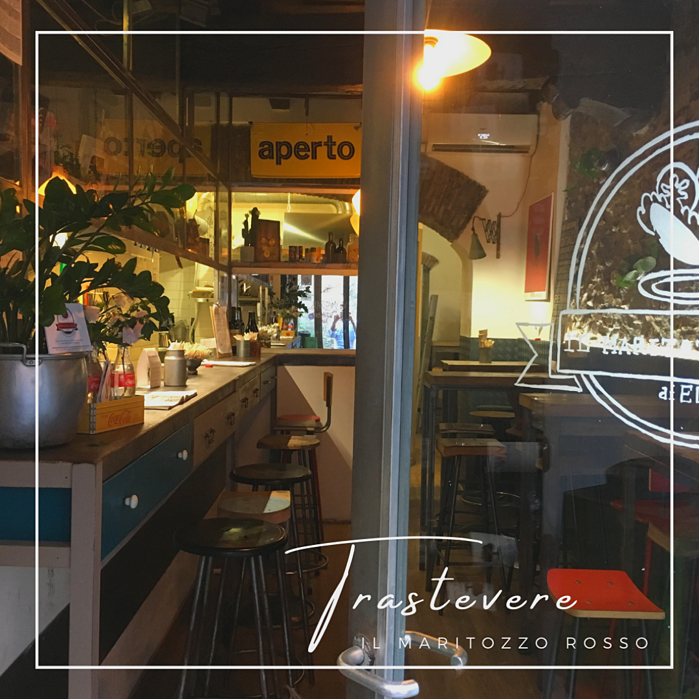
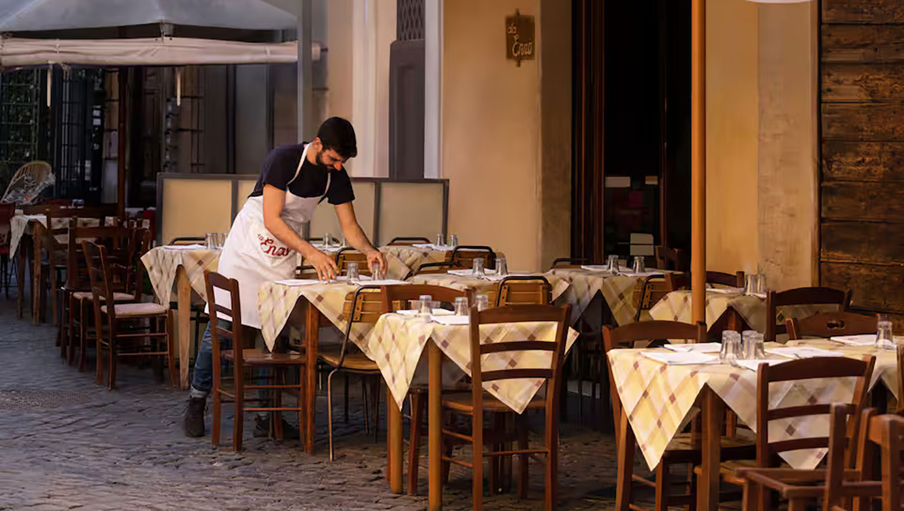
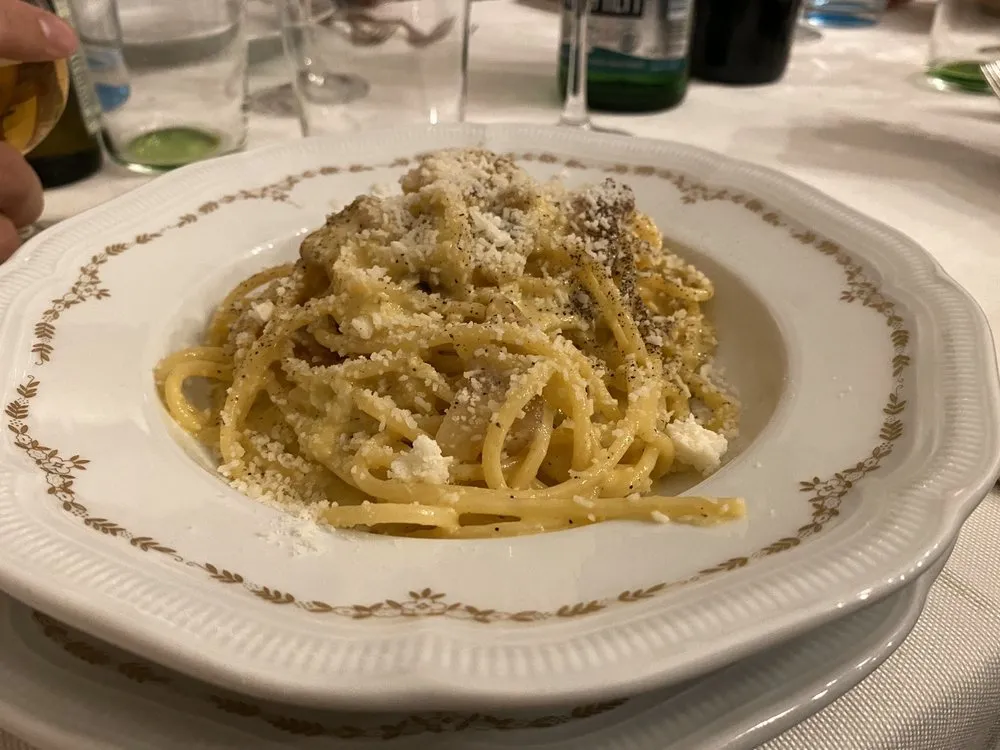
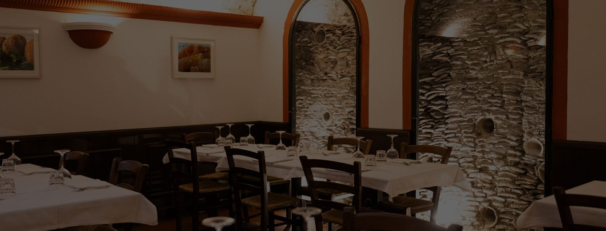
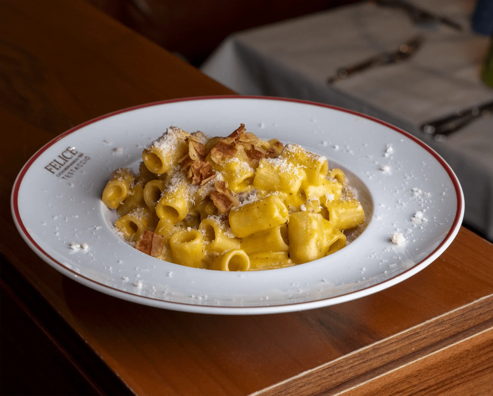

The best carbonara in Rome is the plain Roman one: pasta tossed with guanciale (cured pork cheek), egg, Pecorino Romano and black pepper, and no cream. Seven places that put it on their own menus are Armando al Pantheon, Salumeria Roscioli, Il Maritozzo Rosso, Da Enzo al 29, Checchino dal 1887, Flavio al Velavevodetto and Felice a Testaccio.

Carbonara is one of the four classic Roman pastas, with gricia, amatriciana and cacio e pepe. The sauce is only egg and cheese, loosened with a little of the pasta water and stirred off the heat. Too much heat turns it into scrambled egg, and too little water leaves it dry and sticky.

We read every menu below on the restaurant's own website this week and describe each carbonara the way the kitchen does. Where a menu leaves something out, we say so.

## Armando al Pantheon

A small trattoria on Salita de' Crescenzi, a few steps from the Pantheon. Armando Gargioli took it over in 1961 and his family still runs it. The spaghetti alla carbonara is on both the lunch and the dinner menu, made with egg, pecorino, guanciale and black pepper. The menu warns that pasta takes 25 to 30 minutes.

Lunch is from half past twelve to three, Monday to Saturday; dinner from six to eleven, Monday to Friday. Closed on Saturday evening and on Sunday, and from 24 December to 4 January. Bookings are taken online only.

**Salita de' Crescenzi 31, 00186 Rome** · [Website](https://www.armandoalpantheon.it/)

## Salumeria Roscioli

*Photo: [Salumeria Roscioli](https://www.salumeriaroscioli.com/)*

A delicatessen with a restaurant inside, on Via dei Giubbonari near Campo de' Fiori. The October menu calls the dish simply "La carbonara": mezze maniche (short, wide tubes of pasta) with guanciale, a blend of three peppers chosen by the house, eggs from Paolo Parisi and Pecorino Romano DOP aged 30 months. Pasta comes al dente; the menu asks you to say so when you order if you want it cooked longer.

The restaurant is open every day, from half past twelve to half past three and from seven to half past eleven.

**Via dei Giubbonari 21, 00186 Rome** · [Website](https://www.salumeriaroscioli.com/)

## Il Maritozzo Rosso

*Photo: [Il Maritozzo Rosso](https://www.ilmaritozzorosso.com/prenota/)*

Since 2016 Il Maritozzo Rosso has filled the maritozzo bun with savoury Roman dishes, and it cooks the classic pastas too. The Trastevere menu lists "La nostra carbonara n°1": tonnarelli with eggs from the Peppovo farm, Pecorino Romano DOP, crisp guanciale and pepper. It is sold by weight, and you choose 80, 120 or 160 grams of pasta.

This first branch is small, with a counter facing the kitchen and high tables; evenings run in two sittings, at 8 and half past 9. Open Tuesday to Thursday from half past ten to three and from half past six to eleven, and Friday to Sunday from half past ten to eleven. Its website gives two answers for Monday, so ring first.

**Vicolo del Cedro 26, 00153 Rome** · [Website](https://www.ilmaritozzorosso.com/)

## Da Enzo al 29

*Photo: [Da Enzo al 29](https://www.daenzoal29.com/)*

A neighbourhood trattoria with few tables in the quieter part of Trastevere. Much of what it cooks comes from the family farm, Le Terre di Enzo, including the flour for its pasta. The carbonara is rigatoni with guanciale from Amatrice (IGP), pecorino DOP from the Agro Romano, eggs and Sarawak black pepper ground to order.

It takes no bookings and seats people in the order they arrive. Open Monday to Saturday, from noon to three and from half past six to half past ten.

**Via dei Vascellari 29, 00153 Rome** · [Website](https://www.daenzoal29.com/)

## Checchino dal 1887

*Photo: [Checchino dal 1887](https://checchinodal1887.com/)*

On Via di Monte Testaccio, Checchino has been run by the same family for six generations, and much of its menu is quinto quarto (offal). The spaghetti alla carbonara sits among the house classics: spaghetti, guanciale, egg, black pepper and pecorino.

Open Wednesday to Sunday, for lunch from half past twelve to three and for dinner from half past seven to eleven. Closed on Monday and Tuesday.

**Via di Monte Testaccio 30, 00153 Rome** · [Website](https://checchinodal1887.com/)

## Flavio al Velavevodetto

*Photo: [Flavio al Velavevodetto](https://www.ristorantevelavevodetto.it/ristoranti/roma-testaccio/)*

A large osteria a little further along the same street, built under the Monte dei Cocci, the hill of broken Roman amphorae that gives Testaccio its name. The menu on its website, which it says follows the seasons, lists rigatoni alla carbonara among the Roman pastas; it does not give the ingredients.

Open every day, for lunch from half past twelve to three and for dinner from half past seven to eleven.

**Via di Monte Testaccio 97, 00153 Rome** · [Website](https://www.ristorantevelavevodetto.it/ristoranti/roma-testaccio/)

## Felice a Testaccio

Felice has been cooking Roman food in Testaccio since 1936. Its Rome menu lists rigatoni alla carbonara among the dishes made every day, next to the tonnarelli cacio e pepe, and describes it as rigatoni with guanciale, egg yolk and black pepper; the menu does not name the cheese.

Open every day, for lunch from half past twelve to half past three and for dinner from seven to half past eleven.

**Via Mastro Giorgio 29, 00153 Rome** · [Website](https://www.feliceatestaccio.com/)

## How to spot a bad carbonara

A carbonara that is white and runny and pools on the plate has been made with cream. Smoked bacon in place of guanciale gives it a smoky taste the Roman dish does not have. Small yellow curds of egg mean the pan was too hot when the egg went in.

If you would like to make fresh pasta yourself, a local chef shows you how in our two-hour [pasta cooking class](/experience/pasta-cooking-class) in the centre of Rome, and you eat what you made at the end. For more tables across the city, see our [best restaurants in Rome](/journal/best-restaurants-rome).

## Good to know

### Does real carbonara have cream in it?

No. The Roman recipe uses egg, cheese and the fat from the guanciale, and none of the seven menus above lists cream.

### Is carbonara made with pecorino or Parmigiano?

The Roman recipe uses Pecorino Romano, and every menu on this list that names the cheese names pecorino.

### Where can I eat carbonara on a Sunday or a Monday?

Salumeria Roscioli, Flavio al Velavevodetto and Felice a Testaccio are open every day. Checchino dal 1887 and Il Maritozzo Rosso open on Sunday; Checchino closes on Monday and Tuesday, and for Il Maritozzo Rosso ring first on a Monday. Armando al Pantheon and Da Enzo al 29 open on Monday and close on Sunday.

### Do I need to book?

Da Enzo al 29 takes no bookings, so arrive early. Armando al Pantheon takes bookings online only, Il Maritozzo Rosso by phone or online, and the other four have booking links on their own websites.

*Cover photo: [Luca Nebuloni](https://commons.wikimedia.org/wiki/File:Spaghetti_alla_carbonara_%2832998643591%29.jpg), CC BY 2.0, via Wikimedia Commons*
