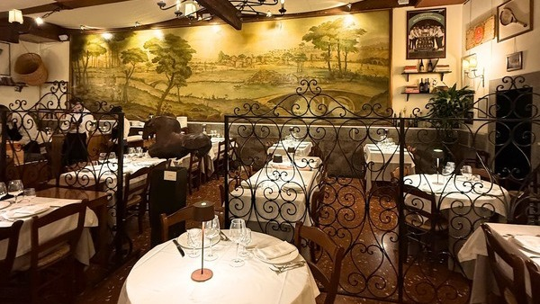
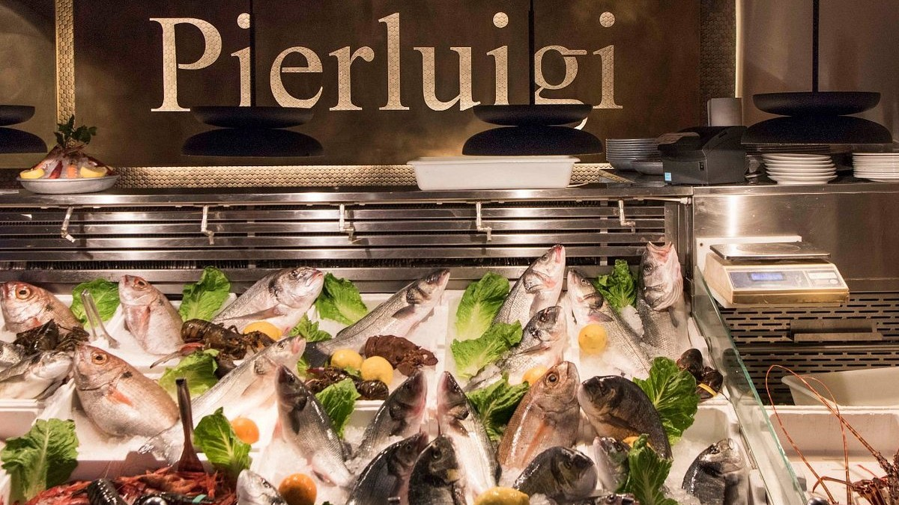
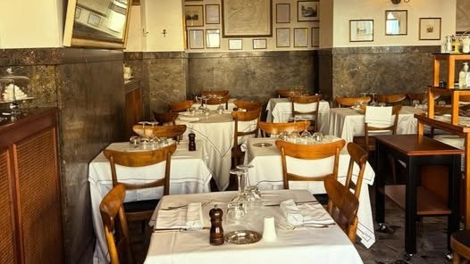
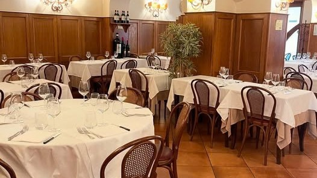
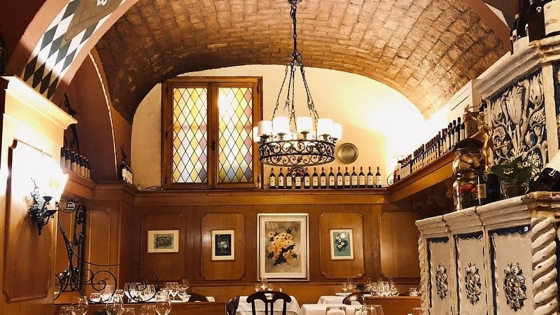

Rome has more restaurants than anyone could get through in a lifetime, and a good share of them, especially near the monuments, exist mainly to feed people who will never come back. The menu is in six languages, the carbonara has cream in it, and nobody minds because nobody local is there to notice.

The places below are the other kind. Most have been run by the same families for generations, a few are more polished, all of them cook food that is recognisably Italian and recognisably good. We chose them for the room as much as the plate: somewhere worth the walk on its own.

The guide is split by category, because the right restaurant depends on the night you want to have. The first category is our selection: the places we go back to ourselves and would send a friend to without a second thought. After that come local favourites, tables with a view, date nights, rustic trattorias, Michelin stars, Roman pizza, and a few international kitchens for the evening you need a break from pasta.

These are the first five from our selection.

## Taverna Trilussa

A family-run trattoria in Trastevere that has been cooking Roman food for nearly a century, named after Trilussa, the poet who wrote in Roman dialect. The rooms are full of old tennis rackets and memorabilia, and the mood sits somewhere between smart and homely: dressed up enough for a birthday, still unmistakably a trattoria.

The pasta is the reason to come. The Roman classics are finished in the pan and brought to the table in it. Our favourite is the ravioli mimosa, made to a recipe the house keeps to itself. Book ahead: it is always full.

**Via del Politeama 23, 00153 Rome** · [Website](https://tavernatrilussa.com)

## Pierluigi

*Photo: Pierluigi*

Pierluigi started as a small osteria in 1938, a few streets from Piazza Navona. Today it fills a Renaissance building with elegant rooms and spills out onto Piazza de' Ricci, which is where you want to be on a warm evening.

The kitchen works with the season: fish and seafood above all, plus meat and vegetables, traditional recipes with a lighter modern hand. Order the seafood, which is what Pierluigi does best, and ask for an outdoor table when you book.

**Piazza de' Ricci 144, 00186 Rome** · [Website](https://www.pierluigi.it)

## La Matriciana dal 1870

Round the corner from the Teatro dell'Opera, La Matriciana has been open since 1870 and has fed the city's singers and audiences ever since. The room still has its 1930s fittings, down to an old telephone booth, and it feels lived-in rather than preserved.

The menu is classic Roman with a few seasonal additions and a well-kept cellar. The dish is, inevitably, the bucatini all'amatriciana. Reservations open fifteen days ahead, so book early if you have a particular date in mind.

**Via del Viminale 44, 00184 Rome** · [Website](https://www.lamatriciana.it/)

## Dal Toscano

In Prati, a short walk from the Vatican, Dal Toscano has belonged to the Bruni family since 1938, when Pietro Bruni and his wife Gabriella opened a Tuscan trattoria and wine shop. The open roasting area sets the tone: warm, unhurried, old-school.

The cooking is Tuscan through and through, ribollita, pappardelle, grilled meat and Chianti, with a few Roman dishes for balance. Our pick is the bistecca alla fiorentina, the thing the house is known for. Come hungry and call ahead, especially for dinner.

**Via Germanico 58/60, 00192 Rome** · [Website](https://www.ristorantedaltoscano.it)

## Girarrosto Fiorentino

On Via Sicilia, off Via Veneto, Girarrosto Fiorentino has been cooking Tuscan food since the 1960s, when this was the street of the Dolce Vita. The big open grill and its chimney are the centre of the room; the rest is elegant and quiet.

The menu leans on Tuscan classics, charcoal-grilled meat first, then ribollita, pasta e fagioli and cured meats. Order the fiorentina, cooked over charcoal and meant for two. Book ahead if you want a table at the usual dinner hour.

**Via Sicilia 46, 00187 Rome** · [Website](https://www.girarrostofiorentino.it)

<h3>Rimessa Roscioli</h3>
On Via del Conservatorio, near Campo de' Fiori, the wine-focused restaurant from the Roscioli family.

<h3>Trattoria della Barchetta dal 1924</h3>
In Prati, just behind Piazza Cavour, a historic family restaurant.

<h3>Trattoria al Moro</h3>
Steps from the Trevi Fountain, family-run since 1929.

<h3>Armando al Pantheon</h3>
A few steps from the Pantheon, a Roman institution since 1961.

<h3>Cecilia Santa Cucina</h3>
In Trastevere, two dining rooms under one roof.

<h3>Alfredo alla Scrofa</h3>
On Via della Scrofa, near Piazza Navona, serving diners since 1914.

<h3>Nino Restaurant</h3>
On Via Borgognona, a short walk from Piazza di Spagna, since 1934.

Unlock all 73 of Rome's best restaurants, sorted by category

Local favourites · With a view · Date night · Rustic vibe · Michelin star · Roman pizza · International

<a class="btn" href="https://stan.store/romesomuch?utm_source=romesomuch&utm_medium=journal&utm_campaign=restaurants">See all the restaurants</a>

