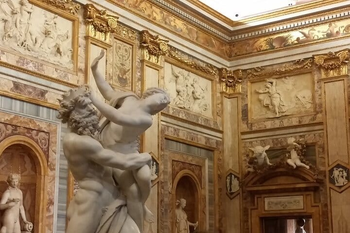
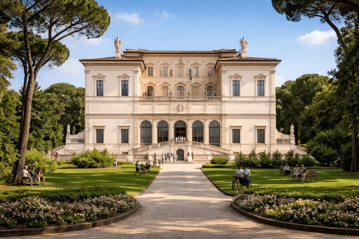
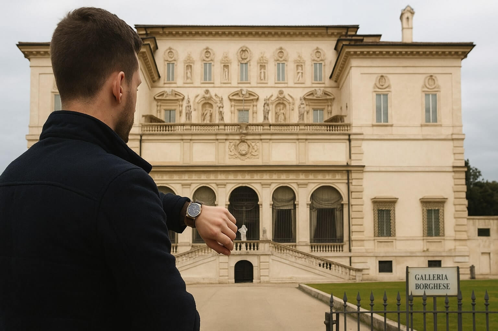
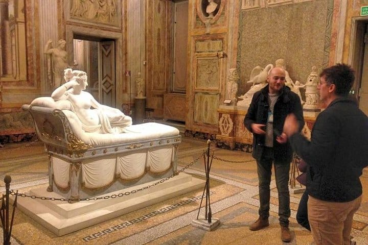

Is the Borghese Gallery worth it? Yes, if you want to see sculptures by Bernini and Canova and paintings by Caravaggio, Raphael and Titian in twenty frescoed rooms, in a booked visit of two hours. You could skip it if your only free day is a Monday, when it is closed, or if the official site has no tickets for your dates and you would rather not queue at the box office for a ticket that is not guaranteed. What decides it is the ticket: every visit needs a timed booking, at 16 euros plus a 2 euro booking fee, on the gallery's own site or by phone on +39 06 32810, and when both show nothing the box office still sells a few last-minute tickets from twenty past each hour, and tickets for the first date available.

Resellers charge more than that 16 plus 2, and the gallery says it is not responsible for tickets sold at higher prices by others. Every hour, price and rule below comes from its website, read in November 2026; open the page linked in each section the week you go, as they change.

## Is the Borghese Gallery worth it?

The gallery is the villa the Borghese family built in the early 1600s inside their own park, and the collection is still in it. Its core goes back to Cardinal Scipione Borghese (1579–1633), nephew of Pope Paul V: ancient sculpture, reliefs and mosaics, and paintings and sculpture from the fifteenth to the nineteenth century, with works by Caravaggio, Raphael, Titian, Correggio, Antonello da Messina and Giovanni Bellini, and sculptures by Gian Lorenzo Bernini and Antonio Canova.

It is all in twenty frescoed rooms, plus the portico and the entrance hall: a great deal of art in a building small enough to see properly in one visit. It is also on our list of [what to do in Rome when it rains](/journal/what-to-do-in-rome-when-it-rains), and our guide to [whether the Vatican Museums are worth it](/journal/vatican-museums-worth-it-how-to-visit) answers the same question for the Vatican.

**Piazzale Scipione Borghese 5, 00197 Rome** · [Website](https://galleriaborghese.cultura.gov.it/)

## How to book Borghese Gallery tickets

Booking is mandatory for every ticket, free ones included, and the [ticket page](https://galleriaborghese.cultura.gov.it/visita/info-biglietti/) charges a 2 euro booking fee on each. A full ticket costs 16 euros, or 11 euros for the last slot of the day. Visitors aged 18 to 25 pay 2 euros, up to the day they turn 25, and under-18s go in free. The page notes, under these rates, that they are valid for EU citizens, citizens of countries with a reciprocity agreement and holders of a residence permit, and anyone with a free ticket has to show proof of the right to it. During temporary exhibitions the price can go up.

You can buy online through the Acquista (buy) button on that page, by phone on +39 06 32810 from Monday to Friday, 9.30 to 18.00, or at the box office. One purchase covers at most five tickets, and tickets cannot be changed or refunded, so check the date and time before you pay.

Entry is by the hour, with 180 people in each slot, and a visit lasts two hours. The exception is the last slot, at 17.45, which is shorter because the gallery closes at 19.00.

## When it is sold out: last-minute tickets and the box office

If the website and the call centre both show nothing, the gallery's [FAQ](https://galleriaborghese.cultura.gov.it/info/) says you can still come and queue at the box office, though entry on the day is not guaranteed. The box office sells last-minute tickets only from minute 20 of each hour, two per person at most, and there are few of them. The wait can be long, and the visit is shorter, an hour and a half. The box office opens at 8.30 and closes an hour before the museum, and it can also sell you a ticket for the first available date.

The park around the gallery, Villa Borghese, is free to walk in, and the bookshop and the café inside the gallery are open without a ticket. The cloakroom and the toilets are not.

## The free first Sunday

On the first Sunday of every month, and on 25 April, 2 June and 4 November, entry is free, but you still have to book and pay the 2 euro fee. Tickets for those days go on sale on the official channels ten days before, and there are no last-minute tickets at the box office. The next two are 6 December 2026, with tickets from 26 November, and 3 January 2027, with tickets from 24 December.

## At the door: bags and timing

Only small waist bags and pochettes no bigger than 21 x 15 cm are allowed in the rooms. Medium and large bags, shopping bags, rucksacks and luggage go to the cloakroom at the museum entrance, which takes suitcases only up to aircraft cabin size, only for the length of the visit and only while there is space. The gallery takes no responsibility for bags it cannot accept.

Visitors go in only at the start of each hour, which is why a queue forms just before. The gallery says it moves quickly. There is no skip-the-line ticket, since entry is capped at 180 people per slot.

The gallery stands inside the park. The nearest gate is on Via Pinciana, which also has the closest bus stop, Pinciana/Museo Borghese.

## What a guided visit adds

You do not need a guide to visit. What a guide adds is the story of the collection, of Scipione Borghese and the works he gathered, and someone to choose what to see in your two hours. The gallery limits groups to between 7 and 15 people, plus the guide and children up to 15.

If you would rather have a guide take care of the tickets and walk you through the Berninis and the Caravaggios, we run a [guided visit of the Borghese Gallery](/experience/borghese-gallery-tour).

## Good to know

### How long does the Borghese Gallery take?

Two hours, the length of every booked slot except the last one at 17.45, which ends at closing time. Last-minute tickets bought at the box office give an hour and a half.

### Can I buy last-minute tickets at the door?

Sometimes. The box office sells a few from twenty past each hour, two per person at most, with no guarantee and never on the free days.

### Is the Borghese Gallery open on Mondays?

No. It is open from Tuesday to Sunday, 9.00 to 19.00, with last entry at 17.45, and closed on 25 December and 1 January.
