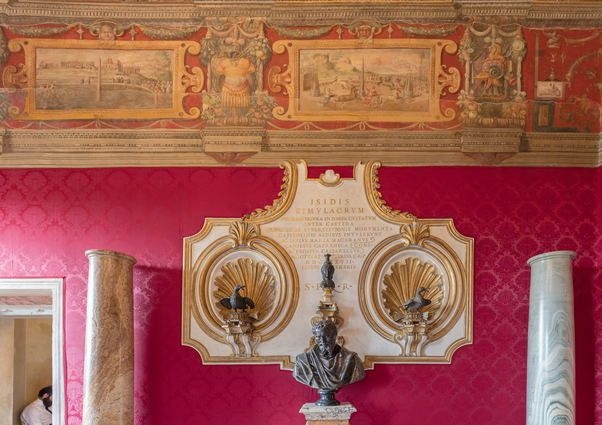
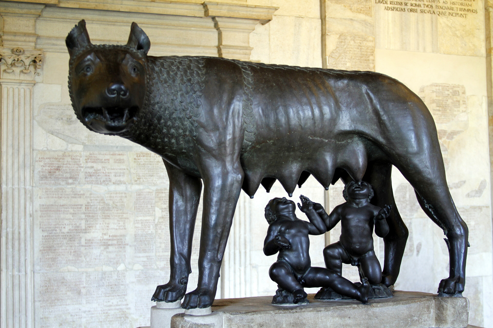

Are the Capitoline Museums worth it? Yes, if you want to see the bronzes and marbles of ancient Rome, and two Caravaggios, in a single visit. The Musei Capitolini are the city's own museum, in the palaces on Piazza del Campidoglio, and they hold the bronze equestrian statue of Marcus Aurelius, the Capitoline She-wolf, the Capitoline Venus, Caravaggio's St John the Baptist and a gallery that looks out over the Roman Forum. A ticket for the museums alone costs €15, or €9.50 reduced, and they are open every day from 9.30 to 19.30.

The collection fills Palazzo dei Conservatori and Palazzo Nuovo, on either side of Michelangelo's square, with the Capitoline Picture Gallery and the Tabularium in the same visit. Every hour, price and rule below comes from museicapitolini.org, read in November 2026. Some rooms are closed for now (see the end of this guide), so check the [notices page](https://www.museicapitolini.org/en/servizi/avvisi) the week you go.

## Capitoline Museums opening hours

The museums are open every day from 9.30 to 19.30, and last admission is one hour before closing. They close on 1 May and 25 December, and on 24 and 31 December they are open from 9.30 to 14.00. The call centre on +39 060608 answers every day from 9.00 to 19.00.

**Piazza del Campidoglio 1, 00186 Rome** · [Website](https://www.museicapitolini.org/en/informazioni_pratiche/orari_e_indirizzi)

## Tickets: what they cost, and who goes in free

*Photo: [Diego Delso](https://commons.wikimedia.org/wiki/File:Museos_Capitolinos,_Roma,_Italia,_2022-09-16,_DD_53.jpg), CC BY-SA 4.0, via Wikimedia Commons*

With no exhibition on, the museums cost €15 full price and €9.50 reduced. While an exhibition is running inside, the ticket includes it and costs more: until 10 January 2027, with the exhibition *Angeli* in the ground-floor halls of Palazzo dei Conservatori, it is €16.50 full and €11 reduced for non-residents.

Entry is free for residents of Rome and the Metropolitan City, with an ID proving residence shown at the ticket office, and for MIC card holders. The Roma Pass gives free or reduced entry. The Capitolini Card costs €15.50, or €11.50 reduced, lasts seven days and adds the Centrale Montemartini; an exhibition costs €5.50 on top.

On the [tickets page](https://www.museicapitolini.org/en/informazioni_pratiche/biglietti_e_videoguide), buying ahead online, by phone on 060608 or at the ticket office for a later day (card only) adds a €1 pre-sale fee. Same-day tickets at the ticket office, in cash or by card, have no fee. Advance tickets cannot be refunded or changed. The audio guide costs €4 and the video guide €6.

## Bags, photos and the rules at the door

Bulky bags, backpacks and umbrellas are not allowed inside; the cloakroom is free and self-service, and you collect your things before closing. You can photograph and film the collection for personal use, but not temporary exhibitions, and without tripods, selfie sticks or extra lights. No food or drink inside. The [visitor services page](https://www.museicapitolini.org/en/informazioni_pratiche/condizioni_di_accesso2) has the full rules.

## Marcus Aurelius in the glass Exedra

The equestrian statue of Marcus Aurelius, in gilded bronze, dates from between 161 and 180 AD. Late-Imperial lists of Rome counted 22 larger-than-life equestrian statues in the city, and the museum's [page on the statue](https://www.museicapitolini.org/en/percorsi/percorsi_per_sale/museo_del_palazzo_dei_conservatori/esedra_di_marco_aurelio/statua_equestre_di_marco_aurelio) says this is the only one to have survived. Pope Paul III had it moved to the Capitoline in 1538, and Michelangelo made it the centre of his design for Piazza del Campidoglio.

Today the statue stands indoors, in the Marcus Aurelius Exedra, a glass hall built in what was called the "Roman Garden" of Palazzo dei Conservatori, with the remains of the bronze colossus of Constantine. In the courtyard is the colossal marble right hand of Constantine; its raised index finger is a modern addition to the ancient fragment.

## The Capitoline She-wolf

*Photo: [José Luiz](https://commons.wikimedia.org/wiki/File:Lupa_Capitolina_-_Sala_della_Lupa_-_Palazzo_dei_Conservatori_-_Musei_Capitolini_-_Rome_2016.jpg), CC BY-SA 4.0, via Wikimedia Commons*

The bronze wolf has its own room, the Hall of the She-wolf, in the Conservators' Apartment. The museum's [page on the wolf](https://www.museicapitolini.org/en/percorsi/percorsi_per_sale/appartamento_dei_conservatori/sala_della_lupa/lupa_capitolina) dates it to the fifth century BC, from Etruscan or Magna Graecia workshops. The twins were added much later, when the statue was moved inside during Michelangelo's work, and are attributed by some to Pollaiolo.

In the Hall of the Triumphs is the Spinario, a first-century BC bronze of a boy pulling a thorn from his foot.

## The Capitoline Venus and the Capitoline Gaul in Palazzo Nuovo

Across the square, the [Capitoline Venus](https://www.museicapitolini.org/en/collezioni/percorsi_per_sale/palazzo_nuovo/gabinetto_della_venere/statua_della_venere_capitolina) has the Cabinet of Venus, a small octagonal room, to herself. The marble Venus coming out of her bath is based on the Cnidian Aphrodite by Praxiteles, and was found near the Basilica of San Vitale around 1666–1670.

The [Capitoline Gaul](https://www.museicapitolini.org/en/collezioni/percorsi_per_sale/palazzo_nuovo/sala_del_gladiatore/statua_del_galata_capitolino), in the Hall of the Galatian, is a wounded Celtic warrior half-lying on his shield: a marble replica of one of the sculptures dedicated by Attalus I at Pergamon for his victories over the Galatians.

## Caravaggio in the Capitoline Picture Gallery

Caravaggio's [St John the Baptist](https://www.museicapitolini.org/en/percorsi/percorsi_per_sale/pinacoteca_capitolina/sala_di_santa_petronilla_la_grande_pittura_del_seicento_a_roma/san_giovanni_battista), painted in 1602, hangs in the Hall of St Petronilla. The same room has his earlier [Good Luck](https://www.museicapitolini.org/en/percorsi/percorsi_per_sale/pinacoteca_capitolina/sala_di_santa_petronilla_la_grande_pittura_del_seicento_a_roma/la_buona_ventura), as the museum titles it in English, dated 1596–1597, and Rubens' Romulus and Remus.

## The view over the Roman Forum: the Tabularium

From the museum, a junction gallery leads into the Tabularium, the building that held ancient Rome's state archives, put up in 78 BC. A long corridor runs through its foundations to a gallery that opens out on to the Roman Forum, as the [Tabularium page](https://www.museicapitolini.org/en/percorsi/tabularium) describes.

If the Colosseum and the Forum come next, our guide to [whether the Colosseum is worth it](/journal/colosseum-worth-it-how-to-get-tickets) explains its tickets and time slots.

## Capitoline or Vatican Museums?

The Capitoline Museums are open every day and cost €15 for the museums alone. The Vatican Museums open Monday to Saturday from 8.00 to 20.00, are closed on Sundays except the last one of the month, and a full ticket costs €20 without online booking, or €20 plus €5 booked on their website. Our guide to [whether the Vatican Museums are worth it](/journal/vatican-museums-worth-it-how-to-visit) covers their tickets, dress code and the Sistine Chapel.

If you are fitting both into a short stay, a Roman on our team can plan the days around opening hours and closing days in a [bespoke itinerary](/bespoke-itinerary/).

## Good to know

### How long should I spend at the Capitoline Museums?

The museums give no suggested time. There are two palaces, the Picture Gallery and the Tabularium to walk through, and last admission on a normal day is 18.30, so arrive well before that to see everything.

### Are the Capitoline Museums free for residents?

Yes, for residents of Rome and the Metropolitan City who show an ID proving residence at the ticket office, and for MIC card holders.

### Are any rooms closed?

Yes. A notice of 16 February 2026 says the Pietro da Cortona room is temporarily closed for renovation, and one of 5 August 2026 says the Halls of the Horti di Mecenate are closed for renovations. Check the [notices](https://www.museicapitolini.org/en/servizi/avvisi) before you go.

*Cover photo: [Daderot](https://commons.wikimedia.org/wiki/File:Equestrian_statue_of_Marcus_Aurelius_-_Musei_Capitolini_-_Rome,_Italy_-_DSC05879.jpg), Public domain, via Wikimedia Commons*
