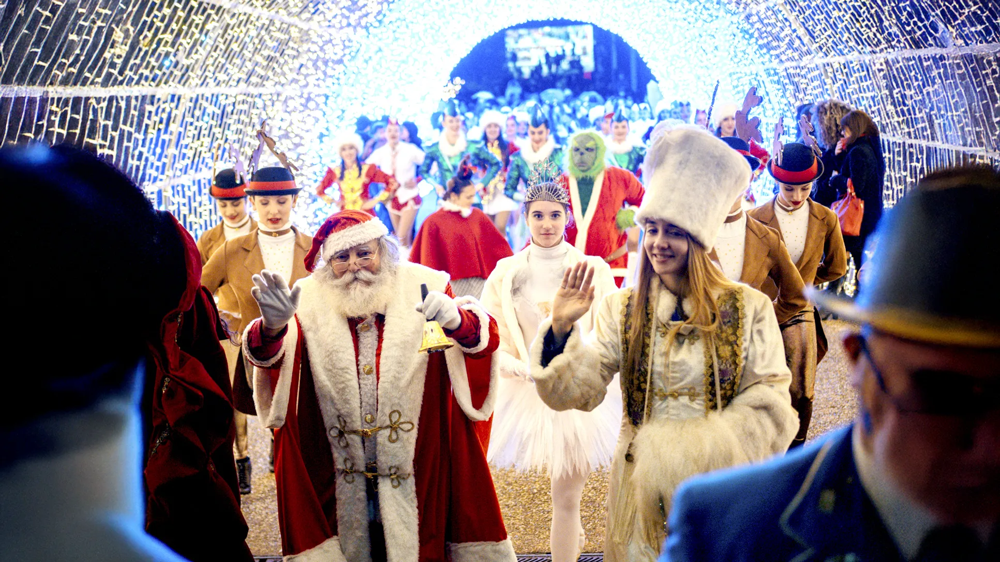

Christmas World, the Christmas village in Villa Borghese in Rome, runs from 28 November 2026 to 10 January 2027. It is open every day from 10.00 to 20.00, closing at 18.00 on 24 and 31 December, and the entrance is in Piazzale delle Canestre, off Viale del Galoppatoio. An adult ticket costs between 12.50 and 18.50 euros, depending on the day. It covers the village, the shows, the parades and meeting Santa and the other characters, but every ride and all the food are paid on top.

Is it worth it? For a family with small children who will spend the day on the shows, the parades and the characters, the ticket covers most of what they will do. If you are coming for the ice rink and the rides, each one is paid separately, and the official site does not publish their prices. Christmas World is a place we have filmed; the dates, prices and rules below come from the organiser's own pages, read on 18 November 2026, while many websites still show the 2025 dates.

## Christmas World 2026: dates and opening hours

The village opens on Saturday 28 November 2026 and closes on Sunday 10 January 2027. The [Plan your visit](https://christmasworld.net/en/pianifica-la-tua-visita/) page gives 10.00 to 20.00 every day, except 24 and 31 December, when it closes at 18.00.

## Christmas World tickets and prices

Prices come in three bands, Off Peak, Standard and Peak, and the calendar on the official page shows which band applies to each date.

- Adult (18 to 65): 12.50, 16.50 or 18.50 euros.
- Reduced (12 to 17, over 65, adults with a disability): 11.50, 14.50 or 16.50 euros. Military personnel pay it on Standard and Peak days only.
- Child (3 to 11): 10.50, 13.50 or 15.50 euros.
- Family Pack for two adults and two children: 41, 54 or 61 euros.
- Family Pack for two adults and three children: 51, 66 or 75 euros.

Children up to the age of two go in free. Entry is also free for minors with a Law 104 certification and for adults with a certified disability of 70 per cent or more.

Tickets cannot be refunded. If you miss your date, the [FAQ](https://tickets.christmasworld.net/) says a ticket for a weekday can be used on another day from Monday to Friday, and a ticket for a weekend or a public holiday can be used on any day.

## What the ticket includes, and what costs extra

*Photo: [Christmas World (Lux Entertainment S.p.A.)](https://christmasworld.net/en/)*

The entry ticket gives you the village and what goes on in it during the day: the Grand Christmas Show on the Main Stage and the shows that move around the village, among them the Christmas Jungle Show, Missione Elfi in Lapponia and the Baby Dance. There are two Christmas Parades every day, and the whole cast comes out for the Good Morning and Good Night greetings.

Children can meet the characters, from Santa and the Elves to the Befana, the old woman who brings Italian children their presents on 6 January, and Renna Renata the reindeer. The Letters to Santa House and Santa's home are included too, and the FAQ says that is where children can ask for presents and have a souvenir photo taken. The Snow Village and face painting are also part of the ticket.

All the rides cost extra, and so does the food. The [attractions page](https://christmasworld.net/en/attrazioni/) lists an ice rink of about 900 square metres beside a set of the Brooklyn Bridge, the Ice Slide, Ice Bumper, Santa's Coaster, The Tree of Lights and the Grand Carousel, plus two rides new this year, Santa's Balloons and Jingle Sleighs. It gives no prices for any of them.

## Christmas World with toddlers and small children

Under-threes go in free, and much of what is included is aimed at small children: the Baby Dance, the parades, the characters and the Letters to Santa House. The attractions page marks three rides for the youngest visitors: the Little Carousel, the North Pole Raceway, a track of small cars, and the Mini Pony Ride, on real ponies in a separate area. They are paid too.

## Getting to Christmas World: the entrance in Piazzale delle Canestre

Christmas World is on Viale del Galoppatoio inside Villa Borghese, and you go in from Piazzale delle Canestre. The [Plan your visit](https://christmasworld.net/en/pianifica-la-tua-visita/) page links to a map and a journey planner for public transport.

If you come by car, the organiser has an agreement with the Saba car park Villa Borghese - Piazza di Spagna. From the car park, Christmas World is reached through Area D of the shopping gallery. The shorter route follows the signs to Villa Borghese and has stairs; the slightly longer one has escalators and follows the signs for the Via Veneto exit. Show your Christmas World ticket at the Saba cash desk for 20 per cent off the parking. The discount does not apply if you enter with Telepass or UnipolMove.

**Viale del Galoppatoio, entrance from Piazzale delle Canestre, Villa Borghese, Rome** · [Website](https://christmasworld.net/en/)

## Rain, re-entry and changes of plan

Christmas World is outdoors, and it opens as usual in light rain. In strong wind, heavy storms or a weather alert, the organiser can postpone, suspend or change the activities and close some rides, so check that the village is open before you set off. If the weather keeps it closed, tickets are not refunded but stay valid for another date. If activities stop after you have gone in, there is no refund either, but you are told how to come back another day.

Once you leave the village, you cannot go back in.

If the forecast is bad, our guide to [what to do in Rome when it rains](/journal/what-to-do-in-rome-when-it-rains) has seven indoor places, the Galleria Borghese in the same park among them. If you are planning several December days in Rome around a visit like this, we can put them together for you in a [bespoke itinerary](/bespoke-itinerary/).

## Good to know

### Can you leave Christmas World and come back in?

No. Once you leave the village you cannot go back in.

### Is Christmas World free for children?

Up to the age of two, yes. Children from three to eleven pay from 10.50 to 15.50 euros, depending on the day.

### Is Christmas World accessible in a wheelchair?

Yes. The village has no architectural barriers, and there is a priority lane when there is a queue. Visitors with a certified disability of 70 per cent or more go in free without booking, by showing their documents at the ticket office, and their companion pays the reduced price.

*Cover photo: [Sonse](https://commons.wikimedia.org/wiki/File:Villa_Borghese_%2831551773687%29.jpg), CC BY 2.0, via Wikimedia Commons*
