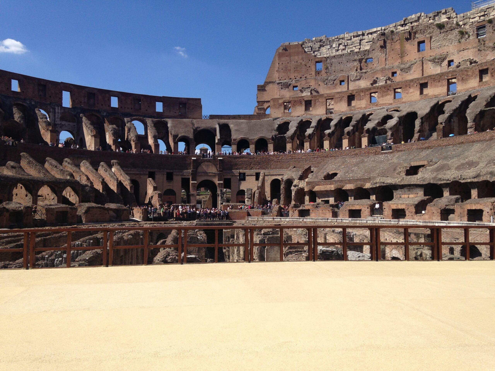
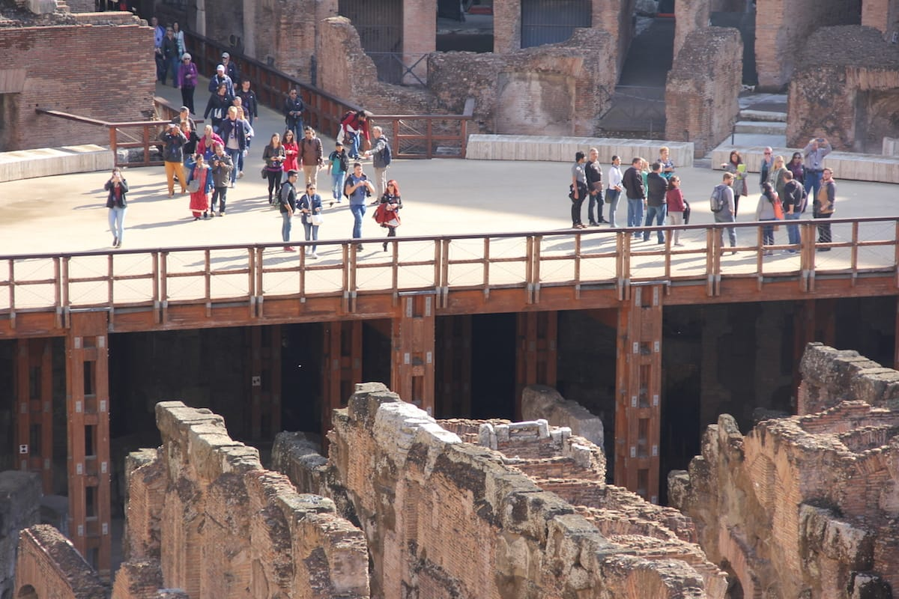

Is the Colosseum worth it? Yes, if you want to go inside the amphitheatre and walk the Roman Forum and the Palatine on the same ticket. The standard ticket, 18 euros, gives you 75 minutes on the first and second levels and one entry to the Forum and Palatine within 24 hours. The Full Experience Underground and Arena, 24 euros, adds the arena floor and, when there is availability, the underground, with 90 minutes inside. If your date shows no tickets, count the days first: the official site puts tickets on sale 30 days before the visit, so a date further away has not gone on sale yet and is not sold out.

The only official booking site is ticketing.colosseo.it, and every ticket carries the holder's name, so bring the ID that matches it. Every hour, price and rule below comes from the park's website, colosseo.it, read in November 2026; check the linked pages the week you go.

## Is the Colosseum worth it?

The Colosseum is part of the Parco archeologico del Colosseo, the archaeological park that also covers the Roman Forum, the Palatine and the Domus Aurea.

Expect a lot of walking: the park's [guidelines](https://colosseo.it/en/guidelines-for-a-safe-and-enjoyable-visit/) warn that the paths are often rocky and uneven, that the amphitheatre has some very steep steps, and that high heels and flip-flops are not recommended. They also forbid ceremonial dresses, masks, period costumes and any other fancy dress.

We answer the same question for [the Vatican Museums](/journal/vatican-museums-worth-it-how-to-visit) and [the Borghese Gallery](/journal/borghese-gallery-worth-it-how-to-get-tickets).

**Piazza del Colosseo, Rome** · [Website](https://colosseo.it/en/)

## Which ticket: standard or Full Experience

The [standard ticket](https://colosseo.it/en/tickets/colosseum-roman-forum-palatine/), Colosseum, Roman Forum and Palatine, costs 18 euros. EU citizens from 18 until the day of their 25th birthday pay 2 euros. It gives one entry to the Colosseum at the booked time, to the first level and the second level with its panoramic terraces but not the arena, 75 minutes inside, and one entry to the Forum and Palatine at any time within 24 hours before or after your slot.

The [Full Experience Underground and Arena](https://colosseo.it/en/tickets/full-experience-underground-arena/) costs 24 euros, 32 euros with an educational tour, and 2 euros at the same reduced rate. It includes the arena and the underground, the latter marked "based on availability", and gives 90 minutes inside the Colosseum. It is valid for two consecutive days, so the Forum and the Palatine can wait until the next day.

If standing on the arena floor and looking into the underground is the reason you came, take the Full Experience; otherwise the standard ticket covers the amphitheatre and the Forum.

## When tickets go on sale, and what "sold out" means

The [opening times page](https://colosseo.it/en/opening-times-and-tickets/) says ticket sales, with a compulsory time slot for the Colosseum, open 30 days before the date of the visit. A date six weeks away that shows nothing is not on sale yet: come back when it is 30 days off.

If your date is inside the 30 days and the standard ticket has no slots, the same page lists other tickets. The [Only Arena](https://colosseo.it/en/tickets/24h-only-arena/) ticket, 18 euros, gives 20 minutes on the arena floor, entering from the Sperone Stern side, plus one entry to the Forum and Palatine. The [Forum Pass SUPER](https://colosseo.it/en/tickets/forum-pass-super-ticket/), also 18 euros, covers the Roman Forum, the Imperial Fora and the Palatine but not the Colosseum. It needs no time slot, and bought online it can be used within 30 days of purchase. The park's FAQ also says tickets can be bought at the ticket office.

For booking help, helpdesk@ticketcolosseo.com answers within 48 to 72 hours; for a same-day admission problem, call +39 06 21115843.

## At the gate: name, ID and time slot

Tickets are issued in the holder's name, and at the entrances you must keep an identification document visible along with the ticket. You do not need to print it: the receipt on your phone is enough.

You cannot enter the Colosseum at a different time from the one booked. The park advises arriving 15 minutes early, at the entrance near the Arch of Constantine.

## Colosseum opening hours in winter

The Colosseum opens at 8.30, the Roman Forum-Palatine area and the Domus Aurea at 9.00. From 25 October 2026 to 28 February 2027 the park is open from 8.30 to 16.30, with last admission at 15.30. It is closed on 25 December 2026 and 1 January 2027.

The Domus Aurea has its own ticket and opens only on Fridays, Saturdays and Sundays.

## The free first Sunday

Entry is free on the first Sunday of every month, and on 25 April, 2 June and 4 November. The next two first Sundays are 6 December 2026 and 3 January 2027.

Free tickets cannot be booked online: they are handed out in order of arrival at the ticket offices in Piazza del Colosseo, near the Temple of Venus and Rome, and in Largo della Salara Vecchia. The free options are the standard Colosseum, Roman Forum and Palatine ticket and the Forum Pass, so no arena and no underground. The Domus Aurea is closed on the first Sunday of the month.

## What a guided visit adds

You do not need a guide. The park's free MyColosseum app has audio guides in Italian and English that follow you from the underground to the intermediate gallery and the attic. The Full Experience is also sold with an educational tour, for 32 euros, and the FAQ says guided tours can be booked online or inside the Colosseum.

A guide tells you the history as you walk and chooses what to see in your 75 or 90 minutes. Groups are capped at 25 people, guide included.

If you would rather have a guide just for your group take you through the Colosseum, tell us your date and we arrange a [private Colosseum tour](/experience/private-colosseum-tour/).

## Good to know

### Can I change the name on a Colosseum ticket?

Once, for visits from 9 May 2026, and only by midnight on the seventh day before the visit. It is allowed only for an obvious error in the first or last name, a wrong ticket type within the same transaction, or serious documented reasons, through the [name change form](https://ticketing.colosseo.it/en/richiesta-cambio-nominativo/).

### How long does the Colosseum take?

75 minutes inside with the standard ticket, 90 with the Full Experience, then you have to leave. The Forum and the Palatine take extra time.

### Can I see the Colosseum underground?

With the Full Experience Underground and Arena ticket, which lists the underground as based on availability. The standard ticket and the free Sunday tickets do not include it.
