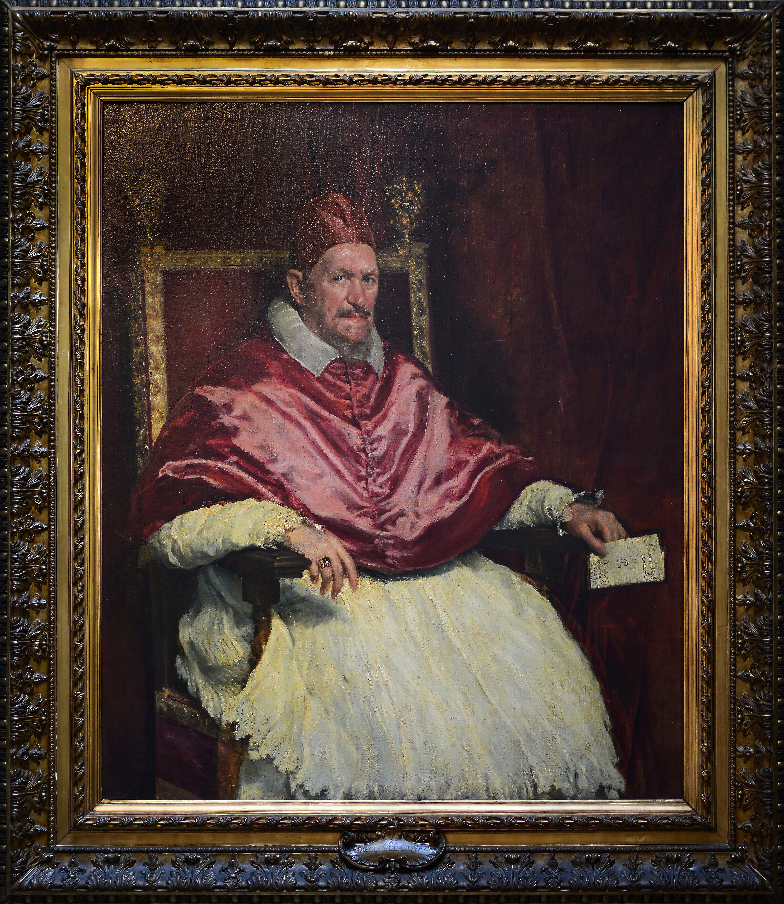

Is the Doria Pamphilj Gallery worth it? Yes, if you want to see Velázquez's Portrait of Pope Innocent X, two early Caravaggios and works by Titian and Raphael in the palace of the family that collected them, a few metres from Piazza Venezia. The entrance is at Via del Corso 305, and you need to book: the gallery says access will not be granted without a reservation. It is closed every Wednesday, so if Wednesday is your only free day in the centre, choose something else.

This is the Doria Pamphilj family's private collection, hung in the four wings around the palace's inner courtyard and in two large halls next to them. There are so many paintings that they cover the walls, and they still hang in the late eighteenth-century arrangement described in a 1767 manuscript in the family archives. Every hour, price and rule below comes from the gallery's own website, read in November 2026. Check the [visit page](https://www.doriapamphilj.it/en/rome/your-visit/) the week you go.

## Opening hours, and the Wednesday closing

The gallery is open on Monday, Tuesday and Thursday from 9.00 to 19.00, with last entrance at 18.00, and from Friday to Sunday from 10.00 to 20.00, with last entrance at 19.00. It is closed every Wednesday, and on 1 January, Easter and 25 December.

Some search summaries say it closes only on the third Wednesday of the month. The gallery's own page says every Wednesday.

## Tickets and booking

A standard ticket costs €16.00, or €17.00 when you book online. Children under 12 go in free, but a booked ticket for them costs €1.00. Entry is also free for holders of an Italian or European Union Disability Card, and for people with documentation of a disability above 67 per cent.

Book on the gallery's own [ticket site](https://ticketroma.doriapamphilj.it/en/biglietteria/gallery-ticket/). The gallery's visit page also lists a ticket office in the palace, open on Monday, Tuesday and Thursday from 9.00 to 18.00 and from Friday to Sunday from 10.00 to 19.00, but it says there is no access without a reservation and recommends booking online. With an e-ticket from the gallery's website you go straight to the gallery entrance on the first floor of the palace. The gallery takes no responsibility for tickets bought through other sellers.

Bring only a small bag. There is no cloakroom and no lift, and luggage, rucksacks and medium or large bags are not allowed in.

**Via del Corso 305, 00186 Rome** · [Website](https://www.doriapamphilj.it/en/rome/your-visit/)

## The Velázquez Cabinet: Portrait of Pope Innocent X

*Photo: [Orlando Paride](https://commons.wikimedia.org/wiki/File:Portrait_of_Innocentius_X_by_Diego_Vel%C3%A1zquez_in_Galleria_Doria_Pamphilj_(Rome).jpg), Public domain, via Wikimedia Commons*

The gallery calls it the masterpiece of the collection. Velázquez painted Innocent X, the Pamphilj pope, in 1650, and the gallery says the likeness was so real that the pope exclaimed "Too true!". The portrait has a small room of its own, the Velázquez Cabinet, which also holds one of the two marble busts of the same pope carved by Gian Lorenzo Bernini. Compare the two while you are in the room: Bernini gives the pope a heroic, rhetorical look that Velázquez's painting does without.

## Caravaggio in the Rooms on the Corso

At the end of the Hall of Mirrors, a row of sixteenth-century rooms looks out over Via del Corso. In the second of them, the young Caravaggio's Penitent Magdalene and Rest on the Flight into Egypt hang side by side, with his St John the Baptist.

## The Hall of Mirrors

Gabriele Valvassori designed this wing around 1730: gilded Venetian mirrors alternate with ancient statues. Aureliano Milani, from Bologna, painted the vault between 1731 and 1734 with the Labours of Hercules, which the family linked to its own tree: the Pamphilj were supposed to descend from a nephew of the Greek hero.

## The Aldobrandini Hall and the rest of the collection

One of the two large halls next to the wings has Titian's early Salome with the Head of the Baptist, Raphael's Double Portrait and Guercino's Sleeping Endymion, with ancient sculpture along the walls and a marble centaur in the middle. Elsewhere in the gallery, its own list of masterpieces includes Annibale Carracci's Landscape with the Flight into Egypt, Claude Lorrain's Marriage of Isaac and Rebecca and Hans Memling's Lamentation over the Dead Christ.

## Doria Pamphilj or the Borghese Gallery?

The Borghese is a villa inside its own park, closed on Mondays, and its booked visits last up to two hours. The Doria Pamphilj is a family palace on Via del Corso, closed on Wednesdays, and once you are in there is no time limit. Our guide to [whether the Borghese Gallery is worth it](/journal/borghese-gallery-worth-it-how-to-get-tickets) explains how its tickets work, and [are the Vatican Museums worth it](/journal/vatican-museums-worth-it-how-to-visit) answers the same question for the Vatican.

If you would rather not juggle closing days and bookings across a whole trip, a Roman on our team can plan it day by day in a [bespoke itinerary](/bespoke-itinerary/).

## Good to know

### How long does the Doria Pamphilj Gallery take?

The gallery recommends setting aside an hour and a half, and says there are no time restrictions.

### Is the audio guide included?

Yes. Audio guides in Italian, English, French and Spanish are included in the ticket, subject to availability.

### Is the Doria Pamphilj Gallery open on Wednesday?

No. It is closed every Wednesday, as well as on 1 January, Easter and 25 December.

### Is the Velázquez portrait always on view?

Paintings from the collection are sometimes lent to exhibitions elsewhere, so check the gallery's [news page](https://www.doriapamphilj.it/en/news/news-rome/) before you go.

### Does the ticket include the Secret Apartments?

No. The Secret Apartments are in the same building but are run by the Floridi Doria Pamphilj Trust, with a separate ticket.

*Cover photo: [Livioandronico2013](https://commons.wikimedia.org/wiki/File:Ceiling_of_the_Hall_of_Mirrors_in_Galleria_Doria_Pamphilj_(Roma).jpg), CC BY-SA 4.0, via Wikimedia Commons*
