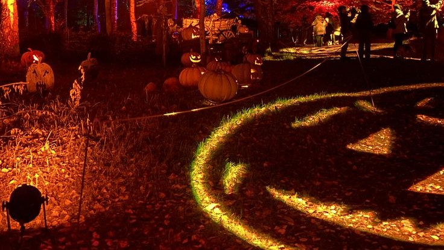
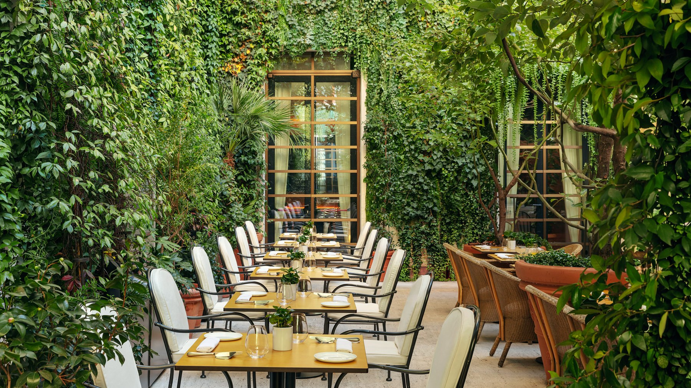
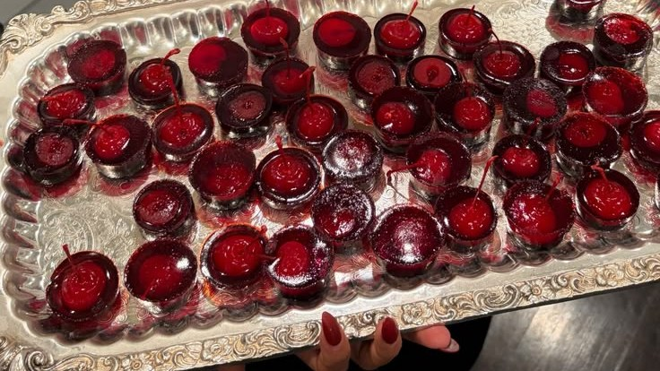
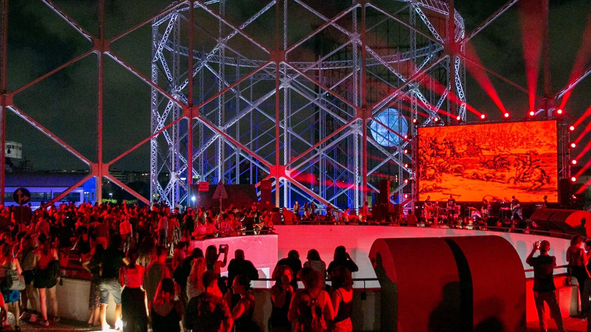
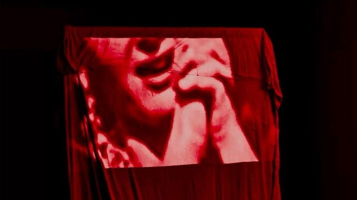
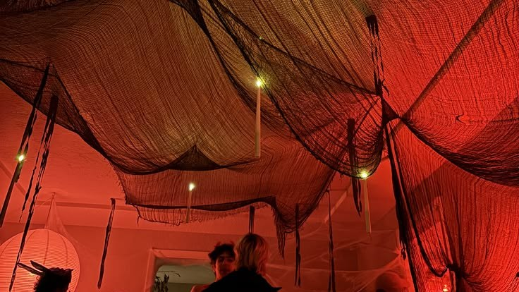

Rome was not built for Halloween. This is a city that takes its dead seriously the other way round: on 2 November families go to the Verano with chrysanthemums, and the night before was, for a long time, something that happened in films. That has changed. Every October now the hotels dress their bars, the clubs print orange flyers, and on the 31st the trams fill with witches, zombies and at least one person who has clearly given up and come as a bedsheet.

What Rome brings to it is the setting. A party here can happen on monumental steps, in a nineteenth-century slaughterhouse, in a hotel garden over a Roman villa, or in a 1930s cinema that will keep the lights down until morning. The costume matters less than where you take it.

So here are seven ways to spend the night, from a theme park that turns into a horror set to a dinner with a door you are told not to open. Some are for families, most are not, and two of them run until well after sunrise. Most of them sell out, so book first and plan the costume second.

## Halloween Night at Cinecittà World

The theme park transforms for Halloween with horror attractions, themed performances and entertainment for a night full of thrills.

Cinecittà World is Rome's film-themed park, out at Castel Romano on the southern edge of the city, and through October it runs a full Halloween season it calls *Un ottobre da brividi*, a month of shivers, from 3 October to 1 November. The 31st is the finale, and the one night the park does not close at dinner time.

The season's new attraction is The Haunted Theatre, a walk-through set in an old Broadway-style theatre whose audience, the story goes, never quite left. The Horror House has new rooms and more live actors waiting in them. Inferno, the indoor roller coaster themed on Dante, runs in complete darkness, which is exactly as unpleasant as it sounds and the reason people queue for it. Between rides there are the shows: The Last Night Horror Show, a musical loosely based on *The Rocky Horror Picture Show*, and a Far West show built around the legend of Black Town.

Families are not left out. Spooky Town Playground is a covered, multi-level play area with actors, and the Villaggio Piccoli Brividi, the little-shivers village, has a straw maze, pumpkins and face painting. Come in the afternoon with children and you will see the park at its gentlest.

On Halloween Night itself the park stays open late: the attractions run until 11 PM, and the themed events and live performances carry on after that. The Halloween Night ticket is sold separately online, and some of the night's festivals inside the park need their own dedicated tickets on top, so read the conditions before you pay.

This is the one pick on the list that needs a plan for getting there. Castel Romano is well outside the centre, so check the park's own page for shuttles on the night, or come by car or taxi. Wear shoes you can queue in, and something warm: it is an outdoor park, and late October nights are cooler than they look at lunchtime.

**Via Irina Alberti, 00128 Rome** · [Website](https://www.cinecittaworld.it/)

## Mama Halloween Party at Mama Shelter Roma

A lively Halloween celebration with live shows, DJ sets and costumes, perfect for dancing and enjoying the spooky atmosphere with friends.

Mama Shelter is the hotel group that made the lobby the point of the hotel, and the Rome one, a few minutes from the Vatican, follows the formula: a restaurant, a bar and a rooftop, all open to people who are not staying the night. It is loud and colourful, which makes it a natural home for Halloween.

The party runs from 7 PM to 12:30 AM, so it is an evening rather than an all-nighter. That is its strength: you can arrive in costume straight after work, have dinner, dance, and still be on your way home before the city's clubs have even opened their doors. If you are in Rome with a group of friends and want one place for the whole evening, this is the easiest call on the list.

Expect live shows and DJ sets, and expect most of the room to have made an effort with the costume. This is not a crowd that turns up in jeans with cat ears drawn on in eyeliner. Nobody will stop you, but you will feel it.

The kitchen joins in. For the season the restaurant serves a Spooky Halloween menu: a "fake risotto", pork neck with pumpkin, a pumpkin cheesecake with popcorn, and a cocktail called Jack's Eclipse. If you want to eat before the dancing, book a table rather than hoping for one, because on the 31st the restaurant will be full of people with exactly the same idea.

Bringing children? Mama Shelter also runs a Mama Halloween Kids Party on the afternoon of 31 October, from 4 PM to 6 PM, which means the family can do the early shift and the adults can come back for the late one.

The hotel is on Via Luigi Rizzo, on the quiet residential side of the Vatican, away from the tour groups. The neighbourhood does not have much nightlife of its own, so plan to get there by taxi, then let the party come to you.

**Via Luigi Rizzo 20, 00136 Rome** · [Website](https://mamashelter.com/roma/)

## Halloween Dinner at Anima, The Rome EDITION

*Photo: The Rome EDITION*

A special three-course dinner created by Chef Antonio Gentile, followed by music in the stylish atmosphere of The Rome EDITION.

If your idea of Halloween involves a tablecloth more than a mask, this is the one. The Rome EDITION sits on Salita di San Nicola da Tolentino, a short climb above Piazza Barberini, and Anima is its signature restaurant: a light-filled dining room set around a courtyard, with more than 400 plants softening the stone.

The kitchen is led by executive chef Antonio Gentile, and its usual line is Italian cooking with strong Roman and Neapolitan accents, built on seasonal produce. For Halloween he has written a special three-course menu, and the evening continues with music once dinner is done. It is the most grown-up way to mark the night on this list: you dress up, but in the sense of a jacket rather than a cape.

The wine list leans Italian, with bottles from across the country, which is useful if you want to treat the night as an excuse to try something from a region you would not normally order. Ask the room for a pairing with the three courses rather than choosing blind.

A few practical things. The venue had not published the exact timings when we wrote this, so confirm the dinner time and the shape of the evening when you book, and ask whether costumes are encouraged or merely tolerated: in a hotel restaurant of this kind, a well-judged accessory usually lands better than full prosthetics. Anima normally serves dinner from 7 PM to 11 PM, so expect the Halloween menu to sit somewhere in that window, but do not plan around that until the hotel has said so.

The location is a gift for the rest of the night. You are a few minutes on foot from Piazza Barberini and the bottom of Via Veneto, with Trevi and the centre within walking distance. It is a very easy place to start an evening and then decide, over dessert, whether you are the sort of person who goes on to a party or the sort who goes home. Both are respectable answers on 31 October.

**Salita di San Nicola da Tolentino 14, 00187 Rome** · [Website](https://editionhotels.com/rome/restaurants-and-bars)

## Halloween Sucks: All You Can Bite, All Night Long at Cinema Troisi

An overnight vampire movie marathon featuring eight films, from cult classics to modern horror, with screenings continuing until the early morning.

Cinema Troisi is in Trastevere, on Via Girolamo Induno, inside a building designed by Luigi Moretti that opened in 1937 and became the Cinema Induno in the 1950s. It closed, sat empty, and was brought back by Piccolo America, the group of young Romans who spent years screening films in squares when they had no cinema of their own. It reopened in 2021 with a 300-seat hall, a bar in the foyer, a terrace and a study room open around the clock. Films here are usually shown in their original language with Italian subtitles.

For Halloween they have gone all in on a single idea: vampires. Halloween Sucks is eight vampire films back to back, from cult classics to modern horror, starting at 5 PM on 31 October and running until the morning of 1 November. The full title promises "all you can bite, all night long", and the programme delivers it.

This is the pick for anyone who would rather sit in the dark than stand in a club. It is also the one that needs the most stamina. Eight films is a long night, so treat it like a journey: come fed, bring a layer for the small hours, and accept that somewhere around the sixth film you will doze for ten minutes and wake up to a different decade of vampire. That is part of it.

You do not have to stay for the whole thing to make it worth it, but the people who do will share something specific: walking out into Trastevere on the morning of All Saints' Day, blinking, while the bakeries open and the city that partied all night is only now going to bed.

Check the cinema's programme for the full list of films, tickets and whether you can come and go during the night. Trastevere is easy to reach: Via Induno is just off Viale di Trastevere, where the tram 8 runs, and at that hour of the morning the walk home through the old streets is half the fun.

**Via Girolamo Induno 1, 00153 Rome** · [Website](https://www.cinematroisi.it/)

## Gasometro Halloween at Città dell'Altra Economia

*Photo: Videocittà*

A Halloween gathering in Rome's industrial Testaccio district, with themed food, drinks, music and a party atmosphere that carries on into the night.

Testaccio is the Rome neighbourhood that still smells faintly of work. It grew up around the city's slaughterhouse, and the slaughterhouse is still there: a vast complex of sheds and yards at the end of the district, now given over to culture. The Città dell'Altra Economia, the "other economy city", occupies the former cattle-market section, the Campo Boario, in about 3,500 square metres of restored sheds and weigh-houses. Most of the year it hosts organic and fair-trade markets, workshops, concerts and festivals.

A little way down the river stands the Gazometro, the great iron skeleton of a gasholder that dominates the Ostiense skyline, and it gives this party its name. It is one of the few places in Rome where Halloween does not have to pretend: an industrial landscape at night needs very little decoration to look like the set of a horror film.

Expect themed food and drinks, music, and a party mood that builds as the evening goes on and keeps going into the night. This is a neighbourhood party more than a velvet-rope one, and the crowd tends to reflect that: Romans from Testaccio and Ostiense, students, people who would rather spend the night outdoors with a drink in hand than queue for a club.

The organisers had not posted the full programme when we wrote this, so check the event's official channels for times, the line-up and whether you need a ticket in advance.

Getting there is easy. Piramide, on Metro line B, is a walk away, and the stretch between the station and the Mattatoio is lined with the places Testaccio is known for, so you can eat first in a trattoria and arrive at the party already in a good mood. Afterwards, Ostiense and its clubs are a short walk south if you have the energy for a second act, and the bars of Monte Testaccio are closer still.

**Largo Dino Frisullo, 00153 Rome** · [Website](https://www.cittadellaltraeconomia.org/)

## Satyrus Halloween Night: The Ghosts of Villa Borghese

A mysterious Halloween party under the stars, featuring dark-themed scenery, cocktails and a special DJ set in the heart of Villa Borghese. Entry is for guests aged 18 and over.

Satyrus is one of Rome's open-air bars: a pop-up cocktail bar that sets up on the Scalea Bruno Zevi, the wide flight of steps facing the Galleria Nazionale d'Arte Moderna, on the edge of Villa Borghese. It began in 2017 as a temporary bar for thirty nights and has kept coming back since, an aperitivo spot at sunset that turns into a place with music and drinks once it is dark.

For Halloween it becomes The Ghosts of Villa Borghese, and the title fits the place. The park around the steps at night is quiet and very dark, the gallery's neoclassical front is lit up behind you, and the pines lean over everything. You could not design a better backdrop for a ghost party if you tried.

Expect dark-themed scenery on the steps, cocktails and a special DJ set. This is a late party, not a dinner: it starts at 11 PM and goes on until late, so have dinner somewhere else first and arrive with the night still ahead of you. Entry is strictly for guests aged 18 and over, so bring an ID even if you have not been asked for one in years.

This is an outdoor event at the end of October, which is worth taking seriously. Choose a costume that works with a coat, or a coat that works as a costume. Something long and black covers a lot of themes. The steps are steps, so heels are a gamble.

The venue has not given much more than this, which suits a party with ghosts in the name. Follow Satyrus on Instagram for entry details and any tickets before the night.

Getting home is the one thing to think about. The steps face Viale delle Belle Arti, and a taxi or ride from there is simplest; walking back through Villa Borghese in the small hours is atmospheric, and also a long way in the dark.

**Scalea Bruno Zevi, Villa Borghese, 00197 Rome** · [Instagram](https://www.instagram.com/satyrus/)

## Don't Open That Door at Amaro, Gran Meliá Villa Agrippina

An elegant Halloween experience featuring a dinner show with live performers, followed by a DJ set and a night of music in a sophisticated setting.

Villa Agrippina is a five-star hotel on the slope of the Gianicolo, the hill above Trastevere and the Vatican, set in private gardens on land that once belonged to the villa of Agrippina, the mother of Nero. Amaro is its lobby bar and lounge, and it is open to people who are not staying at the hotel, which is the useful part. By day it is a garden with a view; by night, a cocktail bar with DJ sets.

For Halloween it is running Don't Open That Door, and the title tells you the tone: theatrical and slightly sinister, but dressed for dinner. The evening comes in two acts. First a dinner show at 8:30 PM, with live performers working the room while you eat. Then, from 11 PM, the party: a DJ set and music late into the night.

This is the most polished of the parties on the list, a good pick if you want the costume and the cocktails without the sticky floor. It also suits couples, or a group that wants to sit down together for dinner before splitting up between the dance floor and the garden. Costumes are part of the point, but the setting rewards the elegant version of a theme: a good mask and a good jacket rather than fake blood on a white shirt.

You can choose your act. Book the dinner show if you want the whole story from the start, or come for the party at 11 PM if you have already eaten in Trastevere at the foot of the hill. Either way, book ahead, and confirm prices and what the dinner includes when you do.

The Gianicolo is steep, and the walk up from Trastevere is lovely on a summer afternoon and much less so in a costume at midnight. Take a taxi up, and plan for one down. Before you leave, walk to the edge of the garden: the city is laid out below you, and on Halloween night it looks like it is in on the joke.

**Via del Gianicolo 3, 00165 Rome** · [Instagram](https://www.instagram.com/amaro.roma/)
