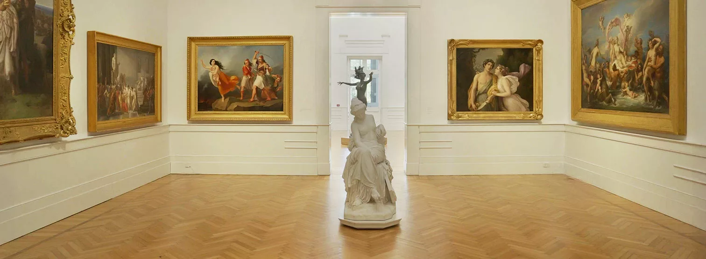
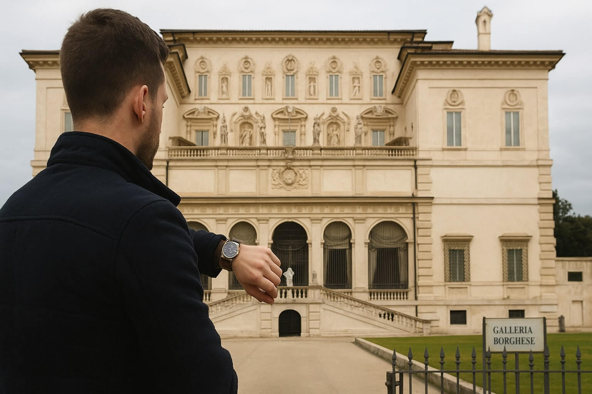

The Marina Abramović exhibition in Rome, "Marina Abramović: Historical Works and Transforming Energy", is at the Galleria Nazionale d'Arte Moderna e Contemporanea (GNAMC), Viale delle Belle Arti 131, from 18 November 2026 to 4 April 2027. The museum is open from Tuesday to Sunday, 9am to 7pm, and the show is included in the ordinary museum ticket: 20 euros full price, 2 euros for EU citizens aged 18 to 25, free for under-18s.

The exhibition marks the artist's 80th birthday. It sets some of the performances that made her name beside her Transitory Objects, beds and structures of quartz, amethyst and other minerals that visitors are invited to lie, sit or stand on. It was first shown at the Gallerie dell'Accademia in Venice during the 61st Biennale, and comes to Rome in an expanded version.

## What is in the show

Turismo Roma, the city's tourist office, describes around two hundred works from fifty years of her career, and says the visit begins with the artist's avatar, a digital twin of Marina Abramović. The show is curated by Shai Baitel, artistic director of the Modern Art Museum (MAM) in Shanghai, in close collaboration with the artist.

The Historical Works section, curated by Andrea Tarsia, covers the performances that shaped her career, among them Imponderabilia (1977), made with Ulay; Balkan Baroque (1997), presented at the Venice Biennale, where it won the Golden Lion; and The Artist is Present (2010), performed at the Museum of Modern Art in New York.

Transforming Energy, at the centre of the show, is a selection of the Transitory Objects, a series she has worked on for more than thirty years: stone beds, structures and sculptural forms made with quartz, amethyst, agate and other minerals. Visitors are invited to lie down, sit or stand on them to set off what she calls a "transmission of energy". According to the GNAMC, her interest in crystals grew after her 1988 journey along the Great Wall of China, where she came into contact with some principles of traditional Chinese medicine.

The artist says that bringing together work from different moments "lets the public see how the ideas behind my work have developed over time".

## The Galleria Nazionale

*Photo: [Galleria Nazionale d'Arte Moderna e Contemporanea](https://gnamc.cultura.gov.it/museo/)*

The GNAMC stands in the valley of the academies on the edge of Villa Borghese, in a building by Cesare Bazzani from 1911. Its own collection runs to around 20,000 works, from paintings, drawings and sculpture to installations, design objects, films and photographs, and the ticket that gets you into the Abramović show is the museum's ordinary admission ticket.

Like the Borghese Gallery, it is closed on Mondays. If you are planning around the weather, our guide to [what to do in Rome when it rains](/journal/what-to-do-in-rome-when-it-rains) lists more museums and which of them open on a Monday.

**Viale delle Belle Arti 131, 00197 Rome** · [Website](https://gnamc.cultura.gov.it/)

## GNAMC opening hours and the Thursday evenings

The Galleria Nazionale is open from Tuesday to Sunday, 9am to 7pm, with last admission 45 minutes before closing. It is closed on Mondays and on 25 December.

Every Thursday until 17 December 2026 it also opens in the evening, from 7pm to 11pm, with last admission at 10pm and an evening ticket of 10 euros. The evening openings end on 17 December, so for the rest of the show, until 4 April, the museum closes at 7pm.

## Marina Abramović tickets: price and how they work

A full ticket costs 20 euros and includes the Abramović exhibition. EU citizens aged 18 to 25 pay 2 euros, under-18s go in free, and so do a few other groups listed on the museum's visit page. Tickets are sold online through TicketOne, the sales channel linked from the museum's own website.

The ticket is valid for three hours, in a time slot you choose when you buy it. Within those three hours you can step out to the Caffè delle Arti, the museum's café, and come back in.

Entry is free on the first Sunday of every month, but you must reserve a ticket online and keep to your entry time. While the show is on, that means 6 December, 3 January, 7 February, 7 March and 4 April, its last day.

## Combining it with the Borghese Gallery

The two museums share an offer called "Da Canova a Canova": with a Borghese Gallery ticket, you pay 10 euros at the Galleria Nazionale instead of 20, on the same day. Both are open from Tuesday to Sunday, so a Monday will not work for either.

The Borghese only sells booked, timed tickets. Our guide to [whether the Borghese Gallery is worth it and how to get tickets](/journal/borghese-gallery-worth-it-how-to-get-tickets) explains how to book, and what to do when it looks sold out.

If you would rather have the day worked out for you, with the Borghese slot and the Galleria Nazionale in an order that fits the rest of your trip, that is what our [bespoke Rome itinerary](/bespoke-itinerary) is for.

## At the door

Bags larger than 25 x 30 x 12 cm, backpacks, umbrellas, helmets and suitcases go to the cloakroom, and food and drink are not allowed in the rooms. You can take photographs without flash, but not with tripods or selfie sticks. The Caffè delle Arti is open from 8am to 8pm, Tuesday to Sunday.

The museum says it is fully accessible, with lifts and lift platforms, and has two wheelchairs for visitors. The accessible entrance is at Via Gramsci 71.

## Good to know

### Is the Galleria Nazionale open on Monday?

No. It is open from Tuesday to Sunday, 9am to 7pm, and closed on Mondays and on 25 December.

### Is the Abramović exhibition included in the museum ticket?

Yes. The GNAMC says the show is included in the admission ticket to the Galleria Nazionale, which costs 20 euros full price.

### Until when are the Thursday evening openings?

Until 17 December 2026. On those Thursdays the museum is open from 7pm to 11pm, last admission at 10pm, with a 10 euro ticket.

### How do I get there from Villa Borghese?

The museum is on Viale delle Belle Arti, on the edge of Villa Borghese, at number 131. The accessible entrance is at Via Gramsci 71.

### Can I take photos inside?

The museum's rules allow photographs without flash and amateur videos, but not tripods, selfie sticks or professional equipment.

*Cover photo: [Gabriele Costetti](https://commons.wikimedia.org/wiki/File:Roma_-_Galleria_Nazionale_d%27Arte_Moderna_-_Facciata.jpg), CC BY-SA 4.0, via Wikimedia Commons*
