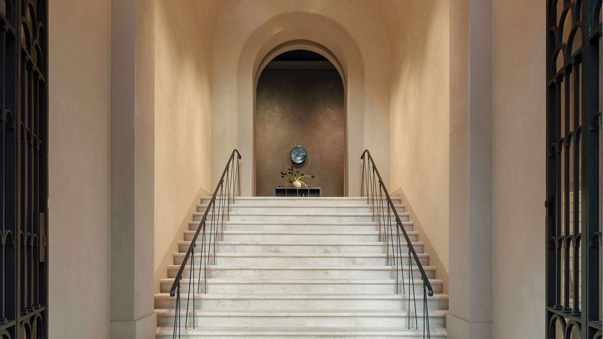
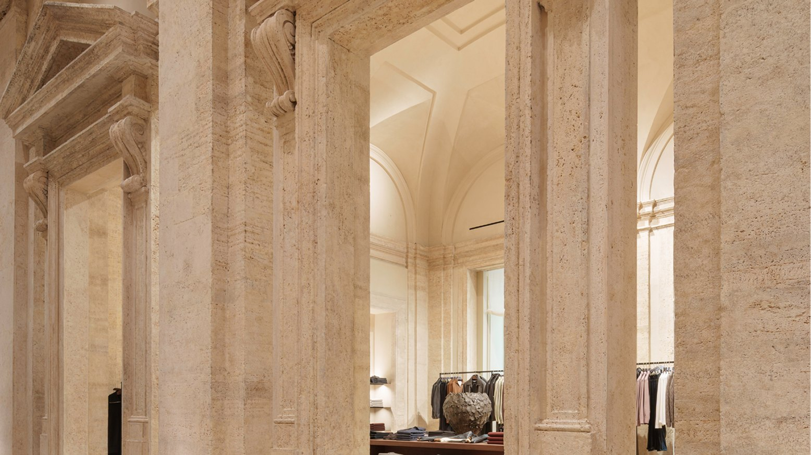
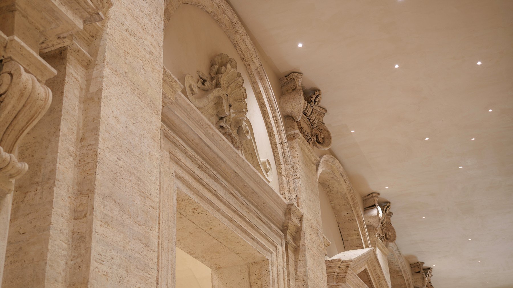
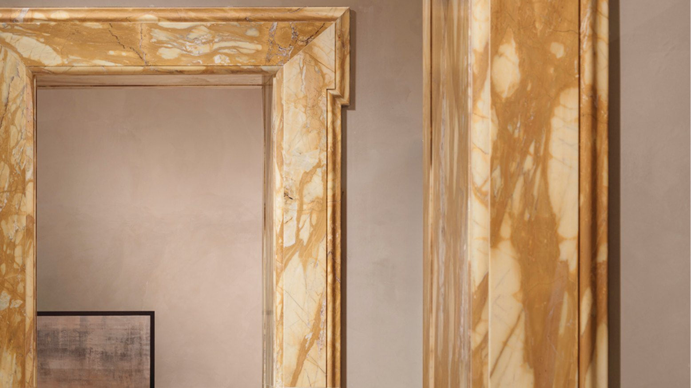
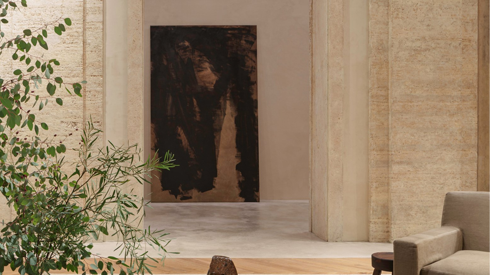
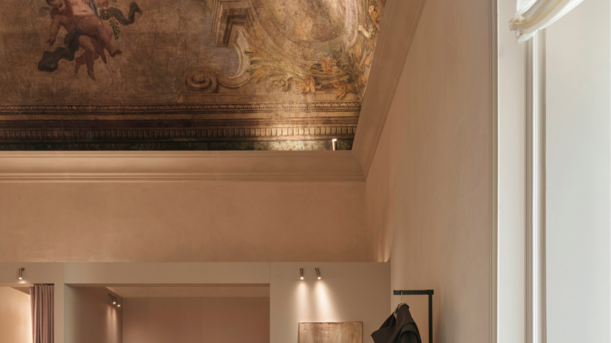
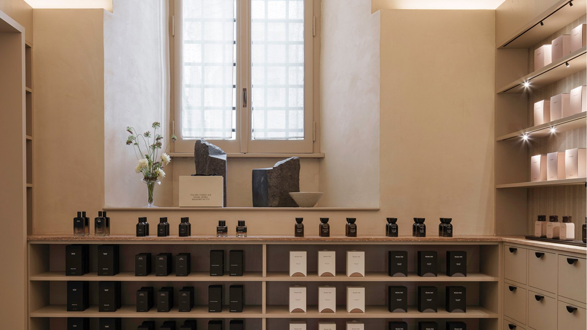

Via del Corso is the street Romans walk to shop, and most of what lines it is shop windows set into old buildings. The new Massimo Dutti flagship works the other way round: you do not walk into a shop, you walk into a palace that happens to sell clothes.

It opens today, 10 October, inside Palazzo Ruspoli. We were at the opening show on 8 October to see the new Fall/Winter 2026 collection, and this is what you will find.

## A palace on Via del Corso

Palazzo Ruspoli was begun in the 16th century and has stood on Via del Corso for almost five hundred years, reshaped by one owner after another. From the street, the only signs of the new tenant are the name above the portal and the small lit windows at pavement level.

The store covers more than 2,000 square metres on the first floor. Before any restoration, the brand commissioned a study of the building and brought in specialist craftsmen to bring the original finishes back rather than cover them.

## Up the staircase

*Photo: Massimo Dutti*

The visit starts at the door. A wide stone staircase climbs under a vaulted ceiling to a niche at the top, and only once you reach it do the rooms open up: a run of arches and vaulted halls in travertine, lit from below so the light washes up the stone.

*Photo: Massimo Dutti*

*Photo: Massimo Dutti*

## Rooms at palace scale

*Photo: Massimo Dutti*

The Woman and Man collections are spread across rooms that keep their original proportions. The furniture is kept low on purpose: big rugs, plain sofas, wooden tables and light displays that leave the walls and vaults in view. In a few rooms the colours turn darker and warmer, as in the checkout area, which is lined with tall bookshelves.

*Photo: Massimo Dutti*

## A painted ceiling over the fitting room

*Photo: Massimo Dutti*

Not many shops can say this: in one of the rooms, the fitting area sits under a painted ceiling of cherubs and garlands. The fitting rooms themselves are simple boxes in warm plaster, so nothing competes with what is overhead.

## The Fall/Winter 2026 collection

The opening coincides with the launch of the Limited Edition Fall/Winter 2026 collection, built around tailoring: long coats, sharply cut jackets, wide trousers and dresses that fall loose. The palette is black and chocolate brown, with grey, taupe, camel and stone, in leather, light fabrics and fine knits.

## Fragrance and books

*Photo: Massimo Dutti*

For the first nine days after opening, the store hosts The Olfactory Archive, made with Profumoir, a Florentine house of artisan perfumery: a guided tour of the brand's main fragrance notes, led by Profumoir's perfumers. The glass holders used to sample the scents were made for the occasion by Pia Glasswork, a glass artist from Barcelona.

Leporello Books, an independent Roman bookshop specialising in art, architecture, design and fashion, has put together a library of nearly a hundred titles for the store. Its founder picked twenty of them and wrote by hand why each one is there.

## Beyond the palace

On opening day the coffee came from Caffè Doria, in Palazzo Doria Pamphilj a few minutes down Via del Corso. From 9 to 11 October it works the other way round: Caffè Doria's courtyard hosts a small Massimo Dutti installation.

The magazine Apartamento has also made a set of illustrated postcards for the opening: twenty-one Roman addresses, three for each day of the week, handed to visitors as a guide to the rest of the city.

## Worth the detour

If you are shopping in Rome, go up the staircase even if you are not planning to buy anything. It is one of the few chances to walk freely through the rooms of a Roman palace on Via del Corso, and you can try on a coat under a painted ceiling while you are at it.

**Palazzo Ruspoli, Via del Corso 418, 00186 Rome** · [Website](https://www.massimodutti.com/)
