Before the doors of the new flagship opened to the public, Massimo Dutti used it for a night of its own. On 8 October the brand held a runway show inside Palazzo Ruspoli, its new home on Via del Corso, to present the Limited Edition Fall/Winter 2026 collection. We were there with our cameras.

If you want the story of the store itself, the staircase, the rooms and the painted ceilings, we wrote about it [here](/journal/massimo-dutti-palazzo-ruspoli/). This is about the show.

## Arriving on Via del Corso

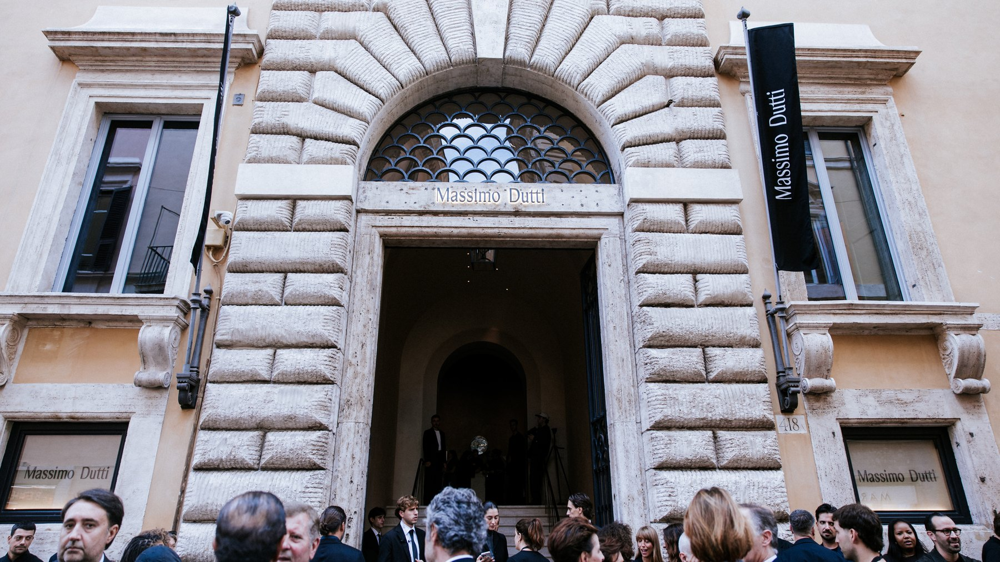
*Photo: [somuchmedia](https://somuchmedia.it)*

Guests queued on the pavement under the palace's stone portal, with black Massimo Dutti banners hanging either side of the door, then went up the grand staircase into the rooms on the first floor.

## A runway between travertine pillars

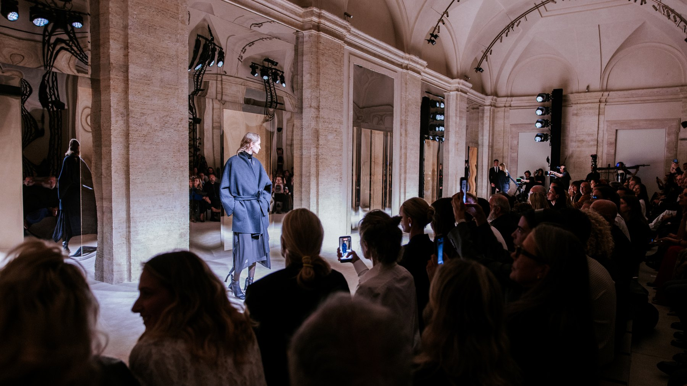
*Photo: [somuchmedia](https://somuchmedia.it)*

The show ran through one of the palace's long vaulted halls. The models walked between the original travertine pillars, past tall mirrored panels that bounced the room back at itself, under lighting rigs hung from the stone and a curved track of spotlights following the vault. The audience sat close on both sides, phones up for most of it.

## The collection

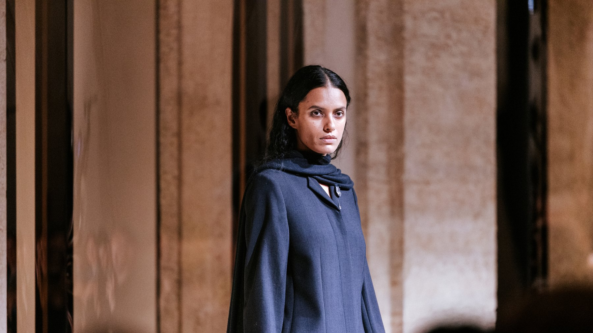
*Photo: [somuchmedia](https://somuchmedia.it)*

The Limited Edition Fall/Winter 2026 collection is built on tailoring. Long coats and carefully cut jackets give the silhouettes length, paired with wide trousers and dresses that fall loose. High collars, layers and different lengths change the volumes from look to look.

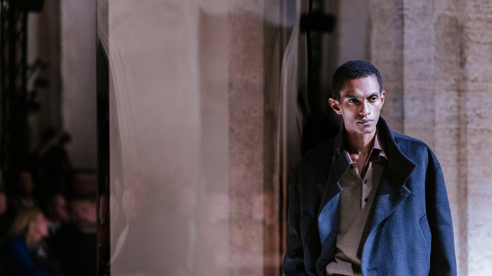
*Photo: [somuchmedia](https://somuchmedia.it)*

The colours stay close together: deep black and chocolate brown, with grey, taupe, camel and stone. Leather sits next to light, almost sheer fabrics and fine knitwear.

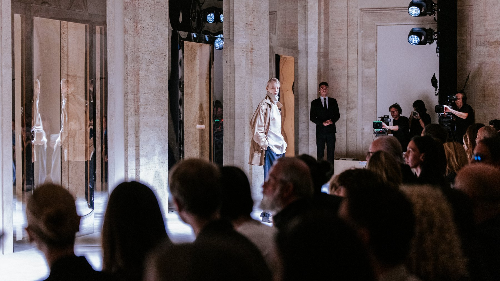
*Photo: [somuchmedia](https://somuchmedia.it)*

After the show, guests went through to the rooms where the collection hangs, to look at the pieces up close.

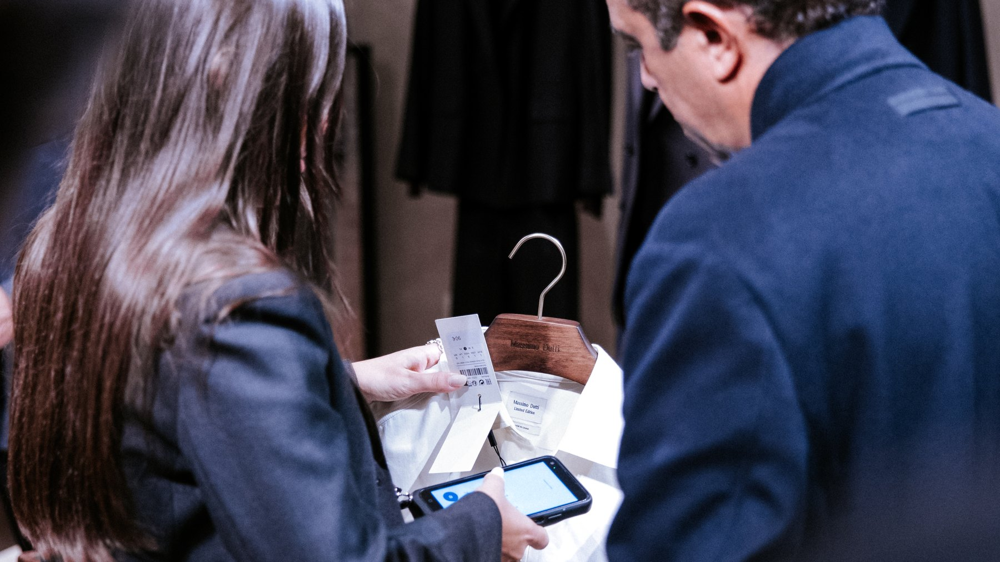
*Photo: [somuchmedia](https://somuchmedia.it)*

## Then the party

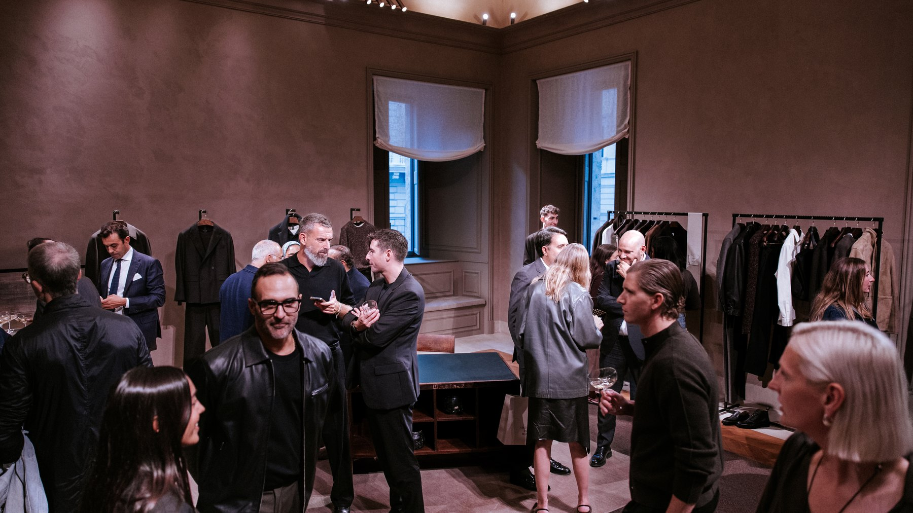
*Photo: [somuchmedia](https://somuchmedia.it)*

Once the runway emptied, the palace became a party. Waiters in white double-breasted jackets carried coupes of champagne between the rooms, a DJ played, and the shop floors filled with people holding glasses.

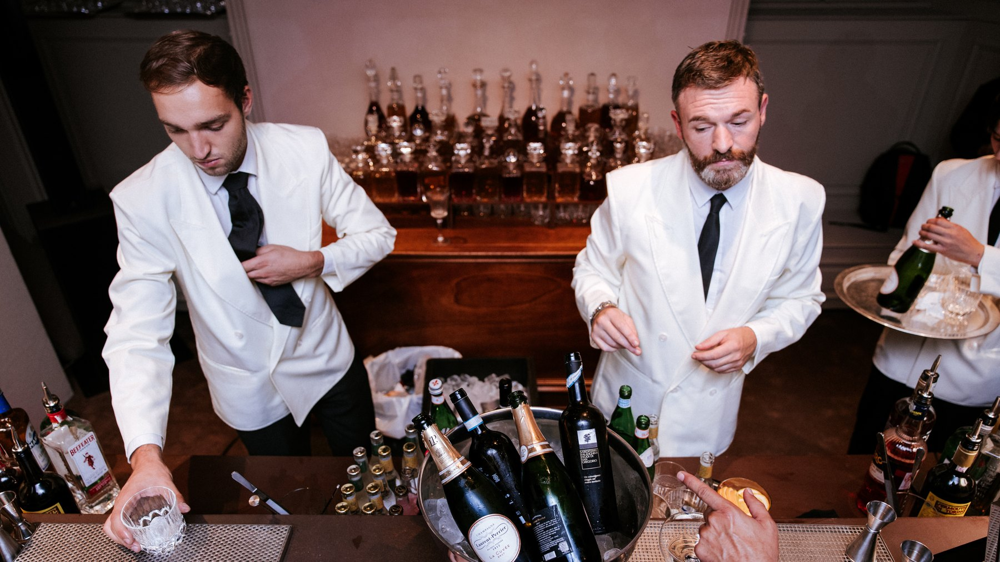
*Photo: [somuchmedia](https://somuchmedia.it)*

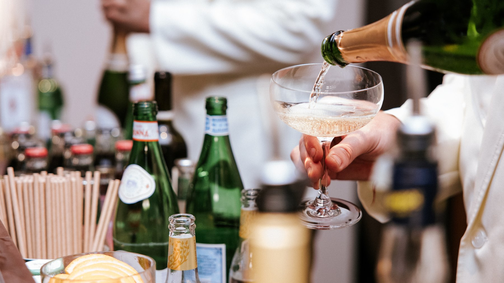
*Photo: [somuchmedia](https://somuchmedia.it)*

In one room, under a big arrangement of white flowers and trailing greenery, a long wooden table was laid with silver trays of small bites, framed by doorways in golden marble.

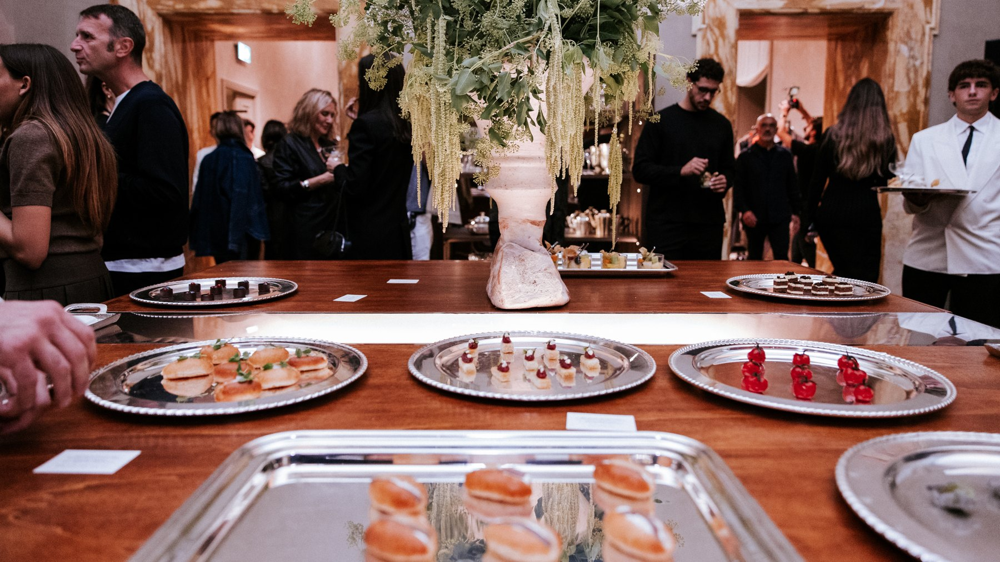
*Photo: [somuchmedia](https://somuchmedia.it)*

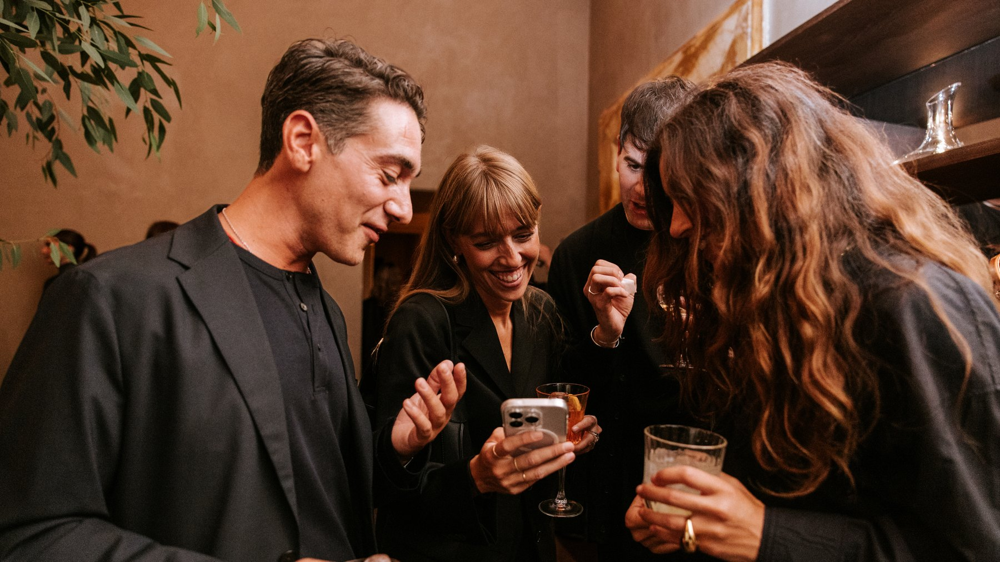
*Photo: [somuchmedia](https://somuchmedia.it)*

## Go and see it

The store opened to the public on 10 October. Look up in the fitting rooms: one of them sits under a frescoed ceiling, which is not something you get every day in a changing room.

For the first nine days after opening there is also The Olfactory Archive, a guided fragrance experience led by the perfumers of Profumoir, a Florentine house of artisan perfumery, and a library of nearly a hundred titles chosen by Leporello Books, the independent Roman bookshop.

**Palazzo Ruspoli, Via del Corso 418, 00186 Rome** · [Website](https://www.massimodutti.com/)
