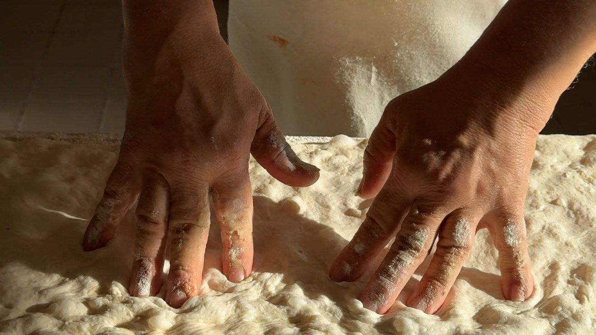
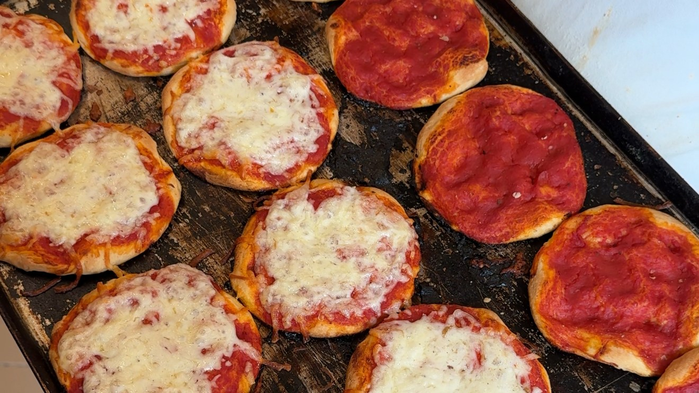

For more than 45 years, Osvaldo Palamidesse made pizza bianca at Forno Campo de' Fiori, one of the most loved bakeries in Rome. This year, he retired.

Over those decades, nearly every kind of pizza that came out of the Forno passed through his hands: the bianca, the rossa, the small round pizzette that go out on trays by the dozen. People stopped at the window just to watch him work, because the way he did it looked less like a job than a performance.

## The man at the window

Pizza bianca is the simplest thing the Forno makes: flour, water, salt, yeast and extra virgin olive oil. There is nowhere to hide in a recipe that short. What makes the difference is the hands, and Osvaldo's were the ones Rome knew.

He stretched each piece of dough into a long, narrow slab, pressed it with his fingertips until it was covered in dimples, slid it onto a long wooden peel and into the oven. It came out blistered and golden, brushed with oil, and went straight to the counter, where it is still cut to the length you ask for, weighed and wrapped in paper.

Watching the baker through the glass is an old habit on this corner. The poet Antonello Trombadori wrote a sonnet in Roman dialect about the Forno's pizza, telling readers not to miss the man in the window "who brushes twenty in two seconds". Since the early 1980s, the hands in that window were Osvaldo's.

## Known far beyond the square

Over the years he was featured in magazines around the world. The New York Times put him in a travel story by Seth Sherwood, with a video of him at work on the pizza bianca he had been making for some four decades.

For those of us lucky enough to know him, though, what stands out is how much he resembles his pizza: simple, brilliant and genuinely good.

## The Forno

Forno Campo de' Fiori sits on the corner of the square, at number 22. Its current owners took it over in 1970 and have kept making the same bread, the same pizza and the same sweets ever since.

The bakery tells a much older story about its corner. Campo de' Fiori has held its market since 1819, and before that it was the square of races, palios and public executions, remembered by the statue of Giordano Bruno in the middle. According to the Forno, its ovens once supplied Vannozza Cattanei, the innkeeper who was the companion of Pope Alexander VI Borgia and mother of Lucrezia and Cesare. Their palace, between Via dei Cappellari and Vicolo del Gallo, still carries the Borgia coat of arms, and today it houses the Forno's pastry shop.

Beyond pizza bianca and pizza rossa, the counter holds olive bread, walnut bread, raisin bread, sour cherry tart, cream and pine nut tart, ricotta tart and biscuits. The classic order is still a slice of bianca, eaten standing in the square, or split open and filled with mortadella.

## What he leaves behind

We could not let this moment pass without celebrating what Osvaldo leaves to Rome's tradition of pizza making: more than 45 years at the oven, and a way of doing things that the next bakers at the Forno have watched up close.

Have you ever tried his pizza?

**Piazza Campo de' Fiori 22, 00186 Rome** · [Website](http://www.fornocampodefiori.com/)
