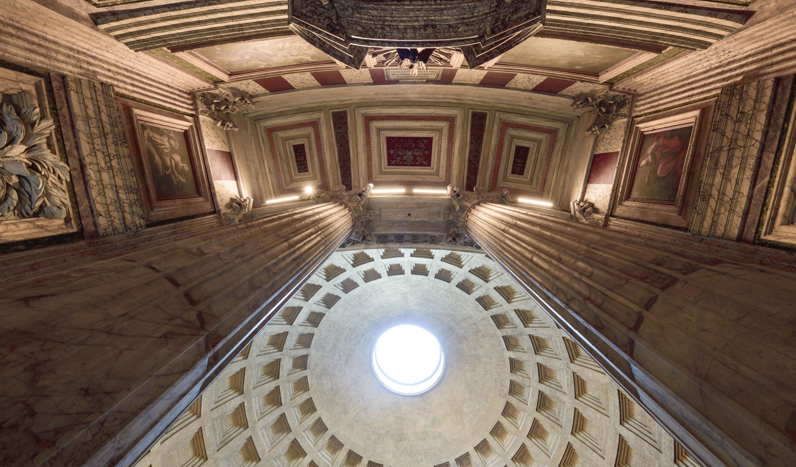
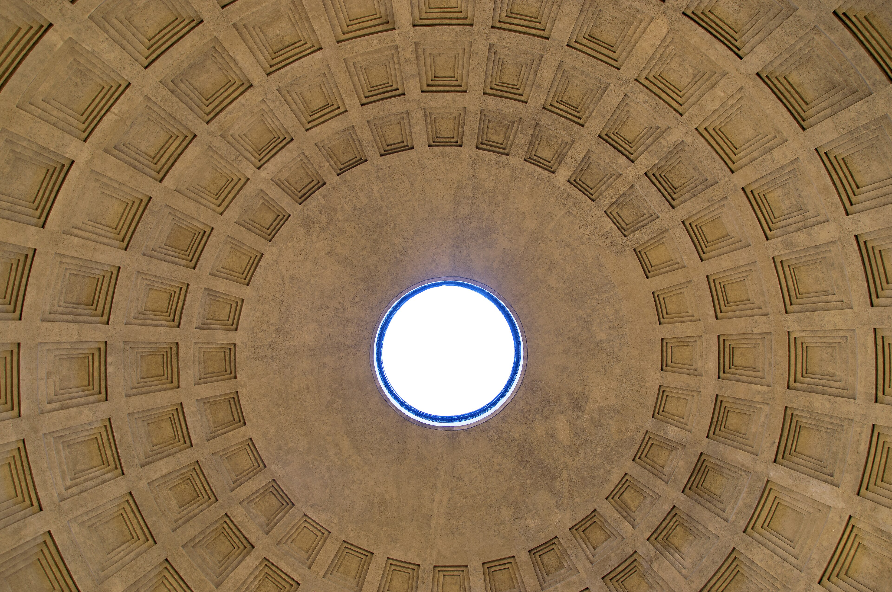

Do you need a ticket for the Pantheon? Yes. Since 1 July 2026 a full ticket costs €7 (it used to be €5), and you buy it for a time slot on the Musei Italiani website or app, or at the Pantheon itself. Under-18s and residents of the Municipality of Rome go in free, and so does everyone on the first Sunday of the month, when you cannot book and simply queue at the entrance. EU citizens aged 18 to 25 pay €2.

The Pantheon is an ancient Roman temple and a working church, the Basilica of Santa Maria ad Martyres, so a visit follows the rules of both a museum and a church. Every price, hour and rule below comes from the official page of the Direzione Musei nazionali della città di Roma, read on 24 November 2026. We have filmed the Pantheon in ten different months of the year.

## How much is a Pantheon ticket?

- Full ticket: €7.00
- Reduced: €2.00 for EU citizens from age 18 up to and including the day of their 25th birthday
- Free: under-18s, residents of the Municipality of Rome, licensed tour guides (with proof of their licence), and everyone on the first Sunday of each month

Other groups may qualify for a reduction or free entry: the Ministry of Culture keeps the [full list of concessions](https://cultura.gov.it/agevolazioni). The price went from €5.00 to €7.00 on 1 July 2026, under an agreement between the Ministry and the Diocese of Rome, and the reductions and free categories stayed as they were. Many older pages still say €5.

## Where to buy Pantheon tickets, and how booking works

*Photo: [Direzione Musei nazionali della città di Roma](https://direzionemuseiroma.cultura.gov.it/en/pantheon/)*

Tickets are sold only through the [Musei Italiani website](https://portale.museiitaliani.it), the Musei Italiani app, the ticket office at the Pantheon (cash or card) and the vending machines on site. The official page warns that tickets from unauthorised resellers may be refused at the door. Online, you register on the portal and choose the date, the time and the ticket type: full, reduced or free, so under-18s and Rome residents can reserve a slot too.

Arrive within your slot. There is no skip-the-line entry at the Pantheon, so a ticket sold as "skip the line" gets you nothing extra. Each month's calendar goes on sale around the middle of the month before: for a visit in January, look from mid-December.

Tickets carry the visitor's name. At the entrance you show the ticket with an identity document, or a copy of one, and the names must match; if they do not, you are refused entry and the ticket is not refunded. Keep the ticket until you leave, because staff can ask to see it inside.

## Pantheon opening hours

The Pantheon is open every day from 9.00 to 19.00. The ticket office closes at 18.00, and the last entry with an individual ticket is at 18.30. Hours can change during religious celebrations, and ticket sales stop one hour before any liturgical service. It is closed on 25 December and 1 January, unless a special opening is announced. The information line is +39 06 68300230, every day from 9.00 to 18.00.

## The free first Sunday

On the first Sunday of each month the Pantheon is free for everyone, and there is no online booking. All visitors, alone or in groups, queue at the entrance to collect a free ticket that carries no name. Expect to wait.

## Mass at the Pantheon

Mass is at 17.00 on Saturdays and on the evenings before holy days, and at 10.30 on Sundays and holidays. Entry for worship is free, and during services only worshippers may come in, so mass is not a way to visit without a ticket. On Saturday afternoons and Sunday mornings, ticket sales stop an hour before the service.

## What to wear and what to leave behind

The dress code is that of a church, and staff can turn away anyone who ignores it: shoulders covered, no shorts or skirts that are too short, no very low necklines and nothing see-through.

Food and drink are not allowed inside, and there is no cloakroom, so travel light. Dogs are not allowed, except guide dogs and service dogs. Phones may be used for photos and videos, not for calls. Visitors with reduced mobility can enter by the ramp on the Via della Minerva side.

**Piazza della Rotonda, 00186 Rome** · [Website](https://direzionemuseiroma.cultura.gov.it/en/pantheon/)

## Is the Pantheon worth it inside?

*Photo: [Livioandronico2013](https://commons.wikimedia.org/wiki/File:Dome_of_Pantheon_(Rome)_-_interior.jpg), CC BY-SA 4.0, via Wikimedia Commons*

For €7, yes. The façade can be seen from Piazza della Rotonda, but the dome and the hall under it need a ticket. Agrippa built the first temple between 27 and 25 BC; the building that stands today is Hadrian's, from 118 to 125 AD, and it became a church in 609, which the official page names as the reason it is the best preserved of the ancient classical buildings.

Inside is a single round hall, 43.30 metres across and as high. A wall more than six metres thick holds up the largest unreinforced dome ever built, open at the top in a circle about nine metres wide, the oculus. At noon the light through it falls on the axis of the door, and rain that comes in drains through 22 holes in the centre of the floor. Seven chapels line the wall, with eight aedicules (small shrines) between them. On the way in you pass the sixteen granite columns of the portico and a door 7.53 metres high, with two bronze leaves of seven tonnes each.

If you would rather see the Pantheon from outside as one stop on a longer route, our [private golf cart tour](/experience/private-golf-cart-tour/) passes it along with the Colosseum, the Trevi Fountain, the Spanish Steps and Piazza Navona. For lunch nearby, see [where to eat near the Pantheon](/journal/where-to-eat-near-the-pantheon). The Trevi Fountain has its own ticket rules, in [do you need a ticket for the Trevi Fountain](/journal/trevi-fountain-ticket-how-it-works), and for the other big sights start with our guide to [visiting the Vatican Museums](/journal/vatican-museums-worth-it-how-to-visit).

## Good to know

### Is the Pantheon free?

For most visitors, no: a full ticket is €7. It is free for under-18s, residents of the Municipality of Rome and licensed tour guides, and for everyone on the first Sunday of the month.

### Is the Pantheon in the Roma Pass?

No. The Pantheon is not part of the Roma Pass or the Omnia card, so you need a Pantheon ticket even if you hold one.

### How long should I spend at the Pantheon?

The official page gives no visit length. Inside there is one round hall with its chapels, so plan around your time slot, which is the part you must keep to, and leave time to look up at the dome.

*Cover photo: [Nicholas Hartmann](https://commons.wikimedia.org/wiki/File:Rome_Pantheon_facade_and_Piazza_della_Rotonda.jpg), CC BY-SA 4.0, via Wikimedia Commons*
