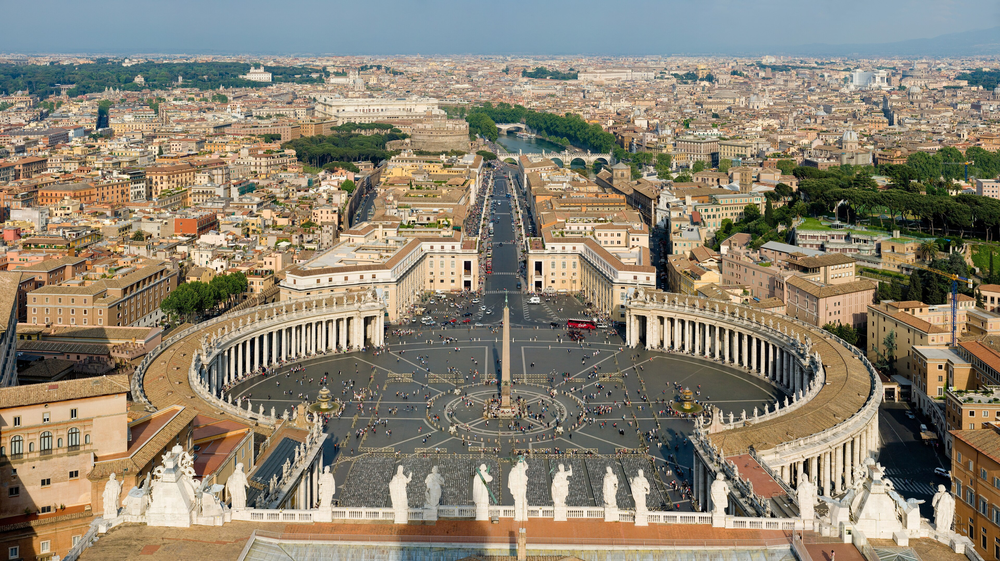

Is St Peter's Basilica worth it? Yes. Its own website calls it the largest church in the world, and inside are Michelangelo's Pietà, Bernini's baldachin and, beneath the dome, the tomb of St Peter. Until 28 March 2027 it is open from 7.00 to 19.00. You go in through the Italian State Police security checks under the right-hand colonnade of St Peter's Square as you face the church, dressed for a place of worship, which means no excessively short clothing, sleeveless tops or hats. The real decision is the dome, which you climb by stairs or take a lift partway up, and which comes with a visit to the Basilica.

The Basilica is a place we have filmed, but every hour and rule below comes from its own website, basilicasanpietro.va, and its booking pages, read in November 2026. It is first of all a church, and the site asks visitors to speak only when they need to, in a low voice, with phones on silent, because many people come to pray or for a celebration.

## Opening hours in winter and summer

From 26 October 2026 to 28 March 2027 the Basilica is open from 7.00 to 19.00; from 1 June to 25 October 2026 it was 7.00 to 20.00. The dome keeps shorter hours: in winter, from 26 October, 7.30 to 17.00, and in summer 7.00 to 18.00.

Guided tours, with a guide from the Fabbrica di San Pietro (the office that looks after the Basilica) or with your own, run from Monday to Saturday between 9.30 and 17.30, with last registration at 17.00. On Sundays and Vatican holidays they run from 13.30 to 15.30, last registration at 15.00.

Worshippers and celebrants have their own entrance gate, and staff walk them along a route kept for prayer and services. To look around afterwards they go back out and come in through the standard entrances. The [opening hours page](https://www.basilicasanpietro.va/en/opening-hours) also lists the hours for confession.

**St Peter's Square, Vatican City** · [Website](https://www.basilicasanpietro.va/en)

## Getting in: the security check

Every visit starts with the Italian State Police checks in the right-hand hemicycle, the curved colonnade on your right as you look at the Basilica. Visitors queue on that same side, where at least four more police gates are available. If you have booked, the visit starts after your QR code is checked and you have been through security, so the Basilica asks you to arrive within your time slot with the security check in mind.

There is no cloakroom at the moment: the booking pages ask you to travel light and bring only a small backpack or bag. Pushchairs can be left in an area under the portico. Visitors with disabilities and pregnant women have a separate entrance with a ramp up to the security checks and into the church.

## Inside the Basilica

The official site sells a timed visit to [the Basilica](https://www.basilicasanpietro.va/en/products/the-basilica) for 1 to 15 people, on the day and at the time you choose. It is what the site calls a "free visit without a guide": you walk round at your own pace with the Digital Audio Guide, from Bernini's baldachin to Michelangelo's Pietà, in about an hour. The audio guide runs on your own smartphone with your own earphones, and the link to start it arrives by email in the 24 hours before your visit. With an 18.00 booking the Grottoes are not open to visitors.

The same page books guided tours in English or Italian and takes requests for other languages.

A booking is in your name and cannot be refunded, transferred or moved to another date. If an extraordinary liturgical celebration or a Holy See event closes the Basilica, you are told within 24 hours of your visit and refunded in full.

## The dome: lift or stairs

*Photo: [Diliff](https://commons.wikimedia.org/wiki/File:St_Peter%27s_Square,_Vatican_City_-_April_2007.jpg), CC BY-SA 3.0, via Wikimedia Commons*

[The dome](https://www.basilicasanpietro.va/en/products/the-dome) is booked in two ways. "Dome with lift" takes you by lift to the terrace level; "Dome with stairs" means climbing 231 steps to get there. From the terrace both continue on foot, 320 more steps to the top, and both include the inner and the outer ring of the dome, with a close view of its mosaics. On the stairs route that comes to 551 steps in all.

Both include a visit to the Basilica with the Digital Audio Guide. The Basilica slot is set one hour before or one hour after your dome time, depending on how busy it is expected to be, and the confirmation email tells you which comes first. Allow about two and a half hours for the whole visit.

Neither option suits wheelchairs, and the site advises against the climb for people with heart conditions, respiratory problems, claustrophobia or vertigo, for pregnant women and for anyone with reduced mobility. During extraordinary celebrations the inner ring may be closed.

## The rules inside

Under the [rules for the common good](https://www.basilicasanpietro.va/en/rules-for-the-common-good), clothing has to suit a place of worship: no excessively short clothing, sleeveless tops or hats. No eating, drinking or smoking, and no pets. Visitors are asked not to take photographs, even for personal use, so as not to disturb celebrations or other visitors, and bulky or professional equipment needs authorisation.

## Good to know

### Is St Peter's Basilica free?

The official website gives no door price and does not say that entry is free. It sells timed visits with the Digital Audio Guide, dome visits and guided tours, and shows the price when you book.

### Do you need to book St Peter's Basilica?

The official site offers timed bookings for the Basilica alone, for the dome with the Basilica, and for guided tours. Booked visitors get QR codes by email, one for each person, to show at the access checks.

### What is the dress code for St Peter's?

Clothing suitable for a place of worship. In the Basilica's own words, that means no excessively short clothing, sleeveless tops or hats.

### Should I see St Peter's or the Vatican Museums first?

The official sites do not recommend an order, but if you do both on the same day, travel light. The [Vatican Museums](/journal/vatican-museums-worth-it-how-to-visit) ask visitors who are going on to the Basilica not to leave their bags in the museums' cloakroom, and the Basilica has no cloakroom at the moment. If you would like a guide just for your group in the Museums and the Sistine Chapel before you cross to St Peter's, we arrange a [private Vatican Museums tour](/experience/private-vatican-museums-tour/).

*Cover photo: [NateBergin](https://commons.wikimedia.org/wiki/File:01_St_Peter%27s_Basilica_Facade.jpg), CC BY 4.0, via Wikimedia Commons*
