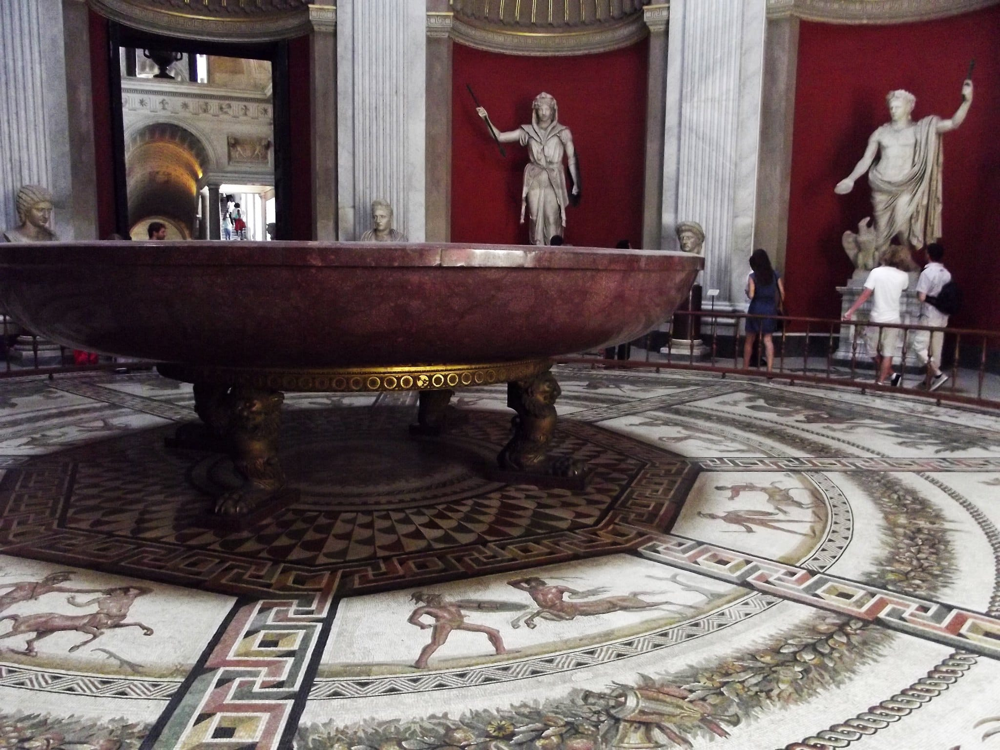
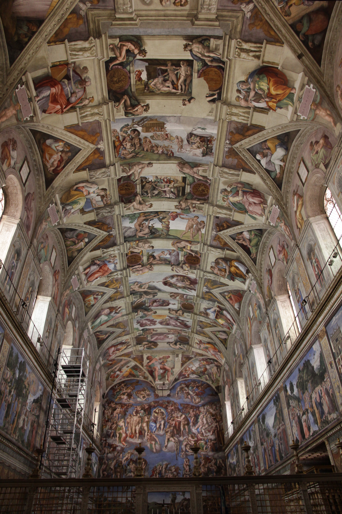

Are the Vatican Museums worth it? Yes, if you want to see the Sistine Chapel and the popes' collections, from ancient sculpture and the Egyptian and Etruscan museums to Raphael's Rooms and the Pinacoteca, and you can go on a day from Monday to Saturday. You could skip them if the only day you have is a Sunday other than the last one of the month, when they are closed, or if a long day indoors in busy galleries is not what you came to Rome for. What decides how the visit goes is the ticket: book it ahead on the museums' own site, tickets.museivaticani.va, and nowhere else.

One entry ticket covers the museums and the Sistine Chapel. The museums themselves note that air-conditioning is limited in some of the busiest areas, especially in summer. Every hour, price and rule below comes from their website, museivaticani.va, read in November 2026; they change during the year, so open the page linked in each section the week you go.

## When to go: opening days and hours

From Monday to Saturday the museums open at 8.00 and close at 20.00, with final entry at 18.00, and visitors have to leave the halls by 19.30. On Sundays they are closed, except on the last Sunday of the month, when they open from 9.00 to 14.00, with final entry at 12.30, and entry is free. That free Sunday does not happen when the last Sunday falls on Easter Sunday, 29 June, or 25, 26 or 31 December.

The [closures page](https://www.museivaticani.va/content/museivaticani/en/info/orari-musei-vaticani.html) also lists these days off: 1 and 6 January, 11 February, 19 March, 6 April, 1 May, 29 June, 14 and 15 August, 1 November, and 8, 25 and 26 December. Below that list is a table of temporary closures, and the page links a 2026–2027 openings and closures calendar as a PDF. Some evenings a single sector, the Sistine Chapel included, closes early, so check both.

On a wet day they can fill a whole morning, and they come first in our list of [what to do in Rome when it rains](/journal/what-to-do-in-rome-when-it-rains).

**Viale Vaticano, 00165 Rome** · [Website](https://www.museivaticani.va/content/museivaticani/en.html)

## Tickets: prices and the one official site

On the [prices page](https://www.museivaticani.va/content/museivaticani/en/organizza-visita/tariffe-e-biglietti.html), a full ticket costs 20 euros without online booking, or 20 euros plus 5 with the "Skip the Line" booking on the official website. The reduced ticket is 10 euros, or 10 plus 5 booked online, for children aged 7 to 18; individual priests, men and women religious, seminarians and novices with valid documents; and employees, serving or retired, of the Holy See or Vatican City State. Students up to and including 25, with a document confirming enrolment for the current year, also pay 10 euros, or 10 plus 5.

Children under 7 go in free, and so do disabled visitors with a certified invalidity of at least 67%, with a companion if they are not self-sufficient. Free tickets for disabled visitors and their companions cannot be booked online; the Special Permits and Welcome Desk desks in the entrance hall issue them on showing the certificate.

A ticket is valid only on the day it is issued, and it cannot be refunded. The museums say the only official site for buying tickets online is tickets.museivaticani.va, and they warn about sites with domains that look like the official one and may charge much higher prices. Before you pay, look at the address bar.

## At the door: what to wear, bags and the security check

The [visitor information page](https://www.museivaticani.va/content/museivaticani/en/organizza-visita/consigli-utili.html) admits only visitors who are appropriately dressed: sleeveless or low-cut clothes, shorts above the knee, miniskirts and hats are not allowed.

Everyone goes through a metal detector, and the museums ask you to take anything not allowed out of your hand luggage beforehand. Suitcases, rucksacks and anything staff consider too big go to the free cloakroom, together with medium and large umbrellas, tripods, video cameras, knives, scissors and metal tools. If you are going on to St Peter's afterwards, the museums ask you not to leave your bags in their cloakroom.

Selfie sticks are forbidden, and you cannot eat or drink in the exhibition halls.

## The Sistine Chapel

*Photo: [Jörg Bittner Unna](https://commons.wikimedia.org/wiki/File:%27Sistine_Chapel_ceiling%27_by_Michelangelo_JBU21.JPG), CC BY 3.0, via Wikimedia Commons*

The rules in the chapel are stricter than in the rest of the museums. Photos and filming are forbidden with any kind of device, and the guards can ask you to delete on the spot anything you have recorded. Mobile phones cannot be used, and visitors are asked to keep absolute silence out of respect for the place.

Because of that silence, guides give their groups the explanation before they go in. For visitors on their own, the museums have information panels on the chapel in the Courtyard of the Pinecone and the Square Garden. Read them first: inside, nobody will explain what you are looking at.

## What a guided visit adds

You do not need a guide: the museums publish an official map to download before you go or open from a QR code inside.

A guide adds the explanation, given before the chapel where talking is allowed, and someone to choose the route for you. Amplified microphones are not allowed, so groups of 11 or more have to hire radio headsets inside. On the free last Sunday, guided tours are possible on reservation.

If you would rather go with a guide who sorts out the tickets and explains the Sistine Chapel before you go in, we run a [guided visit of the Vatican Museums and the Sistine Chapel](/experience/vatican-museums-basilica).

## Good to know

### How long should I allow for the Vatican Museums?

The museums do not give a visiting time. From Monday to Saturday the final entry is at 18.00 and the halls empty at 19.30, so arriving at the last entry leaves you an hour and a half; on the free Sunday the final entry is at 12.30 and you are out by 13.30.

### Is the free last Sunday of the month worth it?

It costs nothing, but the day is shorter, with final entry at 12.30, so you have less time inside. Check the calendar first: there is no free Sunday when the last Sunday is Easter or one of the holidays listed above.

### Can you take photos in the Sistine Chapel?

No. Photos, filming and mobile phones are forbidden in the chapel. Everywhere else in the museums you can take photos without flash, for personal use.

### What should I wear to the Vatican Museums?

Nothing sleeveless or low-cut, no shorts above the knee, no miniskirts and no hats.

*Cover photo: [Wilfredor](https://commons.wikimedia.org/wiki/File:Circular_staircase_of_the_Vatican_Museums_02.jpg), CC0, via Wikimedia Commons*
