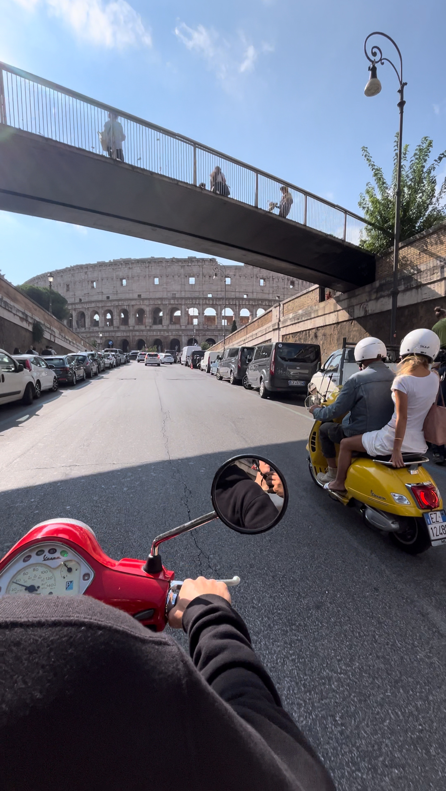
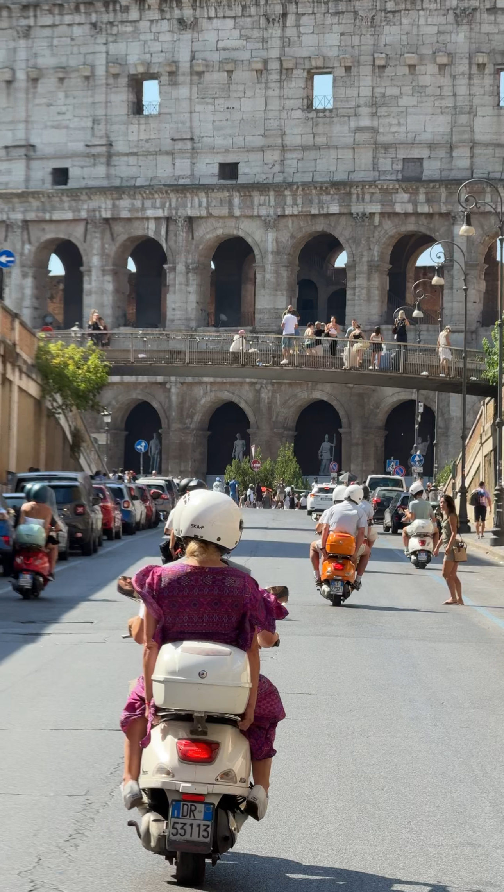
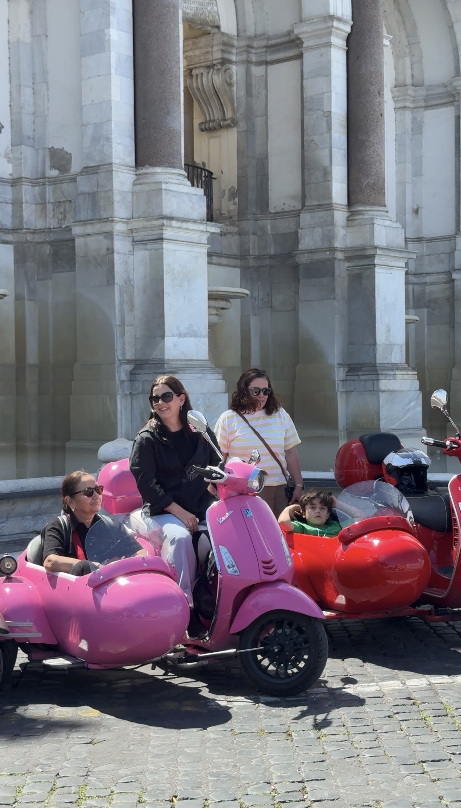

Is a Vespa tour in Rome worth it? Yes, if you want to see a good stretch of the city in an hour and a half without driving in Roman traffic yourself. It is not the right choice for toddlers, children under 8, pregnant women or wheelchair users: the tour page says it is not suitable for them. Our Vespa tour lasts 90 minutes and costs from €90 per person; a local guide drives, so you need no licence of any kind, and the route runs from the Colosseum past the Circus Maximus to the Orange Garden and the Gianicolo, with a drop-off at Piazza Navona.

You ride on the back seat while the guide deals with the traffic and tells you about what you are passing. Entry tickets are not among what the tour includes, so you see the monuments from the road. If going inside the Colosseum is part of your plan, book that as a separate visit: our guide to [Colosseum tickets](/journal/colosseum-worth-it-how-to-get-tickets/) explains how.

## What the Vespa tour covers

You meet at Via Cavour 207, 00184 Rome, and ride a classic Vespa with an experienced local guide at the handlebars. The route runs Colosseum, Circus Maximus, Orange Garden, Gianicolo Hill and Fontana dell'Acqua Paola, then Piazza Navona, where the ride ends. Halfway through there is a stop for a tiramisu tasting, which is included. The Pantheon and Piazza Venezia can be added on request, traffic permitting.

The tour runs in English, Italian and Russian, and you get a refund if you cancel at least 2 days before. Dates and booking are on the [Vespa tour](/experience/vespa-tour/) page.

## Colosseum and Circus Maximus

The ride opens with ancient Rome, the Colosseum first and then the Circus Maximus, before heading up the Aventine to the Orange Garden. The Colosseum is a place we have filmed.

## Orange Garden

The Orange Garden, also called Parco Savello, is a small walled garden on the Aventine Hill, laid out in 1932 inside the walls of a medieval fortress of the Savelli family. Its belvedere looks over the bend of the Tiber as far as St Peter's Basilica. The orange trees recall Saint Dominic, who founded the convent of Santa Sabina next door in the thirteenth century. It is a place we have filmed.

## Gianicolo and Fontana dell'Acqua Paola

From the Aventine the route crosses the Tiber and climbs the Gianicolo, the hill whose promenade, in the words of Rome's tourist board, gives "one of the most evocative views of the historic centre". On the hill stands the Fontana dell'Acqua Paola, known as il Fontanone, built between 1610 and 1614 for Pope Paul V to mark the end of an aqueduct. It has five archways, some of its marble was taken from the Roman Forum, and it looks out from a large terrace over the city.

## Tiramisu and Piazza Navona

The tasting stop is Two Sizes, Piazza Navona, for tiramisu. At the end the guide drops you at Piazza Navona, so you finish in the historic centre and can carry on from there on foot.

## Who it suits, and who it does not

It suits visitors who want to see several parts of Rome in one short outing, couples, and anyone who likes the idea of a Vespa but has no licence or no wish to drive in the city.

The tour page is clear about who should not book: it is not suitable for pregnant women, wheelchair users or toddlers, and the minimum age is 8.

## Renting a scooter yourself instead

Renting a Vespa and riding it yourself is a different trip. You drive, you find your way through Roman traffic, and you need a licence valid for the vehicle you rent. Driver and passenger must both wear a helmet, fastened and EU-approved: the Polizia di Stato puts the fine for breaking that rule (article 171 of the Highway Code) at €83 to €333. Mopeds and motorcycles may enter and park in the limited-traffic zone ZTL A1 Tridente only with an authorisation, according to Roma Mobilità, the city's mobility agency.

On our tour the guide drives and tells the stories, and you need no licence. If you are a confident rider who wants your own route and your own hours, renting may suit you better. If you would rather look at Rome than at the road, the guided ride is the easier choice.

## The Vespa sidecar tour

The sidecar tour is the longer version: 3 hours, from €140 per person, in a classic Vespa sidecar with a local guide who is also your driver. The route runs Colosseum, Castel Sant'Angelo, St Peter's Square and Fontana dell'Acqua Paola, and ends at the Pantheon with gelato. Pickup and drop-off are at your location.

If three hours suit you better than ninety minutes, and you want St Peter's Square on the way, the [sidecar tour](/experience/vespa-sidecar-tour/) is the one to look at. It ends at the Pantheon, and if you are staying on for a meal, our guide to [lunch near the Pantheon](/journal/where-to-eat-near-the-pantheon/) starts from there.

## Good to know

### How much does a Vespa tour in Rome cost?

Our Vespa tour costs from €90 per person for 90 minutes. The sidecar tour costs from €140 per person for 3 hours.

### Can you do a Vespa tour in Rome at sunset?

The tour page gives no fixed departure time, so we cannot promise a sunset ride. The route does climb to the Gianicolo, one of the viewpoints over the centre.

### Can children come on a Vespa tour in Rome?

Yes, from the age of 8. The tour is not suitable for toddlers.

### Is it the Roman Holiday route?

No. Our route is its own: Colosseum, Circus Maximus, Orange Garden, Gianicolo Hill and Fontana dell'Acqua Paola, ending at Piazza Navona.

### What if I need to cancel?

Both tours give a refund if you cancel at least 2 days before.

If the ride sounds right for your trip, everything above is on the [Vespa tour](/experience/vespa-tour/) page, where you can check availability.
