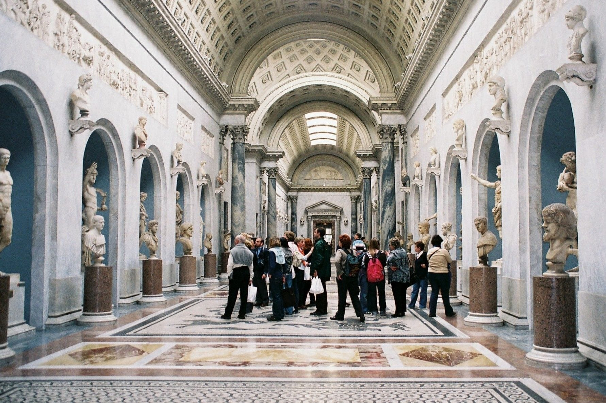
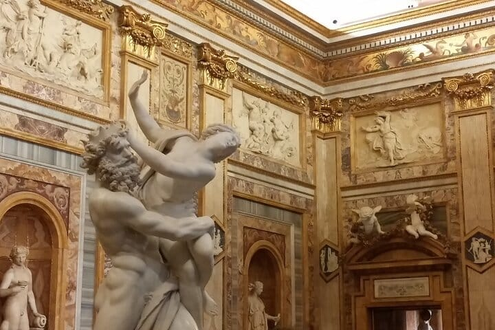
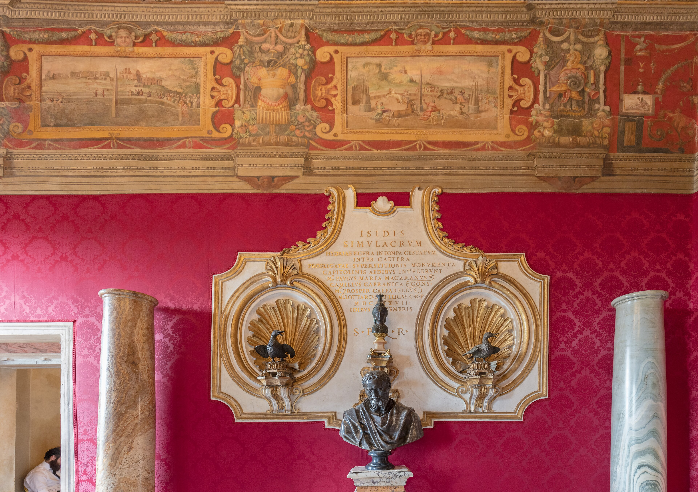
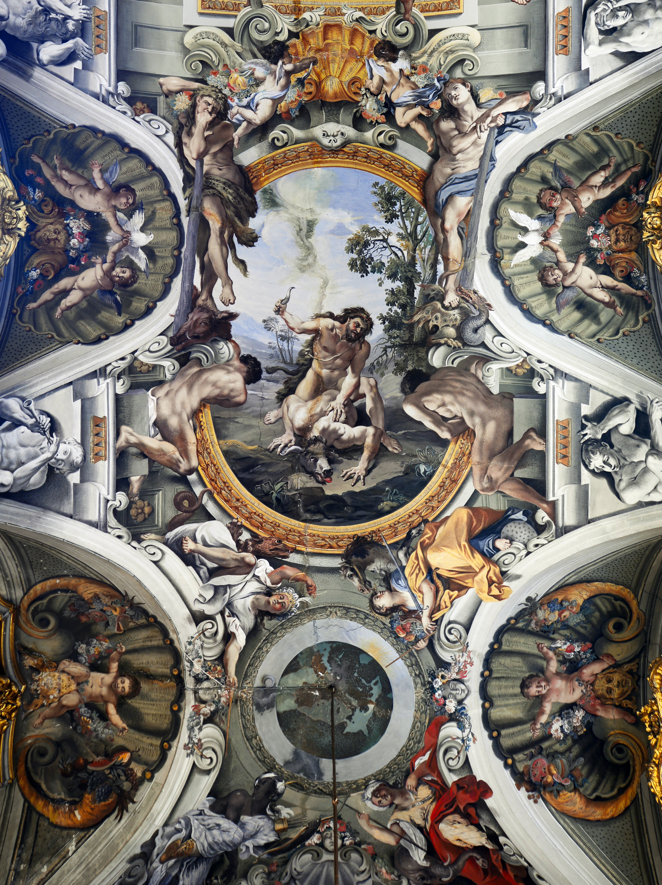
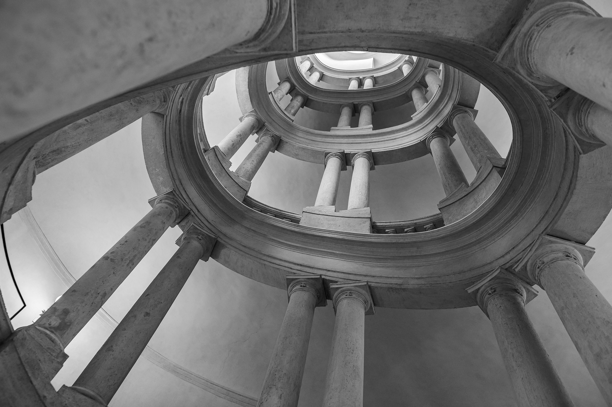
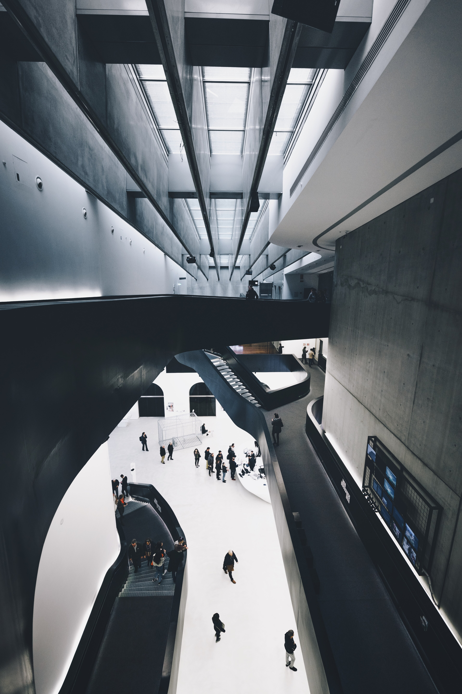
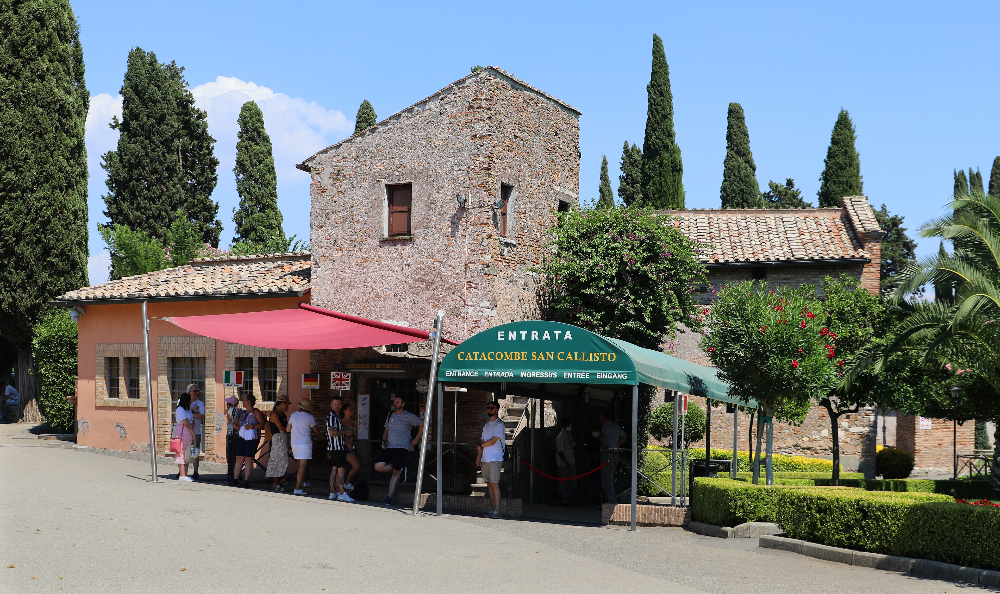

When it rains in Rome, go indoors to places that can fill a whole morning: the Vatican Museums, the Galleria Borghese, the Musei Capitolini, the Galleria Doria Pamphilj, Palazzo Barberini, MAXXI and, underground on the Appian Way, the Catacombs of San Callisto. The one rule that saves the day is to check the closed day before you set off: Monday for the Borghese, Palazzo Barberini and MAXXI, Wednesday for the Doria Pamphilj and San Callisto, and most Sundays for the Vatican.

The opening days, hours and booking rules below come from each venue's own website. Three of the seven will not let you in without a reservation, so book before you leave the hotel.

## Which places are open on a Monday, and on a Wednesday

On a Monday, four of the seven are open: the Vatican Museums, the Musei Capitolini, the Galleria Doria Pamphilj and the Catacombs of San Callisto. The Galleria Borghese, Palazzo Barberini and MAXXI are closed.

On a Wednesday the Doria Pamphilj and San Callisto are closed, and the other five are open.

On a Sunday the Vatican Museums are closed except on the last Sunday of the month. Everything else on this list is open.

## Vatican Museums

The popes' collections fill a small city of rooms, from the Gregorian Egyptian and Etruscan museums to the Pio Clementino and the Pinacoteca, with the Sistine Chapel on the way. A rainy day is not long enough for all of it.

It is open Monday to Saturday from 8.00 to 20.00, with final entry at 18.00, and visitors must leave the halls half an hour before closing. On Sundays it is closed, except on the last Sunday of the month, when it opens from 9.00 to 14.00 (final entry 12.30) with free entry. Between November and March it is also closed on 8, 25 and 26 December, 1 and 6 January, 11 February and 19 March (and, in 2027, on Easter Monday, 29 March), and on 24 and 31 December it closes at 15.00, with last entry at 13.00.

**Viale Vaticano, 00165 Rome** · [Website](https://www.museivaticani.va/content/museivaticani/en.html)

## Galleria Borghese

The Borghese collection is still in the villa built for it, inside the park: Bernini's marble groups, Caravaggio's paintings and Canova's Paolina, in rooms small enough to see properly in one visit.

Booking is mandatory for every ticket, free ones included, with a booking fee of 2 euros. Visitors go in only at the start of each hour, and each visit lasts two hours. The gallery is open Tuesday to Sunday from 9.00 to 19.00, with last entry at 17.45, and is closed on Mondays, 25 December and 1 January.

If you would rather have the tickets reserved for you and a guide to the Berninis and the Caravaggios, we run a [Borghese tour for six people at a time](/experience/borghese-gallery-tour).

**Piazzale Scipione Borghese 5, 00197 Rome** · [Website](https://galleriaborghese.cultura.gov.it/)

## Musei Capitolini

*Photo: [Diego Delso](https://commons.wikimedia.org/wiki/File:Museos_Capitolinos,_Roma,_Italia,_2022-09-16,_DD_53.jpg), CC BY-SA 4.0, via Wikimedia Commons*

The city's own museum fills the palaces on Piazza del Campidoglio and keeps the bronze Capitoline Wolf among its ancient sculpture. For a wet day its best feature is the calendar: it is open every day from 9.30 to 19.30, with last admission an hour before closing.

It closes only on 1 May and 25 December, and on 24 and 31 December it is open from 9.30 to 14.00.

**Piazza del Campidoglio 1, 00186 Rome** · [Website](https://www.museicapitolini.org/en)

## Galleria Doria Pamphilj

*Photo: [Livioandronico2013](https://commons.wikimedia.org/wiki/File:Ceiling_of_the_Hall_of_Mirrors_in_Galleria_Doria_Pamphilj_(Roma).jpg), CC BY-SA 4.0, via Wikimedia Commons*

A family collection still hanging in the family palace on Via del Corso, a few metres from Piazza Venezia. Most people come for Velázquez's portrait of Pope Innocent X Pamphilj, and there are works by Caravaggio and Bernini too.

No one is let in without a reservation. It is open Monday, Tuesday and Thursday from 9.00 to 19.00 (last entrance 18.00) and Friday to Sunday from 10.00 to 20.00 (last entrance 19.00). It is closed every Wednesday, and on 1 January, Easter and 25 December.

The Trevi Fountain is a short walk away, if you want lunch first: we have a list of [where to eat near the Trevi Fountain](/journal/where-to-eat-near-trevi-fountain).

**Via del Corso 305, Rome** · [Website](https://www.doriapamphilj.it/en/rome/your-visit/)

## Palazzo Barberini

*Photo: [ALESSIOTERZO](https://commons.wikimedia.org/wiki/File:Roma_-_Palazzo_Barberini_-_Scala_elicoidale.jpg), CC BY-SA 4.0, via Wikimedia Commons*

The Barberini family palace is one of the two homes of the Gallerie Nazionali di Arte Antica, with paintings from the Renaissance to the Baroque, Caravaggio, Raphael and Guido Reni among them. Look up as you go, at the painted ceilings and at Borromini's oval staircase.

It is open Tuesday to Sunday from 10.00 to 19.00, and closed on Mondays.

**Via delle Quattro Fontane 13, Rome** · [Website](https://www.barberinicorsini.org/en/)

## MAXXI

*Photo: [Alessio Lin lin_alessio](https://commons.wikimedia.org/wiki/File:MAXXI_Museo_nazionale_delle_arti_del_XXI_secolo,_Roma,_Italy_(Unsplash).jpg), CC0, via Wikimedia Commons*

The national museum of twenty-first-century art and architecture, in Flaminio, in a building by Zaha Hadid whose black stairways cross the atrium overhead.

Sophie Calle's "Matrimoni, Rotture e Funerali inclusi" and Tatiana Bilbao Estudio's "Campo aperto" run until 7 February 2027. From 13 November 2026 two more shows open: Gordon Matta-Clark, "Not the Work... The Worker", until 28 February 2027, and Shirin Neshat, "Do U Dare!", until 10 January 2027.

It is open Tuesday to Sunday from 11.00 to 19.00, and closed on Mondays.

**Via Guido Reni 4A, Rome** · [Website](https://www.maxxi.art/en/)

## Catacombs of San Callisto

*Photo: [Sailko](https://commons.wikimedia.org/wiki/File:Catacombe_di_san_callisto,_ingresso.jpg), CC BY 3.0, via Wikimedia Commons*

In the third century this was the official cemetery of the Church of Rome: around half a million Christians were buried here, many martyrs and sixteen popes among them. The visit is underground, so the weather stops mattering once you are inside, although the Via Appia Antica is a bus ride out.

Visits are guided only, for groups of at least two people, start every 30 minutes and last around 40 minutes, and an online reservation is required. The catacombs are open Monday, Tuesday and Thursday to Sunday, from 9.00 to 12.00 and 14.00 to 17.00, with the last tours starting at 12.00 and 17.00. They are closed every Wednesday, on 1 January, at Easter and on 25 December, and this winter from 13 January to 10 February 2027.

**Via Appia Antica 110, 00179 Rome** · [Website](https://www.catacombesancallisto.it/en/)

## Good to know

### Which Rome museums are open on Mondays?

Of these seven, the Vatican Museums, the Musei Capitolini, the Galleria Doria Pamphilj and the Catacombs of San Callisto.

### Are the Vatican Museums open on Sundays?

Only on the last Sunday of the month, from 9.00 to 14.00, with free entry, unless that Sunday is Easter Sunday or 25, 26 or 31 December.

### Do I need to book the Galleria Borghese in advance?

Yes. Every ticket has to be booked, free ones included, with a 2 euro booking fee, and you go in at the start of your hour. The Doria Pamphilj and San Callisto also need a reservation.

### What is closed over Christmas and New Year?

The Vatican Museums close on 8, 25 and 26 December and on 1 and 6 January. The Borghese, the Doria Pamphilj and San Callisto close on 25 December and 1 January, and the Musei Capitolini on 25 December, with short hours on 24 and 31 December. Check Palazzo Barberini and MAXXI on their websites.

*Cover photo: [Berlinuno](https://commons.wikimedia.org/wiki/File:Pantheon,_Rome_a_rainy_day.jpg), CC BY-SA 4.0, via Wikimedia Commons*
