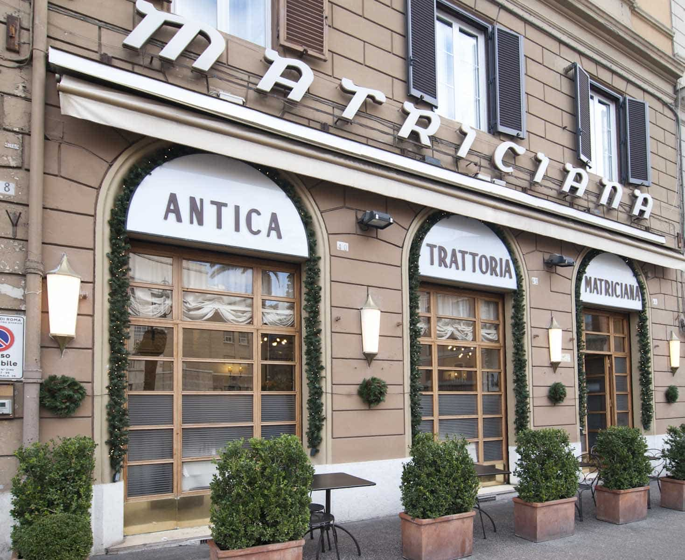
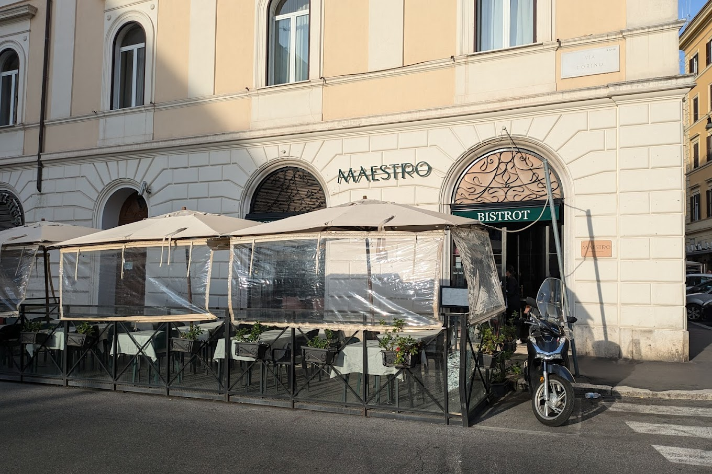
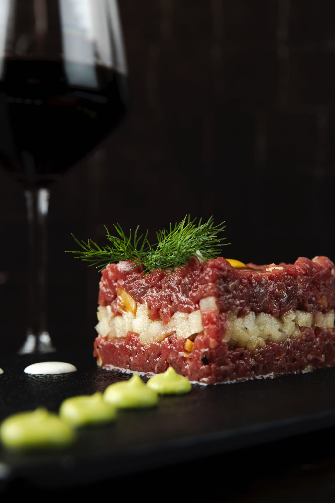
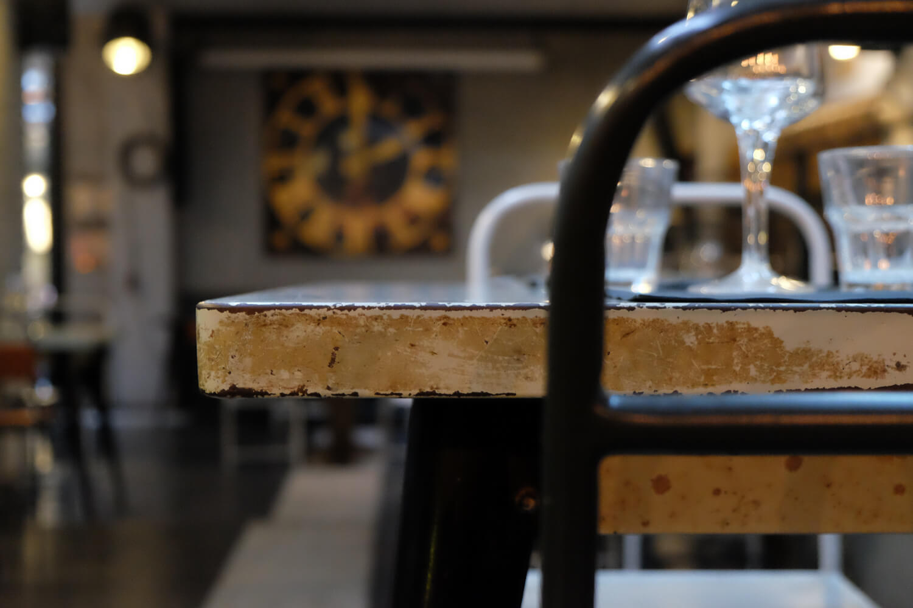
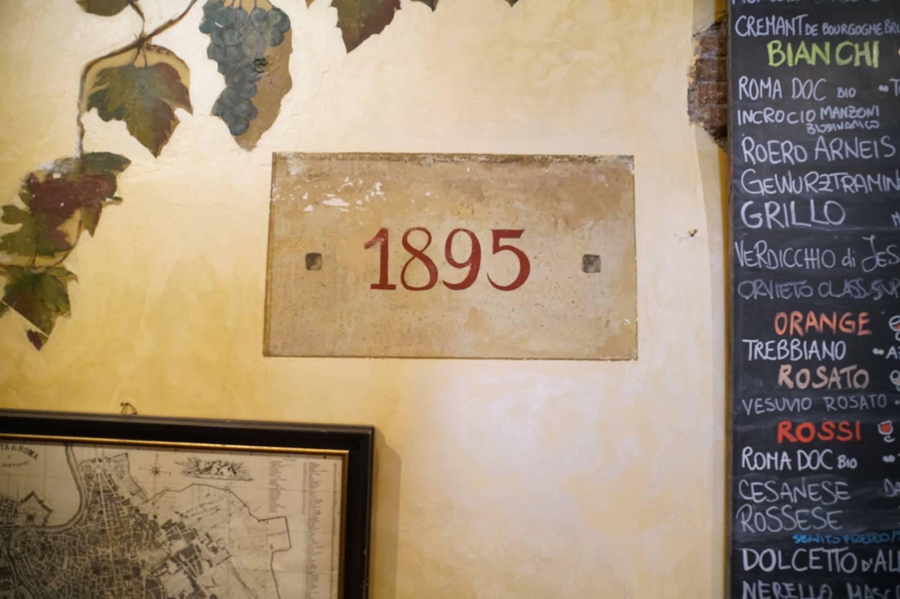
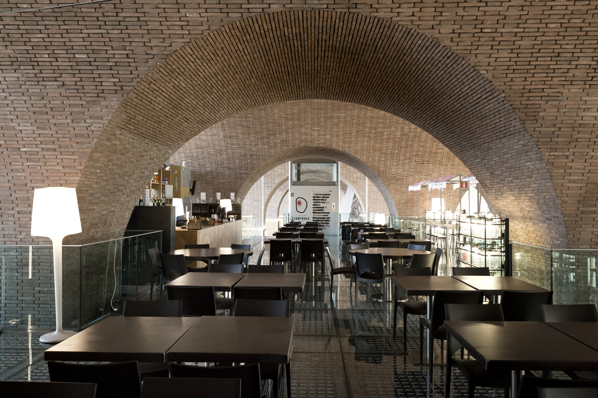

If you are wondering where to eat before the opera in Rome, the six places below are between one and twelve minutes on foot from the Teatro dell'Opera, the Teatro Costanzi on Piazza Beniamino Gigli. For an 8pm curtain, either sit down at about half past six somewhere that serves dinner early, or have something light beforehand and keep dinner for after the show, at a place that stays open late.

Not every evening starts at eight, so check the time on your ticket before you book a table, and leave time to be seated: once the performance has started, latecomers wait in the foyer. Start times and the theatre's other rules are at the end of this article.

We checked every address, opening day and closing day on each place's own website this week, and the curtain times and house rules on the theatre's own site, operaroma.it. Walking times come from OpenStreetMap at an ordinary pace.

## La Matriciana

The oldest choice, and directly across the road from the theatre: a trattoria opened in 1870. It became a meeting place for artists when the Teatro Costanzi opened opposite in 1880, and the house lists Maria Callas, Mario Del Monaco, Carla Fracci and Franco Zeffirelli among the people it fed after a performance. The room still has its old shop windows and furniture, and a telephone booth from the 1930s.

The menu is Roman: bucatini alla matriciana, the dish in the name, the gricia that the house calls "la Matriciana in bianco", abbacchio (roast milk-fed lamb), coda alla vaccinara (oxtail stew) and saltimbocca.

Open Sunday to Friday, from a quarter past twelve to 3 and from a quarter past seven to 11 at night. Closed on Saturdays. Dinner starts too close to an 8pm curtain to be comfortable, so keep it for lunch on the day, or for dinner after a Sunday afternoon performance. Bookings open 15 days ahead.

**Via del Viminale 44, 00184 Rome** · [Website](https://www.lamatriciana.it/)

## Maestro Bistrot & Cocktail Bar

*Photo: [Maestro Bistrot & Cocktail Bar](https://www.maestrobistrot.it/)*

A bistro and cocktail bar on Via del Viminale, a minute from the theatre. The kitchen does the Roman pastas (amatriciana, carbonara, cacio e pepe) alongside lasagne, burgers made in-house, salads and meat and fish mains, and all the fresh pasta is made on the premises.

It has the longest hours on this list: every day from half past eleven in the morning to half past one at night. The website does not say when the kitchen stops serving, so if you want to eat after the show, ring first on +39 06 3973 4733.

**Via del Viminale 23, 00184 Rome** · [Website](https://www.maestrobistrot.it/)

## Ristorante Strega

*Photo: [Ristorante Strega](https://www.ristorantestrega.it/)*

On Piazza del Viminale, about three minutes from the theatre, Strega is a restaurant and pizzeria. There are the Roman pastas (cacio e pepe, rigatoni alla carbonara, gricia, amatriciana), Roman pizza from a wood-fired oven, low and crisp, and a heated terrace.

Dinner starts at half past six every day, which makes this the easiest sit-down dinner on the list before an 8pm curtain. Lunch is from noon to a quarter past three, every day except Saturday, when it opens for dinner only. Dinner ends at half past ten, so it is not one for after the show.

**Piazza del Viminale 27/31, 00184 Rome** · [Website](https://www.ristorantestrega.it/)

## Urbana 47

*Photo: [Urbana 47](https://urbana47.com/restaurant/)*

A restaurant in Monti, about nine minutes on foot, open since 26 January 2008 and cooking from small producers and the seasons. The menu runs from supplì and amatriciana cooked in an iron pan to cacio e pepe, carbonara, pizza and several vegetarian dishes. The room mixes recovered furniture and pieces made by Roman craftsmen, with an open kitchen.

The menu is served from noon onwards, so an early dinner is not a problem. Closed on Tuesdays. The site does not give a clear closing time, so ring 06 4788 4006 if you are coming late.

**Via Urbana 47, 00184 Rome** · [Website](https://urbana47.com/)

## Ai Tre Scalini

*Photo: [Ai Tre Scalini](https://www.aitrescalini.org/)*

A bottiglieria (an old-style wine bar) on Via Panisperna, about eleven minutes away in Monti, whose records go back at least to 1895. A Virginia creeper frames the front, and inside there are paintings on wood from the early 1900s by painters known for decorating the churches of the neighbourhood. The music goes from jazz to stornelli, the old Roman street songs.

Open every day from midday to midnight (a notice on the same site gives half past twelve to 1am). It does not take bookings and may struggle with groups of more than six. Its website does not list the food, so count on it for a glass of wine after the show rather than for dinner.

**Via Panisperna 251, 00184 Rome** · [Website](https://www.aitrescalini.org/)

## Mercato Centrale Roma

*Photo: [Mercato Centrale Roma](https://www.mercatocentrale.it/roma/)*

A food hall next to Termini station, on Via Giolitti, about twelve minutes from the theatre. Among its counters are mozzarella and cheese from Daniele Meini, smashburgers from Joe Bastianich, Argentine empanadas, wine by the glass at Vinario4 and beer at the Baffo Moretti birreria.

Open every day from half past seven in the morning to half past eleven at night, so it works before an early curtain and for something quick after the show.

**Via Giovanni Giolitti 36, 00185 Rome** · [Website](https://www.mercatocentrale.it/roma/)

If the opera is one evening of a longer stay and you would like the tables, tickets and walks fitted together for you, we can plan a [bespoke itinerary](/bespoke-itinerary) around your days in Rome. For a drink after the show, our [night bars](/journal/night-bars) list starts in Monti, next to the theatre.

## Good to know

### What time does the opera start in Rome?

At the Teatro Costanzi most weekday evening performances start at 20:00, some first nights at 19:00, many Saturday performances at 18:00 and most Sunday ones at 16:30. The time for each date is on the performance's page at operaroma.it.

### What happens if I arrive late?

Once the performance has started you cannot take your seat in the stalls or a numbered seat in the gallery or balcony. Latecomers wait in the foyer.

### Is there a dress code at the Teatro dell'Opera?

The theatre asks for evening dress on opening nights and premieres. Its rules say nothing about dress for other performances.

### Can I eat inside the theatre?

Food and drink are allowed only in the theatre's bar areas.

### Where can I eat after the opera?

The Mercato Centrale is open until half past eleven and Ai Tre Scalini until midnight. Maestro Bistrot stays open until half past one, but ring to ask how late the kitchen serves.

*Cover photo: [Carlo Dani](https://commons.wikimedia.org/wiki/File:Teatro_dell%27opera_di_Roma_2016.jpeg), CC BY-SA 4.0, via Wikimedia Commons*
