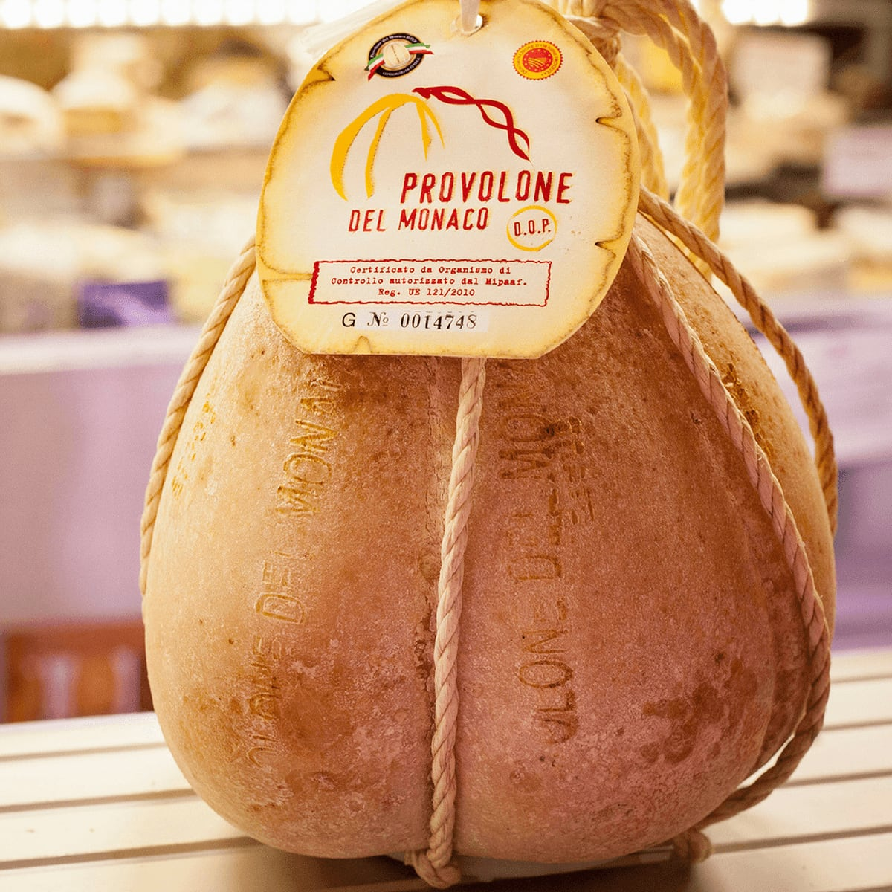
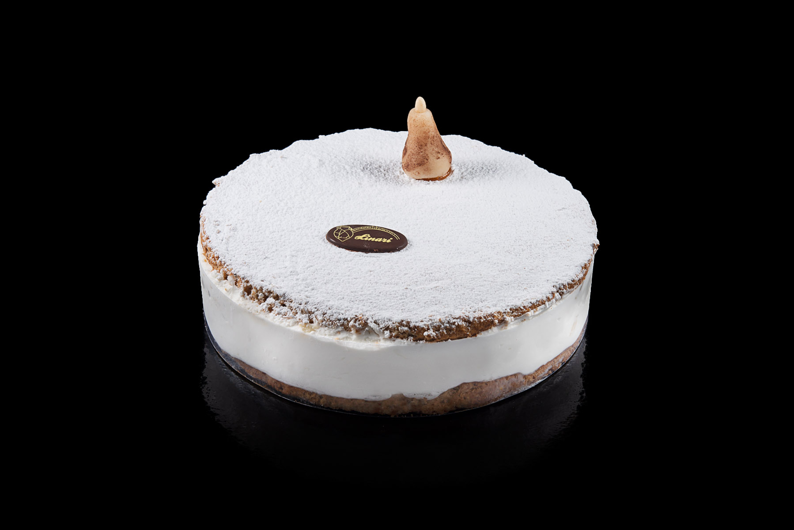
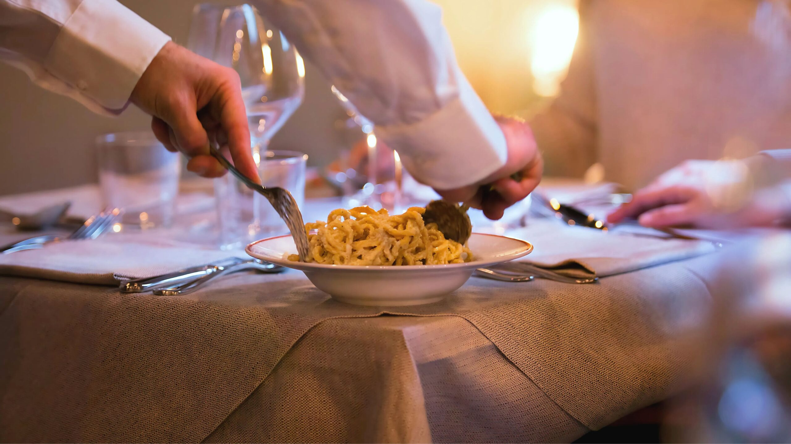
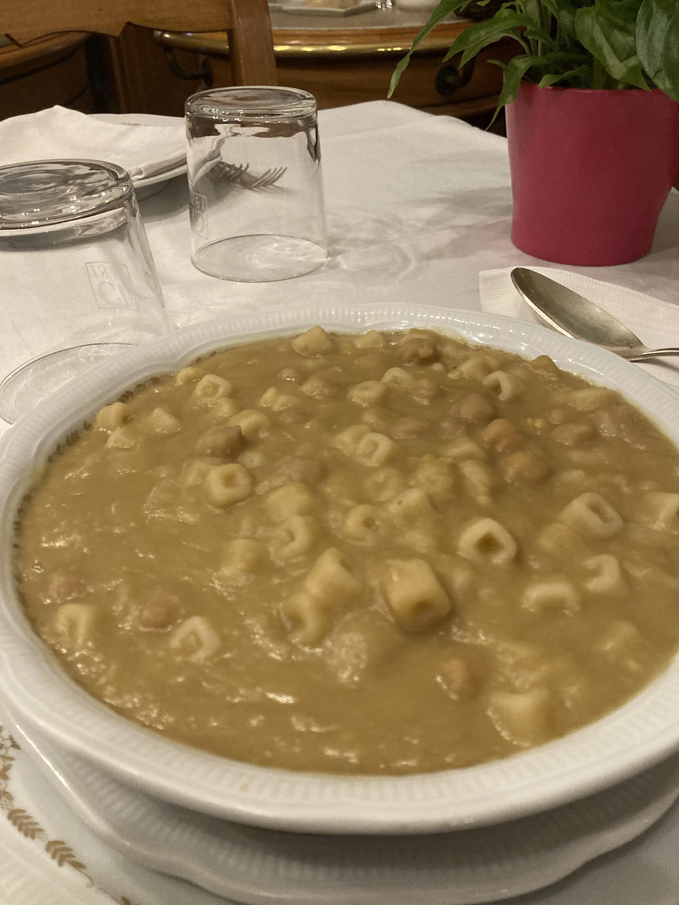
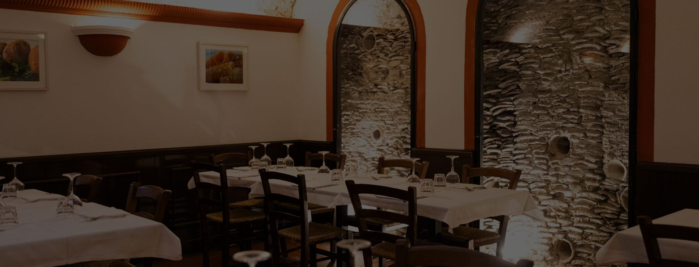

For where to eat in Testaccio, start with the Mercato di Testaccio for lunch at a market stall, Salumeria Volpetti for cheese and cured meats and Pasticceria Linari for pastry, then sit down at Felice a Testaccio, Checchino dal 1887 or Flavio al Velavevodetto. On Sunday the market and Volpetti are closed; Checchino closes on Monday and Tuesday, and Linari at half past one on Tuesday. Felice is booked online and does not accept cancellations by phone, email or social media.

Testaccio was home to the city slaughterhouse, the Mattatoio, whose workers were partly paid in what was left once the four prime quarters of the animal had been divided: head, tail, feet and offal. Cooking those cuts became the Roman cucina del quinto quarto, the "fifth quarter", and two of the trattorie below still build their menus on it. Both stand at the foot of the Monte dei Cocci, a hill of broken Roman amphorae.

We took every address, opening day and booking rule below from each place's own website this week.

## Mercato di Testaccio

The neighbourhood's covered market, designed by the architect Marco Rietti, is open on all four sides like the old markets in Rome's squares. Its website counts about a hundred stalls: fruit and vegetables, meat, fish, groceries, street food, clothes and household goods.

For lunch, the market's own pages describe two street-food stalls. At Mordi e Vai (box 15), Sergio Esposito dips soft ciabatta in broth and fills it with Roman dishes from his mother's recipes, among them boiled beef, picchiapò (boiled beef cooked again with tomato), tripe and meatballs. CasaManco (box 22) bakes pizza alla pala, the long pizza slid into the oven on a wooden peel, from a dough left to rise for 72 hours. Under the market lies a Roman storehouse that still holds hundreds of amphorae, but visits are suspended while the rooms are restored.

Open Monday to Saturday, from 7.00 to 15.30. The website says nothing about Sunday.

**Entrances on Via Beniamino Franklin, Via Alessandro Volta, Via Aldo Manuzio and Via Lorenzo Ghiberti, 00153 Rome** · [Website](https://www.mercatoditestaccio.it/)

## Salumeria Volpetti

*Photo: [Salumeria Volpetti](https://www.volpetti.com/)*

A salumeria, a shop for cured meats and cheese, in business since 1973. The shop on Via Marmorata sells salumi, cheeses, baked goods and pantry staples from Italy and abroad, with a wide choice of wine: useful for a picnic, or for food to take home.

Open Monday to Saturday, from 9.00 to 20.30. Closed on Sunday.

**Via Marmorata 47, 00153 Rome** · [Website](https://www.volpetti.com/)

## Pasticceria Linari

*Photo: [Pasticceria Linari](https://pasticcerialinari.com/gallery/)*

Giancarlo Linari and his wife Enrica took over a small pasticceria (pastry shop) here in 1971 and added the shop next door in 1983. Their children Simona, Lorena, Enrico and Fabio run it now, and have added a tavola calda (a counter of hot dishes), pizza and gelato, all made in house. It opens early enough for breakfast before the market.

Open every day from 6.30 to 21.30, except Tuesday, when it closes at 13.30.

**Via Nicola Zabaglia 9, 00153 Rome** · [Website](https://pasticcerialinari.com/)

## Felice a Testaccio

*Photo: [Felice a Testaccio](https://feliceatestaccio.com/cacio-e-pepe/)*

Felice has cooked Roman food in Testaccio since 1936; the branches in Milan and Turin came later. The house dish is cacio e pepe, and the website says every portion is tossed with the cheese at the table, in front of the people about to eat it.

Open every day, for lunch from 12.30 to 15.30 and for dinner from 19.00 to 23.30. Bookings go through the "Prenota Roma" link on its website, and cancellations are not accepted by phone, email or social media.

**Via Mastro Giorgio 29, 00153 Rome** · [Website](https://www.feliceatestaccio.com/)

## Checchino dal 1887

*Photo: [Checchino dal 1887](https://checchinodal1887.com/)*

Six generations of the Mariani family have run Checchino. Its own history tells how a wine shop in the caves of Testaccio became an osteria, and how, once the new slaughterhouse was ready in 1890, the workers brought the cuts they received as part of their pay to be cooked here. The menu still rests on them: rigatoni con la pajata (milk-fed veal intestine in tomato sauce, with Pecorino Romano), coda alla vaccinara (oxtail stewed for about five hours with tomato, celery, pine nuts, raisins and a dusting of bitter chocolate) and trippa alla romana. The wine cellar is dug under the Monte dei Cocci.

Open Wednesday to Sunday, for lunch from 12.30 to 15.00 and for dinner from 19.30 to 23.00. Closed on Monday and Tuesday. Book through the form on its website at least six hours ahead, or by phone on 06 5743816.

**Via di Monte Testaccio 30, 00153 Rome** · [Website](https://checchinodal1887.com/)

## Flavio al Velavevodetto

*Photo: [Flavio al Velavevodetto](https://www.ristorantevelavevodetto.it/ristoranti/roma-testaccio/)*

A large osteria under the Monte dei Cocci, further along the same street as Checchino, with about 200 seats inside and 110 more outside on a veranda, a terrace and the street. The menu on the Velavevodetto website follows the seasons and changes daily, but some dishes never leave it, among them trippa alla romana, tonnarelli cacio e pepe, coda alla vaccinara and fried meatballs of boiled beef.

Open every day, for lunch from 12.30 to 15.00 and for dinner from 19.30 to 23.00. Book through the form on its page or by phone on 06 5744194.

**Via di Monte Testaccio 97, 00153 Rome** · [Website](https://www.ristorantevelavevodetto.it/ristoranti/roma-testaccio/)

If a day of Roman pasta makes you want to learn it yourself, our [pasta cooking class](/experience/pasta-cooking-class) is a good place to start. For more tables across the city, see our [best restaurants in Rome](/journal/best-restaurants-rome).

## Good to know

### What should I eat at Testaccio market?

A panino filled with a Roman dish at Mordi e Vai, or pizza alla pala at CasaManco. Go between Monday and Saturday, before 15.30.

### Where can I eat cacio e pepe or carbonara in Testaccio?

Felice tosses its cacio e pepe at the table, and Flavio keeps tonnarelli cacio e pepe on its menu. All three trattorie are in our [best carbonara in Rome](/journal/best-carbonara-in-rome), with how each one makes it.

### What is open in Testaccio on a Monday or Tuesday?

The market, Volpetti, Felice and Flavio. Checchino is closed on both days, and Linari closes at 13.30 on Tuesday. On Sunday the market and Volpetti close, while Linari and the three trattorie are open.

### Do you need to book Felice a Testaccio?

Felice is booked online, through the "Prenota Roma" link on its website. Cancellations are not accepted by phone, email or social media.

### What is quinto quarto?

The parts left once the four prime quarters of the animal are divided: head, tail, feet and offal. It was the cooking of Testaccio's slaughterhouse workers. Checchino's menu is still built on it, and Flavio keeps trippa and coda alla vaccinara.

*Cover photo: [Lalupa](https://commons.wikimedia.org/wiki/File:Testaccio_-_il_nuovo_mercato_1280317.jpg), CC BY-SA 3.0, via Wikimedia Commons*
