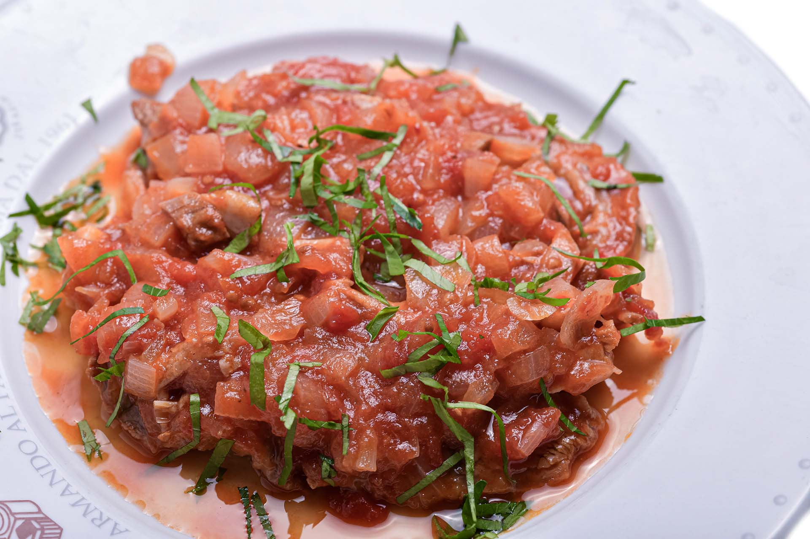
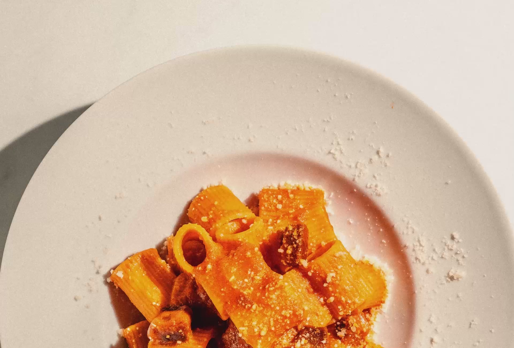
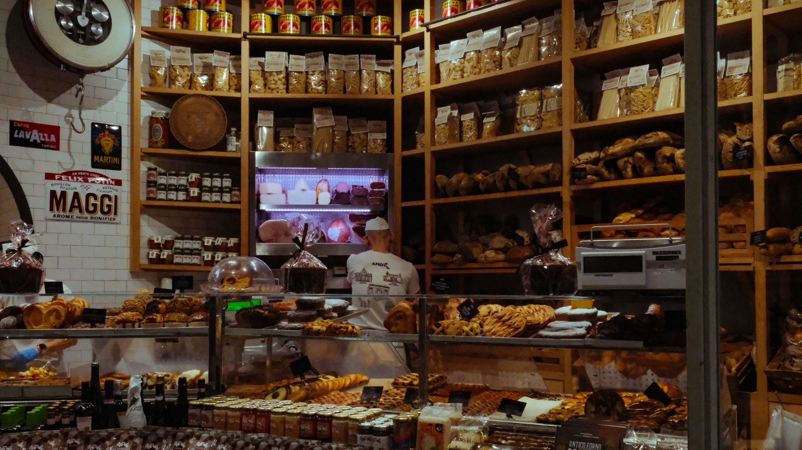
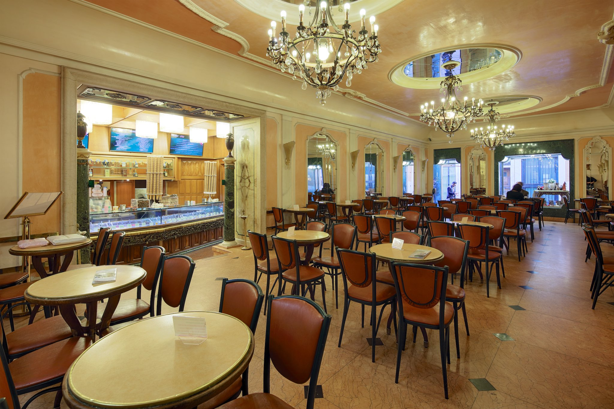
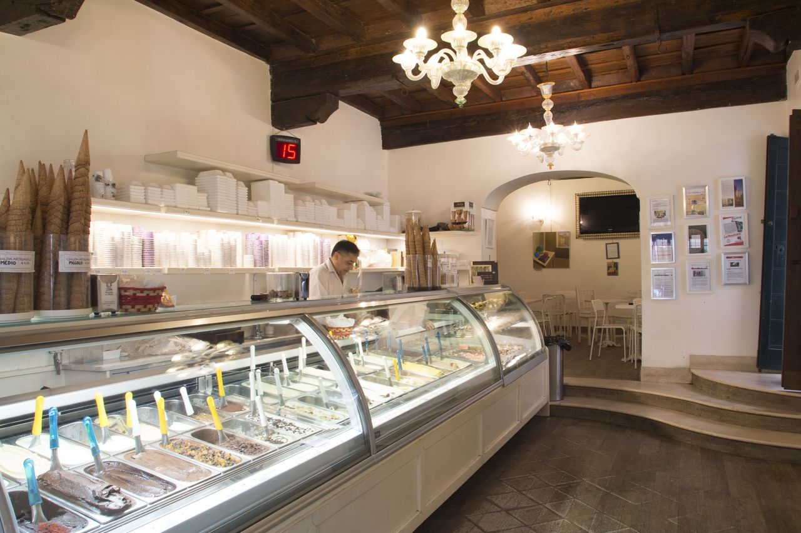

For a sit-down Roman lunch near the Pantheon, book Armando al Pantheon, a family trattoria a minute's walk from the square, or walk ten minutes to the restaurant inside Salumeria Roscioli. For pizza from a bakery counter, go to Antico Forno Roscioli, also ten minutes away, and for gelato afterwards, Giolitti is four minutes from the square and Gelateria del Teatro ten. Tables on Piazza della Rotonda itself cost more than the same lunch a street or two away. On Sunday, Armando is closed (and on Saturday evening too), while both Roscioli addresses and Giolitti open every day.

The square in front of the Pantheon is one of the busiest in Rome, and the cafés with a view of the portico charge for it. We took every address, opening day and booking rule from each place's own website this week, and measured the walking times from Piazza della Rotonda on OpenStreetMap at an ordinary pace.

## Armando al Pantheon

*Photo: [Armando al Pantheon](https://armandoalpantheon.it/)*

The nearest of the five, on Salita de' Crescenzi, a short lane off the square and about a minute on foot. Armando Gargioli took over an old restaurant here in 1961 and turned it into a bottiglieria con cucina, a wine shop with a kitchen. Today the third generation of the family, Fabiana and Flavio Gargioli, runs it, and the cooking is Roman. We have written about its pasta in our [best carbonara in Rome](/journal/best-carbonara-in-rome); here we stick to when to go and how to book.

Lunch is from half past twelve to three, Monday to Saturday, and dinner from six to eleven, Monday to Friday. Closed on Saturday evening and all day Sunday, and from 24 December to 3 January inclusive. Bookings are taken online only, through the link on its website. The email address on the site is only for bookings already made.

**Salita de' Crescenzi 31, 00186 Rome** · [Website](https://www.armandoalpantheon.it/)

## Salumeria Roscioli

*Photo: [Salumeria Roscioli](https://www.salumeriaroscioli.com/)*

About ten minutes on foot, on Via dei Giubbonari near Campo de' Fiori, so not on the Pantheon's doorstep. Salumeria Roscioli is a delicatessen with a restaurant inside: a counter of more than 150 kinds of salumi (cured meats) and more than 350 cheeses, a cellar of over 2,800 wines, and a kitchen that cooks classic Roman dishes next to others from beyond Rome. Alessandro Roscioli runs it, and his family also owns the bakery below.

The restaurant is open every day, from half past twelve to half past three and from seven to half past eleven. The shop is open every day from nine in the morning to half past eleven at night. Bookings go through the booking page on its website.

**Via dei Giubbonari 21, 00186 Rome** · [Website](https://www.salumeriaroscioli.com/)

## Antico Forno Roscioli

*Photo: [Antico Forno Roscioli](https://anticofornoroscioli.it/)*

The family bakery, on Via dei Chiavari close to the Salumeria and also about ten minutes from the Pantheon. In 1972 Marco Roscioli took over a bakery here that dated from 1824, and today his son Pierluigi runs it with his wife Giusy. Their own description is of an old bakery that fills the streets of the centre with the smell of pizza and bread just out of the oven. It is the quickest lunch of the five, if pizza from a bakery is all you need.

Open every day from half past seven in the morning to eight in the evening.

**Via dei Chiavari 34, 00186 Rome** · [Website](https://anticofornoroscioli.it/)

## Giolitti

*Photo: [Giolitti](https://www.giolitti.it/il-locale/)*

About four minutes from the square, on Via Uffici del Vicario, next to the Chamber of Deputies. Giolitti has been here since 1900. Inside there is a large room in Liberty style (the Italian Art Nouveau) with tables, and there are more tables outside. The house serves breakfast, lunch and aperitivo as well as gelato.

Open every day of the year, from half past seven in the morning to midnight, and later in summer. All major credit cards are accepted.

**Via Uffici del Vicario 40, 00186 Rome** · [Website](https://www.giolitti.it/)

## Gelateria del Teatro

*Photo: [Gelateria del Teatro](https://www.gelateriadelteatro.it/gallery-gelateria/)*

About ten minutes west of the Pantheon, between Piazza Navona and Castel Sant'Angelo. The couple behind it opened their first laboratorio (gelato workshop) in 2006 in a lane off Via dei Coronari, below a 13th-century flight of steps that was once home to a theatre where the Roman actor Petrolini performed, hence the name. In 2013 they moved to larger premises on Via dei Coronari itself, with a window onto the street where you can watch the gelato being made.

They make more than 200 recipes that change with the seasons, the cones are made by hand with olive oil, and the colours of the spoons in the tubs, with the staff's advice, help people who avoid lactose, gluten or eggs choose.

The website gives the address but no current opening hours, so check before you walk over.

**Via dei Coronari 65/66, 00186 Rome** · [Website](https://www.gelateriadelteatro.it/)

If you would like to see the Pantheon from the inside as part of a longer walk, from the Spanish Steps and the Trevi Fountain to Piazza Navona, with a guide just for your group, we run a [two-hour private walk](/experience/heart-of-rome-walk) with the Pantheon entrance included. For more tables across the city, see our [best restaurants in Rome](/journal/best-restaurants-rome), and if you are heading on to the fountain, our list of [where to eat near the Trevi Fountain](/journal/where-to-eat-near-trevi-fountain).

## Good to know

### Where is the best gelato near the Pantheon?

Giolitti is the closest, about four minutes from the square, and open every day of the year from half past seven to midnight. Gelateria del Teatro, about ten minutes away on Via dei Coronari, makes its gelato in a workshop you can see from the street.

### Where can I eat near the Pantheon on a Sunday?

Salumeria Roscioli, Antico Forno Roscioli and Giolitti are open every day. Armando al Pantheon is closed all day Sunday, and Gelateria del Teatro's website gives no current hours.

### Is it too expensive to eat on Piazza della Rotonda?

The tables on the square charge for the view. Walk a few minutes away, as with every place above, and choose somewhere that publishes its hours and closing days on its own website.

### Where can I get a coffee near the Pantheon?

Giolitti opens at half past seven every morning and serves breakfast as well as gelato. Antico Forno Roscioli also opens at half past seven, every day.

### Do I need to book?

For Armando al Pantheon, yes, and only online. Salumeria Roscioli takes bookings through its website. Antico Forno Roscioli, Giolitti and Gelateria del Teatro are a bakery and two gelaterie, and their websites mention no bookings.

*Cover photo: [Nicholas Hartmann](https://commons.wikimedia.org/wiki/File:Rome_Pantheon_facade_and_Piazza_della_Rotonda.jpg), CC BY-SA 4.0, via Wikimedia Commons*
