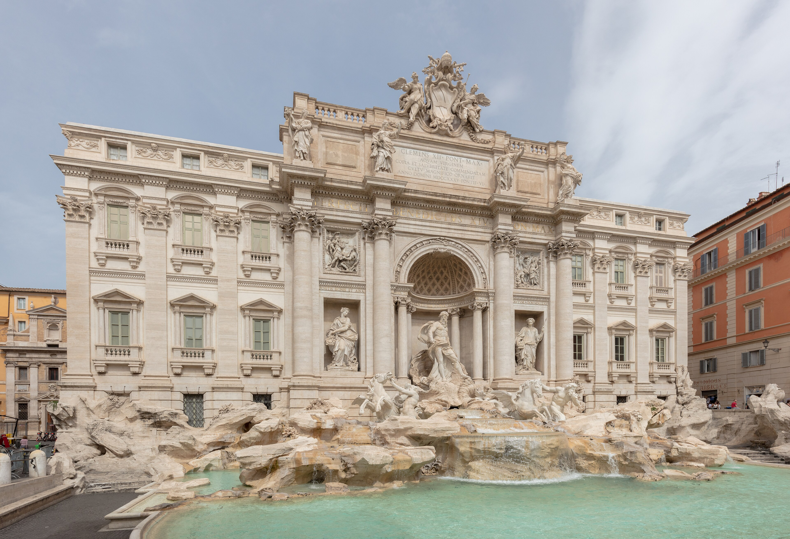
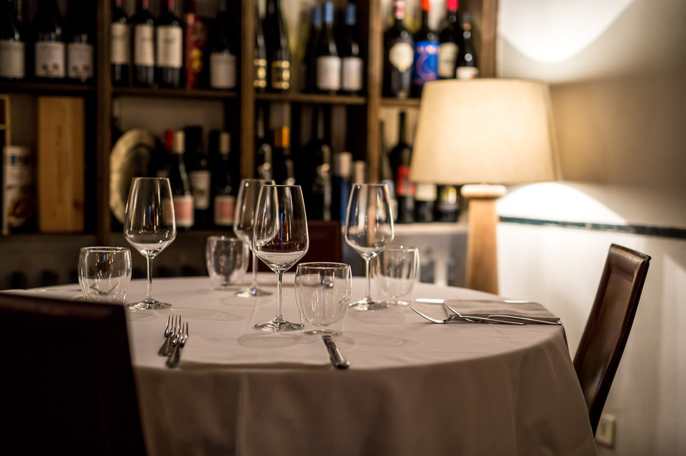
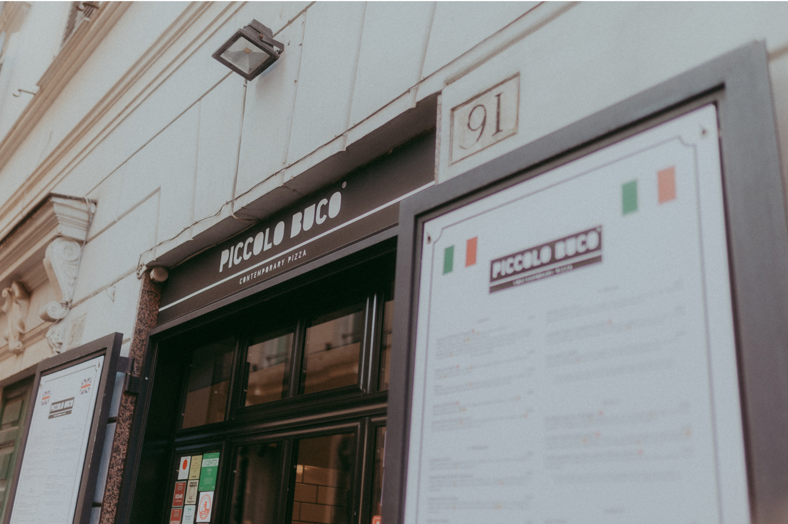
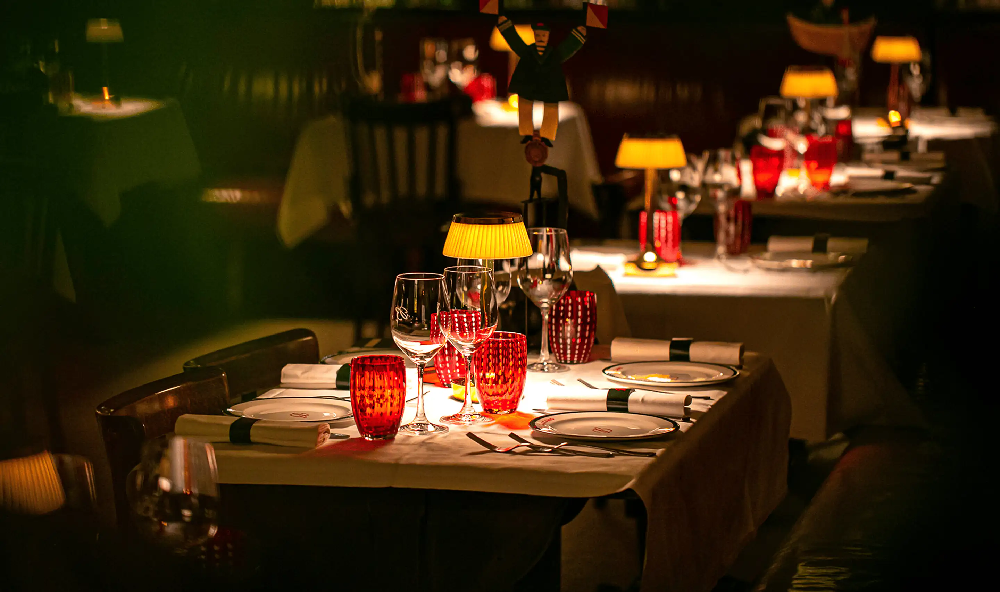
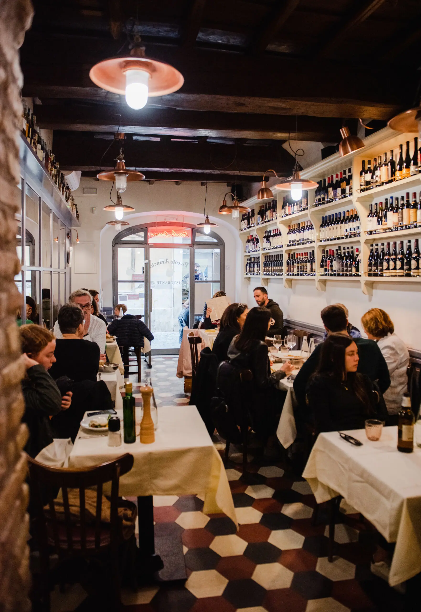
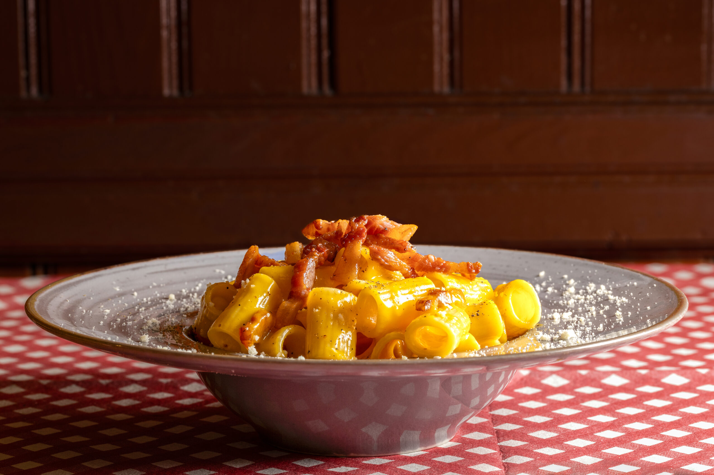
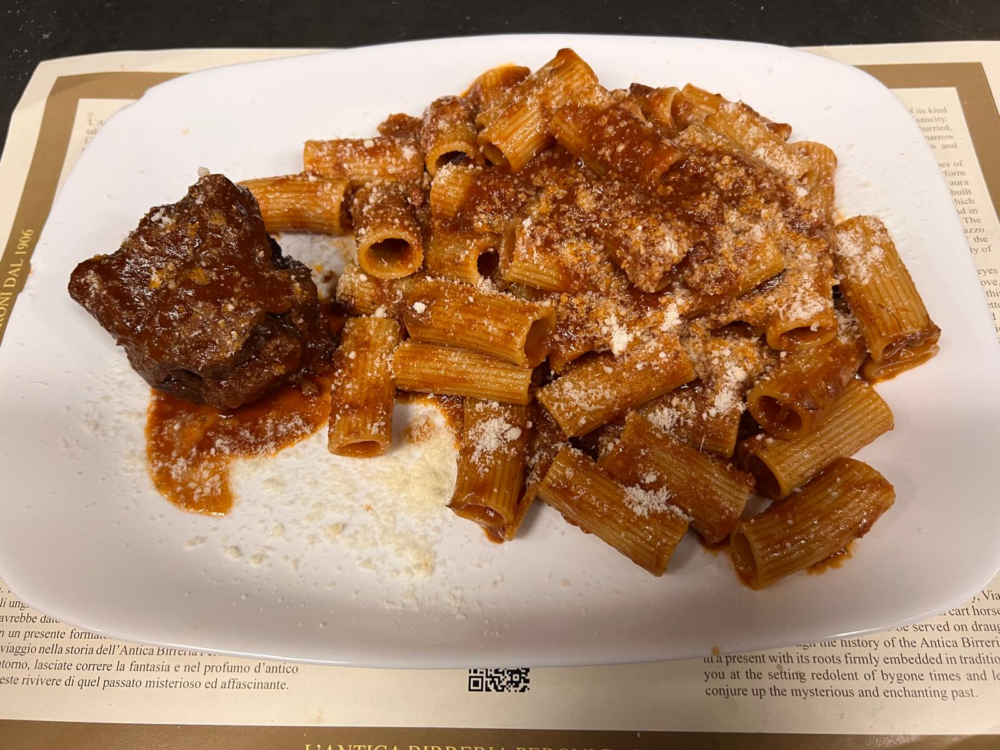

*Photo: [Diego Delso](https://commons.wikimedia.org/wiki/File:Fuente_de_Trevi,_Roma,_Italia,_2022-09-15,_DD_02.jpg), CC BY-SA 4.0, via Wikimedia Commons*

If you want to eat well near the Trevi Fountain, walk away from the square for two to five minutes, into the lanes towards the Quirinale or across to Via di San Marcello. That short walk takes you to the six places below, which range from a family restaurant and a pizzeria that takes no bookings to a beer hall founded in 1906.

The streets around the fountain are among the busiest in Rome, and many menus there are written for people passing through once. We checked every address, opening day and closing day on each restaurant's own website this week. The walking times come from OpenStreetMap at an ordinary pace, so allow a little longer when the crowd at the fountain is thick.

## Le Tamerici

*Photo: [Le Tamerici](https://www.letamerici.com/), used with permission*

The closest of the six, in a narrow lane about two minutes from the fountain. The cooking is mostly fish. The chef and owner, Giovanni Cappelli, grew up in Calabria and is also a sommelier, and wine is taken seriously here. At lunch you can order à la carte or from a set menu that depends on what is available that day.

Open Monday to Saturday for lunch, from 12 to 3, and for dinner, from 7 to half past ten. Closed on Sundays.

**Vicolo Scavolino 79, 00187 Rome** · [Website](https://www.letamerici.com/)

## Piccolo Buco

*Photo: [Piccolo Buco](https://pizzeriapiccolobuco.it/about/), used with permission*

A small pizzeria on Via del Lavatore, about two minutes from the fountain, run by Luca Issa. It does not take bookings, so you simply turn up. The menu runs from a margherita made with burrata to a pizza alla parmigiana.

Open Tuesday to Sunday from noon to 11 at night, or until the dough runs out. Closed on Mondays.

**Via del Lavatore 91, 00187 Rome** · [Website](https://pizzeriapiccolobuco.it/)

## Baccano

*Photo: [Baccano](https://www.baccanoroma.com/), used with permission*

A Mediterranean bistro and oyster bar on Via delle Muratte, about two minutes from the fountain on the way to Via del Corso. The kitchen, led by Nabil Hadj Hassen, keeps Roman cooking among its strengths but goes beyond it, building the menu around seasonal Mediterranean ingredients.

It is open every day, serving from lunch until late at night, which is useful after a late visit to the fountain. The website gives no exact times, so ring ahead if you are planning a late dinner.

**Via delle Muratte 23, 00187 Rome** · [Website](https://www.baccanoroma.com/)

## Piccolo Arancio

*Photo: [Piccolo Arancio](https://www.piccoloarancio.it/), used with permission*

A family restaurant in Vicolo Scanderbeg, between the Quirinale and the fountain, about three minutes away on foot. Carlo and Mara look after both the kitchen and the dining room. The menu is Roman with a few modern touches and follows the seasons: tonnarelli cacio e pepe, coda alla vaccinara (oxtail stew), fettuccine with a lamb ragù and the ravioli all'arancia that go with the name. There are two dining rooms, and tables outside in good weather.

Open Tuesday to Sunday, from 12 to half past three and from half past six to midnight. Closed on Mondays.

**Vicolo Scanderbeg 112, 00187 Rome** · [Website](https://www.piccoloarancio.it/)

## Trattoria della Stampa

*Photo: [Trattoria della Stampa](https://trattoriadellastampa.it/trevi/), used with permission*

A Roman trattoria on Via dei Maroniti, about four minutes from the fountain. It is the Trevi branch of a small group under the same name, which dates its first trattoria to 1956, and the menu sticks to Roman cooking.

Its main advantage near Trevi is the timetable: open every day from noon to midnight with no break in the afternoon, which helps when lunch turns into a late one.

**Via dei Maroniti 32, 00187 Rome** · [Website](https://trattoriadellastampa.it/trevi/)

## Antica Birreria Peroni

*Photo: [Antica Birreria Peroni](https://www.anticabirreriaperoni.net/), used with permission*

A beer hall founded in 1906, on Via di San Marcello, about five minutes south of the fountain. The room has kept its old-fashioned look, and the food is a mix of Roman dishes (bucatini all'amatriciana, carciofo alla giudia, abbacchio a scottadito) and wurstel to go with the Peroni.

Open Monday to Saturday from noon to midnight; the house says closing time can vary, so ring if you are coming late. Closed on Sundays. It does not take bookings.

**Via di San Marcello 19, 00187 Rome** · [Website](https://www.anticabirreriaperoni.it/)

If you would like to see the fountain as part of a longer walk, from the Spanish Steps to the Pantheon and Piazza Navona, with a guide just for your group, we run a [two-hour private walk](/experience/heart-of-rome-walk) that comes this way. For more tables across the city, see our [best restaurants in Rome](/journal/best-restaurants-rome).

## Good to know

### How do I avoid tourist traps near the Trevi Fountain?

Be wary of menus with photos of every dish in five languages and of anyone outside asking you in. Walk a couple of streets from the square and choose somewhere that publishes its hours and closing day on its own website.

### Which restaurants near the Trevi Fountain are open on Mondays?

Le Tamerici, Baccano, Trattoria della Stampa and the Antica Birreria Peroni. Piccolo Buco and Piccolo Arancio are closed on Mondays.

### Which are open on Sundays?

Piccolo Buco, Baccano, Piccolo Arancio and Trattoria della Stampa. Le Tamerici and the Antica Birreria Peroni are closed on Sundays.

### Can I eat in the middle of the afternoon?

Yes. Trattoria della Stampa is open from noon to midnight every day, the Antica Birreria Peroni from noon to midnight from Monday to Saturday, Piccolo Buco from noon to 11 from Tuesday to Sunday, and Baccano from lunch until late every day.

### Do I need to book?

Piccolo Buco and the Antica Birreria Peroni do not take bookings, so arrive early. The other four do.
